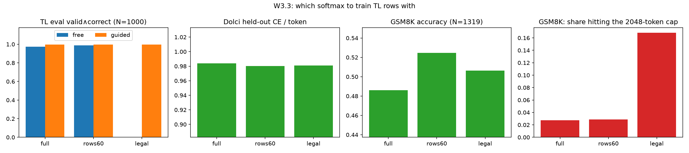

# TL loss-head ablation: the 60-row softmax is the best TL head; the legal-set head breaks free decoding (2026-10-09)

Artifact: https://claude.ai/artifact/EcCAEeSkFMGRWXFKYJjGrn

Plan item: `RLVL-next/PLAN.md` W3.3.
- Table: `analysis/tl_loss_head.md`.
- Script: `scripts/analysis/tl_loss_head.py`.
- Figure: `reports/figures/tl_loss_head.png`.

## Setup

**Question.** Which softmax should train the TL rows during midtraining?

| head | loss on TL label positions | loss on Dolci replay rows |
|---|---|---|
| full | CE over the whole vocabulary (≈248k rows) | full CE |
| rows60 | CE over the 59 TL tokens + EOS only | full CE |
| legal | CE over the guide-legal set at each position (`tl/legal_sets.py`; mean 3.36 legal tokens, 61% of positions forced, so they carry no loss) | full CE |

**Training.** `--tl-loss-head {full,rows60,legal}` in `train_formal_mixture_sft.py`.
- The restricted heads apply only to TL label positions whose target is one of the 60 rows. All other targets use the full head.
- Every run uses the v1 r25 mix: 120k traces + 40k Dolci rows, 0.8B, lr 2e-5, batch 64, one epoch, AdamW.
- full is the v1 model itself. rows60 and legal are alex jobs 4517284 and 4517285.

**Eval** on gruenau (jobs 17483 and 17485), identical to the replay sweep:
- **TL:** 1000 held-out prompts, free and guided, scored by `tl/check.py` (snapshot `tl_snapshot_20261009b`; the full row uses the `snapB` re-eval of v1 with the same snapshot).
- **Dolci:** held-out CE per token.
- **GSM8K:** all 1319 items, greedy, 2048-token cap.

## Result

| TL loss head | TL free v∧c | TL guided v∧c | Dolci CE/tok | GSM8K (1319) | GSM8K hit cap | GSM8K TL leak | bench ms/1k tok | peak GB |
|---|---|---|---|---|---|---|---|---|
| full | 0.975 | 0.998 | 0.984 | 0.486 | 2.7% | 0 | 224 | 9.9 |
| rows60 | **0.987** | 0.998 | 0.980 | **0.525** | 2.9% | 0 | 222 | 9.9 |
| legal | **0.000** | 0.997 | 0.981 | 0.506 | **16.8%** | 0 | 239 | 9.9 |

Paired tests (McNemar normal approximation):
- **TL free, rows60 vs full:** 14 items only rows60 solves, 2 only full solves; z = 3.0.
- **GSM8K, rows60 vs full:** 183 vs 132 discordant items; z = 2.9.
- **GSM8K, legal vs full:** 151 vs 124; z = 1.6, not significant.

The bench numbers are from one L40 (fwd+bwd, 48 mixture rows). HF's own loss path is 238 ms and 23.7 GB.

1. **rows60 beats full on every metric we measure.**
   - Free TL decoding goes 0.975 → 0.987 (z = 3.0).
   - GSM8K goes 0.486 → 0.525 (z = 2.9). That recovers about a third of r25's gap to base (0.600) at no extra data.
   - Guided TL and Dolci CE are unchanged.
   - A plausible reading: with the full softmax, TL rows push down every non-TL logit at every TL position. That adds gradient pressure on the shared embedding/output space that the 60-row head does not apply. This is a hypothesis; we have not measured it.
   - The "TL CE/tok (full softmax)" column in `analysis/tl_loss_head.md` (5.8 / 6.2) is not comparable across heads: the restricted heads never train the logits of non-TL tokens.

2. **The legal-set head is guided-only.**
   - Guided decoding is fine (0.997), but free decoding scores 0/1000: 998 of 1000 proofs end in "unterminated line".
   - Forced positions carry no loss under this head. The model therefore never learns the tokens the grammar forces: line terminators, `:` after a rule, EOS after `ans`.
   - Without the guide it emits plausible content tokens and skips the structure, e.g. `given : @ 2 : @`.
   - That rules it out as the AZ policy's training head, since the free policy is the ablation baseline (PLAN G5).

3. **The legal head also hurts ending the chat turn.**
   - 16.8% of its GSM8K answers hit the cap, against 2.7% for full and 2.9% for rows60.
   - The failure looks like r10's in the replay sweep. The model writes a correct-looking answer (often `\boxed{}`), then emits `assistant` / `<think>` and restarts the solution until the cap. 213 of the 222 capped answers end in a repeating block.
   - Hypothesis, untested: under full and rows60 the end-of-sequence token is trained on every TL row; under legal it is forced, so it gets no gradient there. End-of-sequence then sees only the 40k Dolci rows.
   - Accuracy still lands between full and rows60 (86 of the capped answers are scored correct from their first boxed answer).

4. **Cost is the same.**
   - All three heads use the custom loss path (no full fp32 logits tensor), which cuts peak memory from 23.7 GB to 9.9 GB.
   - The restriction itself is speed-neutral (222–239 ms per 1k tokens).

## Decisions / next steps

- **W3.5 (midtraining v3 on KB v2) uses `--tl-loss-head rows60` with 45% replay** (W3.4).
- **rows60 × 45% has not been run.** The rows60 gain was measured at 25% replay, so the GSM8K effects may not simply add. W3.5 measures the combination directly.
- **legal stays available** only for guided-only uses. It is not a candidate for the AZ policy.
