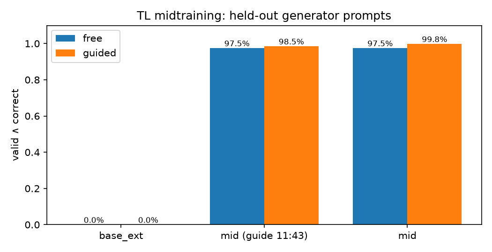
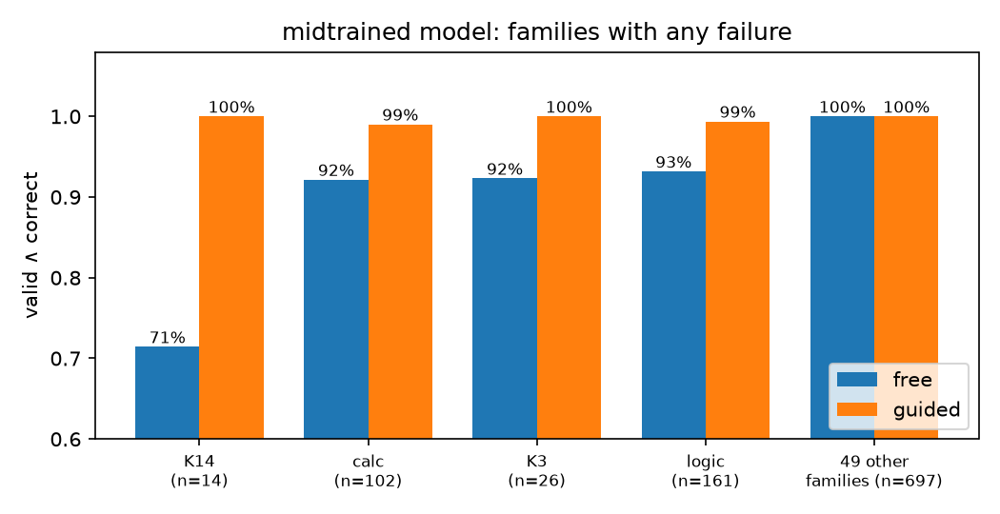
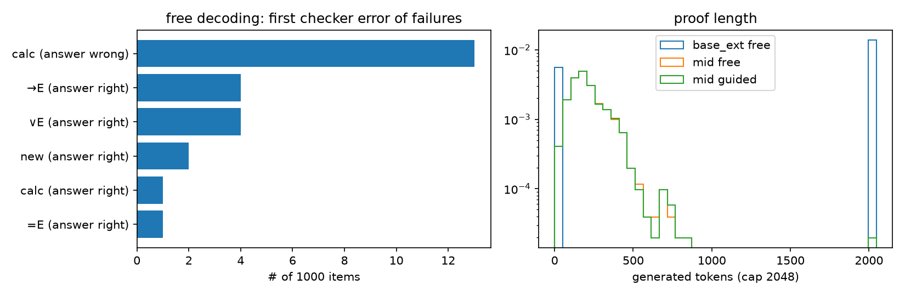

# TL midtraining v1: from 0% to 97.5% unguided and 99.8% guided (2026-10-09)

Artifact: https://claude.ai/artifact/6ybVpQ9Yn36pYHXku7DmQd
Plan item: `RLVL-next/PLAN.md` W3.2. Table: `analysis/tl_mid_eval.md`. Script: `scripts/analysis/tl_mid_eval.py`.

## Setup

**Model and data.** `base_ext_0.8b` is Qwen3.5-0.8B with the 59 TL symbol tokens added. It was trained on `datasets/tl_mid_20261009`:
- 120k generator traces, about 25M TL tokens, median 187 tokens per trace;
- 40k Dolci replay chats, 25% of the examples.

**Training.**
- Full-parameter SFT with plain cross-entropy over the full vocabulary.
- lr 2e-5, global batch 64, one epoch (2499 steps), max length 4096.
- 2× RTX Pro 6000 on alex (job 4513193), 84 min.
- The final eval loss was 0.0015, flat from 70% of the epoch on.

**Eval.** 1000 held-out generator prompts (`tl_eval.jsonl`, different seed), decoded greedily with `tl/eval_hf.py`:
- **free:** argmax over the 60 rows (59 symbols + EOS), with no grammar constraint;
- **guided:** the `tl/guide.py` constrained decoder;
- **scoring:** `tl/check.py`. "valid" means every line checks; "correct" means the `ans` matches the gold answer.

The base model was evaluated on the first 200 items only.

## Result 1: midtraining teaches the language almost perfectly

| model | mode | valid | correct | valid ∧ correct | mean tokens |
|---|---|---|---|---|---|
| base_ext (n=200) | free | 0.000 | 0.000 | 0.000 | 1466 |
| base_ext (n=200) | guided | 0.000 | 0.000 | 0.000 | 2048 (always hits the cap) |
| mid | free | 0.975 | 0.987 | **0.975** | 213 |
| mid | guided | 0.998 | 0.998 | **0.998** | 215 |

**Base model.** It never writes a checkable proof. Without the guide it rambles or stops at once. With the guide it is forced into grammatical lines but loops until the cap.

**Midtrained model.**
- Without the guide, 97.5% of its proofs are fully valid and correct. On the first 200 items it reaches 99.0% (free) and 100% (guided).
- Its proofs have the same length as the generator's traces (median about 190 tokens), with no runaway lengths.

**Caveat.** The test set comes from the same distribution as the training data. This is a test of learning the language and the rules, not of generalization. Transfer to new tasks is W7.

## Result 2: the free failures are arithmetic and single-step slips; the guide removes them

There are 25 free failures in 1000 items.

**13 are wrong `calc` values.** The model has to do multi-step arithmetic in one `calc` step, and the checker catches it.
- Example: c4 = 2·16 and c3 = c4 + 6. The model writes c3 = 40 instead of 38, then answers 72 instead of 70.
- These failures concentrate on k14 (mean of a list, 71% free) and k3 (sum of a list, 92% free).
- A 0.8B model doing exact arithmetic over several numbers in one step is the weak spot.

**12 have the right answer but one invalid step.** These are →E, ∨E or =E citing the wrong line, or `new` with a malformed declaration.
- These are exactly the cases where the reward variants differ: `mul` and `half` give 0 and 0.5, `add` gives 0.5, `gvc` gives 2/3.
- So the W4.2 reward ablation has a real signal to act on.

With the guide, only 2 of 1000 fail:
- a `calc` dead end, where no legal continuation exists;
- one `logic` proof that keeps applying ∨I to its previous line until the token cap. That proof is legal but never ends; only the length budget stops it.

## Result 3: a stale snapshot hid the guide's calc fix (bug found and fixed)

The first guided eval ran on the 11:43 code snapshot. It scored 98.5%, and all 15 failures were digit loops such as `c 3 = 4 0 . 8 8 8 … 4 4 4 …` that ran to the 2048-token cap.

**Cause.** In that version, a `calc` conclusion was only checked at the line end (⏎). A wrong value made ⏎ illegal while further digits stayed legal, so the decoder could never leave the line.

**Fix.** The fix was already in `guide.py` at 12:45 (`State._calc_tok`):
- a value forced by the cited equalities must be spelled canonically, digit by digit;
- calc conclusions are capped at 96 tokens and numerals at 12 digits.

The CPU tests (`test_check`, `test_guide`, `test_gen`, `test_az_game`) pass on that code. The re-run used the new snapshot `tl_snapshot_20261009b`.

**W4.0 throughput sweep (job 17129, finished 16:4x).** It imported the live `tl/` code at 13:26, after the guide fix, so the stale snapshot did not affect it. It ran the smoke model `smoke08` with `max_len=256` and 16 simulations. Its 62–78% "budget" endings are proofs cut at 256 tokens, and its success rates (3–12%) reflect the weak smoke model. Neither says anything about AZ quality.

Throughput:

| parallel | leaves | sims/s | peak mem |
|---|---|---|---|
| 16 | 1 | 189 | 4.9G |
| 64 | 1 | 169 | 8.0G |
| 64 | 4 | 47 | 8.4G |
| 128 | 2 | 92 | 10.1G |
| 128 | 4 | 48 | 9.9G |

- Choose 1 leaf with 16–64 parallel games; virtual-loss batching (more leaves) does not pay off.
- **Consequence:** midtrained proofs average 213 tokens (p99 is higher), so AZ-main needs `max_len` ≥ 512. Otherwise many games end on the length budget instead of by proof outcome.

## Next

- **W4.1 AZ-main:** guide = full, reward mul, starting from this model, with snapshot 20261009b, 1 leaf, 16–64 parallel games and `max_len` 512.
- **W4.2:** the free-guide reward ablation (mul / add / half / gvc). The 12 "right answer, invalid step" cases show it has something to separate.
- **W3.3 / W3.4:** the loss-head and replay-sweep ablations. Their baseline is this run's 97.5% free.
