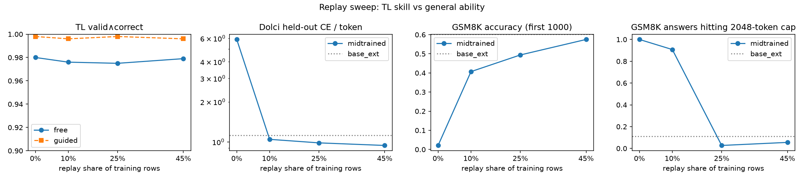

# TL replay sweep: 45% Dolci replay keeps TL at 98% and GSM8K within noise of base (2026-10-09)

Artifact: https://claude.ai/artifact/2tzywF7Use3yvPS6vyYQ5i

Plan item: `RLVL-next/PLAN.md` W3.4.
- Table: `analysis/tl_replay_sweep.md`.
- Script: `scripts/analysis/tl_replay_sweep.py`.
- Eval scripts: `rlvl_data/tl/{dolci_loss.py, gsm8k_eval.py, post_eval_all.slurm}`.

## Setup

**Model and training.**
- All runs start from `base_ext_0.8b` (Qwen3.5-0.8B plus the 59 TL tokens).
- Same recipe as the v1 midtraining run (`2026-10-09_tl_midtraining.md`): full-vocab CE, lr 2e-5, batch 64, one epoch, AdamW.

**Data.**
- The same 120k generator traces in every run. Only the number of Dolci replay rows changes, and the replay sets are nested (the first n Dolci rows).

| run | Dolci rows | replay share | total rows | train time (2× RTX Pro 6000) |
|---|---|---|---|---|
| r00 | 0 | 0% | 120k | 61 min |
| r10 | 13.3k | 10% | 133k | 70 min |
| r25 (= v1) | 40k | 25% | 160k | 84 min |
| r45 | 98k | 45% | 218k | 126 min |

45% is the top level because the prepared Dolci set has only 100k rows.

**Confound:** more replay also means more optimizer steps, up to 1.8× at r45. The number of TL tokens is held fixed, not total compute.

**Eval.** Same for every model, run on gruenau.

- **TL:** 1000 held-out generator prompts, free and guided, scored by `tl/check.py` (snapshot `tl_snapshot_20261009b`).
- **Dolci held-out CE per token:** on the 500 Dolci eval rows of `tl_mid_20261009`, tokenized exactly as in training (prompt masked, max length 4096).
- **GSM8K:** zero-shot on the test set, rendered with the training chat template (thinking off). Greedy decoding, at most 2048 new tokens. The answer is the last `\boxed{}`, falling back to the last number.
  - r00 was run on only the first 1000 items: an `N=1000` environment variable leaked into the job. All comparisons therefore use the first 1000 items, and full-set numbers are listed alongside.
  - The eval also records the share of answers that hit the token cap and the share that contain TL tokens.

## Result

| model | replay | TL free v∧c | TL guided v∧c | Dolci CE/tok | TL CE/tok | GSM8K (first 1000) | Δ vs base [95% CI] | GSM8K (all 1319) | mean tokens | hit 2048 cap | TL tokens in answer |
|---|---|---|---|---|---|---|---|---|---|---|---|
| base_ext | – | – | – | 1.119 | 2.92 | 0.602 | – | 0.600 | 461 | 11% | – |
| r00 | 0% | 0.980 | 0.998 | 5.885 | 0.0014 | 0.021 | −0.58 [−0.61, −0.55] | – | 2048 | 100% | 100% |
| r10 | 10% | 0.976 | 0.996 | 1.046 | 0.0014 | 0.407 | −0.20 [−0.23, −0.16] | 0.390 | 1876 | 91% | 1% |
| r25 | 25% | 0.975 | 0.998 | 0.984 | 0.0015 | 0.494 | −0.11 [−0.14, −0.07] | 0.486 | 198 | 3% | 0% |
| r45 | 45% | 0.979 | 0.996 | 0.941 | 0.0013 | 0.575 | −0.03 [−0.06, +0.01] | 0.561 | 263 | 6% | 0.1% |

The confidence intervals come from a paired bootstrap over items (2000 resamples, first 1000 items).

1. **Replay costs nothing on the TL side.**
   - Free v∧c stays between 0.975 and 0.980 and guided v∧c between 0.996 and 0.998 at every replay share. TL CE stays around 0.0014.
   - The 120k traces saturate the language whatever the replay share, at least up to 45%.

2. **General ability rises monotonically with replay, and 45% is within noise of base.**
   - Dolci CE goes 5.89 → 1.05 → 0.98 → 0.94. From 10% replay on it is *below* base_ext (1.12), because the model also fits the Dolci chat style.
   - GSM8K goes 0.02 → 0.41 → 0.49 → 0.58, against 0.60 for base. Only r45's gap to base is not significant.
   - Gains have not flattened at 45%. Part of the gain may come from r45's 1.8× more steps; see the confound above.

3. **With no replay, the model answers everything in TL.**
   - r00 answers *every* GSM8K question with TL symbols and no `<tl>` marker. It autoformalizes the word problem into `new`/`given`/`calc`/`ans` lines, writes an `⟨ans⟩`, and then emits newlines until it hits the cap.
   - The formalization is mostly wrong: the `⟨ans⟩` value matches the gold answer in 22 of 1000 cases, and 957 of 1000 are parseable.
   - Even 10% replay brings English back: only 1% of r10's answers contain TL tokens.

4. **Ending the turn needs more replay than speaking English does.**
   - r10 reasons in English and writes a `\boxed{}` answer. In 91% of cases it then keeps going: it emits `assistant` or `</think>` and restarts the answer, often verbatim, until the cap. 631 of 1319 answers end in a repeating block.
   - Scoring the *first* boxed answer gives 0.413 instead of 0.407, so this hurts length and cost, not accuracy.
   - At 25% replay the cap rate falls to 3%, lower than base_ext's 11%. Base is more verbose, not loopy.
   - TL traces end with EOS right after `ans`. Too little chat data apparently lets the TL "stop" behavior replace the chat end-of-turn behavior.

5. **Midtrained models are terser on GSM8K.**
   - r25 and r45 use 198 and 263 tokens on average, versus 461 for base_ext.
   - Looking at r25 against base on the full set (base right on 284 items r25 misses, r25 right on 133 base misses), r25 skips steps more often and sometimes runs away on arithmetic.
   - The Dolci replay chats are shorter than base's default answers, so some of the remaining gap may be *style* rather than forgetting.

## Decisions / next steps

- **Default replay for W3.5 (midtraining v3 on KB v2): 45%.** It gives the full TL score and leaves GSM8K within noise of base. 25% stays the cheaper fallback, and AZ currently starts from the 25% v1 model.
  - If GSM8K at 45% matters for the paper, add a control at 45% replay with the same number of steps as r25, to separate replay share from extra steps.
- **Proposed control (not launched): a Dolci-only fine-tune** of base_ext on the same 98k rows, to measure how much of the GSM8K drop and terseness comes from the Dolci style itself rather than from TL interference.
- **Possible probe:** r00's TL autoformalization of GSM8K could serve as a TL→NL transfer probe for later models. With the current KB it is 2% correct.
- **Metric hygiene:** `post_mid.sh` no longer exports `N`. Every GSM8K eval from now on covers all 1319 items.
