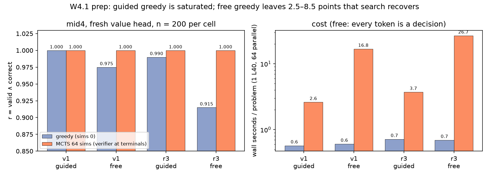

# W4.1 prep: AlphaZero eval-only baseline of tl_mid4 (2026-10-10)

**Question.** Before starting AZ-main (W4.1), how much headroom does the planned init (mid4) leave for self-play, and what does search cost?

**Setup.** gruenau 17842 (1 L40, about 3 h). `tl.az --eval-only` from snapshot `tl_snapshot_20261010e`, init `mid/tl_mid4_0.8b_lr2em5_b64_h60_r45_v3q25/final` with a fresh (untrained) value head, reward `mul`, first 200 rows of the v1 eval (`tl_mid_20261009`) and the realistic r3 eval (`tl_eval_r3_20261010`), guided (`--guide full`) and free decoding, greedy (sims 0) vs MCTS with 64 simulations (1 leaf, 64 games in parallel, max_len 1536). Script `scripts/analysis/tl_az0.py`, table `analysis/tl_az0.md`, outputs `rlvl_data/tl/evals/az0/mid4/`.

**Caveat on sims 64.** MCTS backs up the verifier reward (checker + gold answer) at terminal nodes, so the sims 64 numbers are oracle-assisted search, like pass@k, not an accuracy the model has on its own. They show what self-play search *can find*; greedy (sims 0) is the number AZ training has to raise.

| set | decoding | greedy r (valid ∧ correct) | MCTS 64 r | MCTS − greedy (paired 95% CI) | decisions / problem | s / problem greedy → MCTS |
|---|---|---|---|---|---|---|
| v1 | guided | 1.000 | 1.000 | +0.000 | 84 | 0.6 → 2.6 |
| v1 | free | 0.975 | 1.000 | +0.025 [+0.005, +0.050] | 204 | 0.6 → 16.8 |
| r3 | guided | 0.990 | 1.000 | +0.010 [+0.000, +0.025] | 114 | 0.7 → 3.7 |
| r3 | free | 0.915 | 1.000 | +0.085 [+0.050, +0.125] | 255 | 0.7 → 26.7 |

(n = 200 per cell; greedy numbers match the n = 1000 TL evals of mid4: v1 0.963 / 0.992, r3 0.905 / 0.991 free / guided.)

## Findings

1. **Guided self-play on the current generator is saturated.** mid4 greedy under the guide solves 100% of v1 and 99% of r3. AZ-main as written in the plan (guided × mul, prompts from the v1 generator `tl.gen.generate`) would see a reward of ~1 on nearly every game, so the policy target would barely differ from what the model already does. There is nothing left there to learn.
2. **Free decoding leaves real headroom, and search closes all of it.** Free greedy fails 2.5% of v1 and 8.5% of r3. All free failures are grammatical proofs that the checker rejects and that end in a wrong answer, concentrated in r3 R:gsm (0.854), R:count (0.867) and R:rates (0.882). 64 simulations with an untrained value head fix every one of them (1.000 on all 400 free problems).
3. **Free search is ~7× more expensive than guided search.** Without the guide every token is a decision (255 vs 114 per r3 problem), and MCTS costs 26.7 s per r3 problem vs 3.7 s guided. At 64 games per iteration that is roughly 28 min vs 4 min of self-play per iteration on one L40, i.e. ~45 h vs ~7 h for 100 iterations.

## What this means for W4.1 (decision for the user)

AZ-main as planned would not teach anything. Three ways to give it headroom:

- **A. Free decoding as the main arm** (and gen3 / r3-style prompts for self-play, since v1 free greedy is already 0.975). Real headroom (0.915 → 1.0 on r3); ~45 h per 100 iterations on one L40. This is also the W4.2 reward-ablation setting, so A and W4.2 share infrastructure.
- **B. Harder problems under the guide** (generator difficulty knobs: more steps, deeper chains, larger numbers, more distractors) until guided greedy drops to ~0.5–0.8. Cheaper search (~7 h per 100 iterations); needs a new generator setting and a matching eval set.
- **C. W7 now: GSM8K posed in TL** (GSM8K text as prompts, the model writes a TL proof, the checker plus the GSM8K gold answer give the reward). It targets the real benchmark and likely has the most headroom; it needs the gold answers converted to TL numbers and a first greedy probe of mid4.

HTML: https://claude.ai/artifact/AYBUXZyZVciQyA6rvCcmSi
