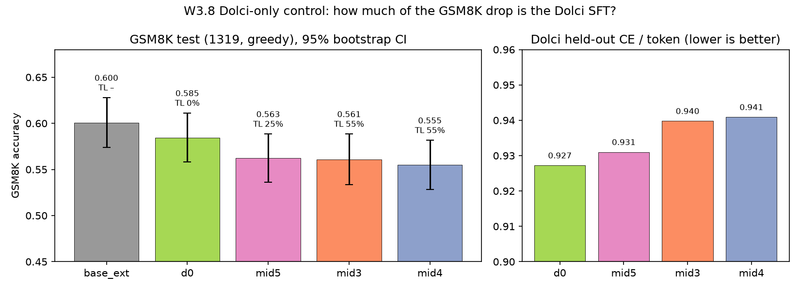

# W3.8 Dolci-only control: where the GSM8K drop of midtraining comes from (2026-10-10)

**Question.** Every midtrained run scores about 0.56 on GSM8K, against 0.600 for base_ext (Qwen3.5-0.8B-Base + 59 TL tokens, no SFT). This
holds for 25% and 55% TL alike (W3.7). Is the drop caused by the Dolci chat SFT, or by the TL data?

**Run.**
- Model: `tl_mid_d0_0.8b_lr2em5_b64_h60` (alex 4521541, 1h13, train loss 0.999).
- Data: the same 98,181 Dolci rows as mid5 (`tl_mid_d0_20261010`), 0% TL.
- Recipe: as mid3–mid5, i.e. lr 2e-5, batch 64, 1 epoch, rows60 head.

**Evals.**
- GSM8K: test set (1319), greedy, `<|im_end|>` stop (gruenau 17805).
- Dolci CE: held out.
- TL floor: v2/r3 (gruenau 17797); v2 free is 0.000, as expected.

| model | TL share | GSM8K | 95% CI | mean tokens | hit cap | Dolci CE/tok | − base_ext | − d0 |
|---|---|---|---|---|---|---|---|---|
| base_ext | – | 0.600 | [0.574, 0.628] | 461 | 11.2% | – | – | +0.016 [−0.014, +0.045] |
| d0 | 0% | 0.585 | [0.558, 0.611] | 201 | 1.1% | 0.927 | −0.016 [−0.045, +0.014] | – |
| mid5 | 25% | 0.563 | [0.536, 0.588] | 195 | 1.9% | 0.931 | −0.038 [−0.067, −0.009] | −0.022 [−0.048, +0.005] |
| mid3 | 55% | 0.561 | [0.534, 0.588] | 195 | 2.1% | 0.940 | −0.039 [−0.070, −0.009] | −0.024 [−0.051, +0.005] |
| mid4 | 55% | 0.555 | [0.528, 0.582] | 180 | 1.4% | 0.941 | −0.045 [−0.076, −0.017] | −0.030 [−0.057, −0.002] |

Differences are paired bootstraps over the 1319 problems (2000 resamples). Analysis: `scripts/analysis/tl_d0.py` → `analysis/tl_d0.md`.

## Findings

1. **The drop is split about in half.**
   - The Dolci SFT alone costs −0.016, which is not significant.
   - Adding TL data costs a further −0.02 to −0.03: significant for mid4, borderline for mid3 and mid5 (CI upper ends +0.005).
   - Only the TL runs are significantly below base_ext.
2. **The TL cost does not scale with the TL share.**
   - 25% TL (mid5, 0.563) and 55% TL (mid3 0.561, mid4 0.555) cost about the same.
   - All of d0, mid5 and mid4 train on the same 98,181 Dolci rows; TL rows are added on top (0 / 32,549 / 119,301).
   - So the TL rows do not displace chat data. The cost is roughly fixed once TL is in the mix and does not grow with 3.7× more TL rows.
3. **The Dolci CE has the same order.** d0 0.927 < mid5 0.931 < mid3/mid4 0.940/0.941.
   - The 25% TL run is closer to d0 than the 55% runs are.
   - Here the TL share does matter, unlike for GSM8K.
4. **Caveats.**
   - Single seed per run. Differences of 0.02 on n = 1319 sit at the edge of what one seed can resolve.
   - base_ext answers in the raw base format: 461 tokens and 11% at the 2048 cap. Its 0.600 may therefore understate the base and is not exactly like for like.

## Implications

- The general-ability cost of midtraining is small: about 0.02–0.03 on GSM8K attributable to TL, about 0.04 in total. It does not grow with the TL share.
- mid4 stays the W4.1 init, as W3.7 decided: it has the best TL accuracy for an almost identical GSM8K.
- If W7 (GSM8K posed in TL) is to be compared against the chat model, d0 is the clean "same SFT, no TL" baseline. Keep `tl/mid/tl_mid_d0_0.8b_lr2em5_b64_h60/final`.
- Optional, not launched: a second seed of d0 and mid5 (about 1.5 h each on alex) would show whether the −0.02 TL cost is real.

HTML version: https://claude.ai/artifact/WxYKA3dWs1vN5wiTdAnGzf

TL floor (gruenau 17797): d0 v2 and r3, free and guided, all 0.000 valid. The second GSM8K run in that job reproduced 0.585 exactly.
