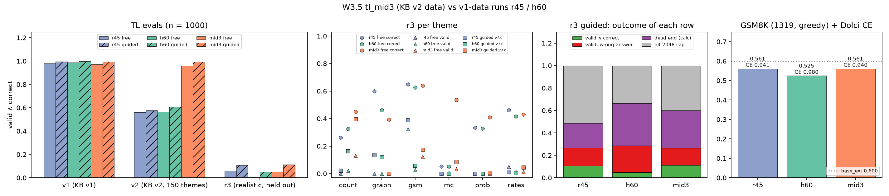

# W3.5 midtraining v3 (KB v2 data): learns v2, keeps v1 and GSM8K, does not transfer to realistic themes

RLVL-next PLAN W3.5 · 2026-10-10 · Qwen3.5-0.8B (base_ext) + 59 TL tokens · lr 2e-5, batch 64, 1 epoch

## Runs

| model | TL data | loss head | Dolci replay | job |
|---|---|---|---|---|
| r45 | v1 (KB v1 generator, 120k traces) | full vocab | 45% | W3.4 replay sweep |
| h60 | v1 | rows60 | 25% | W3.3 loss-head ablation |
| mid3 | v2 (gen2, 150 themes incl. MC, 120k traces) | rows60 | 45% | alex 4518548 |

Evals (gruenau, code snapshot `tl_snapshot_20261010e`, n = 1000 each, greedy, 2048 new tokens):
v1 = the v1 `tl_eval.jsonl`; v2 = `tl_mid_v3_20261009/tl_eval.jsonl`; r3 = `tl_eval_r3_20261010` (1000 gen3 traces over six
realistic themes, which none of these models saw in training). Free = plain decoding; guided = the TL constrained decoder. Baselines on v2/r3: gruenau jobs 17641/17642.

## TL: valid ∧ correct

| model | v1 free | v1 guided | v2 free | v2 guided | r3 free | r3 guided |
|---|---|---|---|---|---|---|
| r45 | 0.979 | 0.996 | 0.560 | 0.578 | 0.059 | 0.107 |
| h60 | 0.987 | 0.998 | 0.566 | 0.606 | 0.010 | 0.049 |
| mid3 | 0.971 | 0.994 | **0.959** | **0.992** | 0.049 | 0.113 |

## General ability

| model | Dolci CE/tok | GSM8K (1319) | mean tokens | hit cap | TL tokens in answer |
|---|---|---|---|---|---|
| r45 | 0.941 | 0.561 | 263 | 5.5% | 0.1% |
| h60 | 0.980 | 0.525 | 231 | 2.9% | 0.0% |
| mid3 | 0.940 | 0.561 | 205 | 2.6% | 0.0% |

Paired bootstrap (2000 resamples): GSM8K mid3 − r45 = +0.000 [−0.028, +0.027]; mid3 − h60 = +0.036 [+0.008, +0.064].

## r3 guided: what happens to each row

| model | valid ∧ correct | valid, wrong answer | dead end (calc) | hit 2048 cap |
|---|---|---|---|---|
| r45 | 107 | 159 | 219 | 515 |
| h60 | 49 | 239 | 376 | 336 |
| mid3 | 113 | 152 | 334 | 401 |

No guided row is invalid: the guide only lets through lines that check, so a row either finishes valid or gets stuck.

## Findings

1. **KB v2 data teaches v2 at no cost on v1.** On the v2 eval, mid3 reaches 0.959 free and 0.992 guided, against
   0.56–0.61 for the v1-data runs (G3 met). On v1 it loses less than 0.01 to r45 (0.971 vs 0.979 free, 0.994 vs 0.996 guided).
2. **General ability depends on replay, not on TL data or head.** mid3 matches r45 exactly on GSM8K (0.561 each) and on
   Dolci CE (0.940 vs 0.941). It beats h60 (25% replay) by 0.036, with a CI that excludes zero. mid3 also gives the shortest answers (205 tokens).
   mid3 is the first rows60 × 45% run. At 25% replay, rows60 had added +0.039 GSM8K over the full head (W3.3). At 45% replay that gain does not add on top: replay already closes the gap.
3. **Nothing transfers to realistic themes.** On r3 all three models are at 0.05–0.11 v∧c, and the KB v2 data adds
   only 0.006 guided over r45. The models often get the *answer* right in free mode (free correct 0.26–0.65 per theme)
   but cannot write a TL proof the checker accepts (free valid ≤ 0.13 per theme, 0 on graph and prob).
4. **Guided decoding fails on r3 by getting stuck, not by producing wrong proofs.** For mid3, 33% of rows dead-end at a
   calc line with no legal token and 40% loop to the 2048 cap. The model formalises r3 problems in v2 conventions
   (for example, entity constants set equal to numbers). The guide rejects those ill-typed continuations, and greedy decoding cannot back up.
   This is a gap in the training distribution, not a guide bug.
5. **KB v2 shifts which themes partly work.** The MC themes in v2 lift mid3's free answer accuracy on R:mc from 0.05 to 0.54.
   mid3 is best guided on R:count (0.395 vs 0.023 for r45). r45 is best on R:gsm (0.388 vs 0.174). mid3 dead-ends on 76% of R:graph rows.
6. **Free-mode errors are mostly vocabulary and typing errors.** In free mode, the main errors are an unknown word after `new`, type mismatches, and trailing tokens.

## Caveats

- Eval/train overlap: 12 (v1) and 42 (v2) of the 1000 eval prompts also occur as train prompts. This is too few to move
  the v1/v2 numbers by more than about 0.04, and it does not affect r3, which none of these runs trained on. The v4 data (W3.6) is deduplicated against r3 and its own eval.
- mid3 differs from each baseline in two ways: from r45 in data and head, from h60 in data and replay. Findings 1 and 2 rely on these other ablations: W3.3 (head) and W3.4 (replay).
- Full-vocab TL generation CE is not comparable across loss heads (a rows60 model puts no mass on non-TL tokens), so it is not reported.

## Next

- W3.6 (running, alex 4519901): the W3.5 recipe plus 25% gen3 traces, to test whether in-distribution realistic data closes the r3 gap.
  It will be evaluated on v1/v2/r3, its own eval, and GSM8K/Dolci.
- Possible guided-decoding fixes for the stuck rows (not started): a nesting-depth cap, and backtracking or beam search instead of greedy commit.

Source: `scripts/analysis/tl_mid3.py` → `analysis/tl_mid3.md`, `reports/figures/tl_mid3.png`; evals in `rlvl_data/tl/evals/`.
