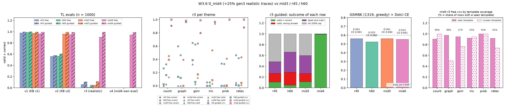

# W3.6 midtraining v4 (+25% realistic traces): r3 goes from 0.05 to 0.91, but r3 is now mostly seen templates

RLVL-next PLAN W3.6 · 2026-10-10 · Qwen3.5-0.8B (base_ext) + 59 TL tokens · lr 2e-5, batch 64, 1 epoch, rows60 head, 45% Dolci replay

## Run

mid4 (alex 4519901, 2h17, train loss 0.582, eval loss 0.462) is the mid3 recipe (W3.5), except that 25% of the 120k TL traces come
from gen3, the realistic-theme generator (gsm, prob, rates, count, graph, mc). The rest come from the v2 generator. Training TL rows
whose prompt equals an r3 or v4 eval prompt were removed (699 rows), so the mix has 119,301 TL rows and 98,182 Dolci rows.
Data: `rlvl_data/datasets/tl_mid_v4_20261010`.

Evals (gruenau 17704/17705, snapshot `tl_snapshot_20261010e`, n = 1000 each, greedy, 2048 new tokens):
- v1, v2 and r3 as in the W3.5 report (`2026-10-10_tl_mid3.md`).
- v4 = mid4's own held-out split (75% v2-style, 25% gen3).
- Script: `scripts/analysis/tl_mid4.py`, which writes `analysis/tl_mid4.md`.

## TL: valid ∧ correct, free / guided

| model | data | v1 | v2 | r3 | v4 |
|---|---|---|---|---|---|
| r45 | v1 | 0.979 / 0.996 | 0.560 / 0.578 | 0.059 / 0.107 | – |
| h60 | v1 | 0.987 / 0.998 | 0.566 / 0.606 | 0.010 / 0.049 | – |
| mid3 | v2 | 0.971 / 0.994 | 0.959 / 0.992 | 0.049 / 0.113 | – |
| **mid4** | v2 + 25% gen3 | 0.963 / 0.992 | 0.948 / 0.990 | **0.905 / 0.991** | 0.943 / 0.989 |

r3 guided outcomes for mid4: 991 valid ∧ correct, 0 valid with a wrong answer, 7 dead ends, 2 at the cap. mid3 had 113 / 152 / 334 / 401.
All 95 invalid free rows of mid4 fail with `calc: not entailed`, an arithmetic step the checker rejects. That is the error the guide
removes, which explains free 0.905 vs guided 0.991.

Per theme (free v∧c): count 0.907, graph 0.966, gsm 0.799, mc 0.940, prob 1.000, rates 0.883. Guided: 0.97–1.00 on every theme.

## How held out is r3 now?

r3 comes from the same gen3 generator that supplied mid4's realistic traces. Only exact prompt duplicates were removed. With numbers
masked and capitalised words (names) replaced by a placeholder:

| theme | n | same template in train | every sentence in train | mid4 free v∧c, seen template | unseen template (n) |
|---|---|---|---|---|---|
| count | 129 | 0.96 | 1.00 | 0.903 | 1.000 (5) |
| graph | 117 | 0.98 | 1.00 | 0.974 | 0.500 (2) |
| gsm | 219 | 0.17 | 1.00 | 0.947 | 0.768 (181) |
| mc | 151 | 0.25 | 0.85 | 0.921 | 0.947 (113) |
| prob | 161 | 0.42 | 0.99 | 1.000 | 1.000 (93) |
| rates | 223 | 0.81 | 1.00 | 0.917 | 0.738 (42) |
| **all** | 1000 | **0.56** | **0.98** | **0.938** | **0.862 (436)** |

So 56% of r3 rows repeat a training template, and 98% are built only from sentence templates mid4 has seen. On rows whose full template is
new (a new combination of seen sentences), free v∧c drops from 0.938 to 0.862. The biggest drops are gsm (0.947 → 0.768) and rates (0.917 → 0.738).

## General ability

| model | Dolci CE/tok | GSM8K (1319) | mean tokens | hit cap | GSM8K, cut at first turn end | rows that start a new turn |
|---|---|---|---|---|---|---|
| r45 | 0.941 | 0.561 | 263 | 5.5% | 0.562 | 13.7% |
| h60 | 0.980 | 0.525 | 231 | 2.9% | 0.525 | 2.4% |
| mid3 | 0.940 | 0.561 | 205 | 2.6% | 0.561 | 4.4% |
| mid4 | 0.941 | 0.553 | 632 | 25.1% | 0.555 | 37.1% |

GSM8K mid4 − mid3: −0.008 [−0.035, +0.017] (paired bootstrap, 2000 resamples), so no detectable cost.

**The cap hits come from an eval bug, not a broken model.** SFT targets end with `<|im_end|>` (`formal_chat_format.END_OF_TURN`) and
never with `<|endoftext|>`, yet `gsm8k_eval.py` stopped only on `<|endoftext|>`. A model that ends its turn correctly keeps writing new
`assistant` turns until something emits `<|endoftext|>` or the cap is reached. mid4 does this on 37% of rows, mid3 on 4%. With the text
cut at the first turn end, accuracy barely changes (0.555 vs 0.553), because the answer is taken from the last `\boxed{}`, which
usually repeats the first. The script now stops on `<|im_end|>` too (2026-10-10). Rerun with the fix (gruenau 17739, `evals/gsm8k_imend_mid3_mid4.json`):

| model | GSM8K | mean tokens | hit cap |
|---|---|---|---|
| mid3 | 0.561 | 195 | 2.1% |
| mid4 | 0.555 | 180 | 1.4% |

The bug inflated length and cap hits only; accuracies match the cut-at-first-turn numbers above. All GSM8K evals from now on use the fixed script.

## Findings

1. **The r3 failure in W3.5 was a coverage gap, and 25% realistic traces close it.** r3 goes from 0.049 to 0.905 free and from
   0.113 to 0.991 guided. v1 and v2 lose at most 0.011 free and 0.002 guided, and Dolci CE and GSM8K are unchanged.
2. **This is not yet transfer.** r3 now shares its templates with training. The fair reading is "composes seen sentence templates":
   0.86 free on new combinations of seen sentences. It says nothing about problems phrased by people. The W7 test (GSM8K / MC
   benchmarks posed in TL) is the real transfer check.
3. **Free-mode errors are now almost all arithmetic.** Every invalid free row on r3 is a `calc` step the checker does not accept. The
   guide fixes these, and so would the AZ value and search.
4. **mid4 is the new default init for W4.1 (AZ-main).**

## Caveats

- One seed per run. The v4 eval is mid4's own split, so it has no counterpart for the other runs.
- The template measure is a lower bound on similarity: synonyms and reordered clauses count as "unseen".

## Next

- **mid5 (alex 4520580, queued):** the mid4 data at the user's synthetic-RLVL ratio, 25% TL / 75% Dolci (32,549 TL rows, a subset of
  mid4's, plus the same 98,181 Dolci rows; dedup as above). The question: is 25% TL enough for TL, and does it buy general ability?
- **A held-out-template r3 split:** gen3 with some sentence templates withheld from training, so "held out" means held out.
- **W7:** GSM8K test problems posed in TL mode.

Artifact: https://claude.ai/artifact/XVjeCZTJuvnkjpk84sUpHX
