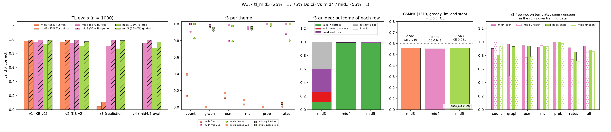

# W3.7 midtraining v5 (25% TL / 75% Dolci): small TL cost, no measurable GSM8K gain, slightly lower Dolci CE

RLVL-next PLAN W3.7 · 2026-10-10 · Qwen3.5-0.8B (base_ext) + 59 TL tokens · lr 2e-5, batch 64, 1 epoch, rows60 head

## Question

In synthetic-RLVL, instruction tuning with about 25% synthetic data worked well. Our midtraining was already instruction-style
SFT (Dolci chat rows plus TL traces), but at 55% TL. mid5 asks two things. Is 25% TL enough for TL? And does the larger Dolci
share buy general ability?

## Run

- **mid5:** alex 4520580, 1h33, train loss 0.834, eval loss 0.458. Data `rlvl_data/datasets/tl_mid_v5_20261010`.
- **Data:** the same Dolci rows as mid4 (98,181), plus 32,549 TL rows. These are a subset of mid4's mix (75% v2-style, 25% gen3)
  with the same dedup against r3 and the eval set. So mid5 differs from mid4 only in having 3.7× fewer TL rows: 25% instead of
  55% of the mix.
- **Evals:** gruenau 17750/17751, snapshot `tl_snapshot_20261010e`, n = 1000 per set. GSM8K uses the fixed `<|im_end|>` stop for
  all three models; mid3 and mid4 come from rerun 17739.
- **Script:** `scripts/analysis/tl_mid5.py`, which writes `analysis/tl_mid5.md`.

## TL: valid ∧ correct, free / guided

| model | TL share | v1 | v2 | r3 | v4 |
|---|---|---|---|---|---|
| mid3 | 55% (v2 only) | 0.971 / 0.994 | 0.959 / 0.992 | 0.049 / 0.113 | – |
| mid4 | 55% | 0.963 / 0.992 | 0.948 / 0.990 | 0.905 / 0.991 | 0.943 / 0.989 |
| **mid5** | **25%** | 0.936 / 0.983 | 0.902 / 0.968 | 0.867 / 0.982 | 0.872 / 0.959 |
| mid5 − mid4, free | | −0.027 [−0.042, −0.012] | −0.046 [−0.063, −0.029] | −0.038 [−0.057, −0.021] | −0.071 [−0.090, −0.053] |
| mid5 − mid4, guided | | −0.009 [−0.017, −0.001] | −0.022 [−0.032, −0.013] | −0.009 [−0.017, −0.002] | −0.030 [−0.042, −0.019] |

Intervals are paired bootstrap 95% CIs over the 1000 rows.

r3 guided outcomes for mid5: 982 valid ∧ correct, 15 dead ends, 3 at the cap (mid4: 991 / 7 / 2). Per theme, free v∧c drops
most on count (0.907 → 0.829) and rates (0.883 → 0.803).

## General ability

| model | Dolci CE/tok | GSM8K (1319, im_end stop) | mean tokens | hit cap |
|---|---|---|---|---|
| mid3 | 0.940 | 0.561 | 195 | 2.1% |
| mid4 | 0.941 | 0.555 | 180 | 1.4% |
| mid5 | **0.931** | 0.563 | 195 | 1.9% |
| base_ext | – | 0.600 | – | – |

GSM8K mid5 − mid4: +0.008 [−0.020, +0.035]; mid5 − mid3: +0.002 [−0.027, +0.029]. Neither is distinguishable from zero.

## Templates seen and unseen in each run's own training data

mid5 has only 8,064 realistic (R:) training rows, against mid4's 29,514. As a result, r3 is more held out for mid5: 44% of rows
repeat a training template (mid4: 56%), and 94% use only seen sentences (mid4: 98%).

| run | R: train rows | same template | free v∧c, seen template | free v∧c, unseen template (n) |
|---|---|---|---|---|
| mid4 | 29,514 | 0.56 | 0.938 | 0.862 (436) |
| mid5 | 8,064 | 0.44 | 0.881 | 0.856 (562) |

On new templates, mid5 is about as good as mid4 (0.856 vs 0.862), with a quarter of the realistic data. The r3 gap between the
two runs comes from seen-template rows (0.881 vs 0.938). So more data mostly sharpens memorised templates.

## Findings

1. **25% TL is nearly enough for TL.** Guided accuracy drops by at most 0.03 (r3 −0.009), and free accuracy by 0.03–0.07. The
   free loss is mostly `calc` steps, which the guide and later AZ search fix.
2. **The larger Dolci share does not buy GSM8K at this scale.** GSM8K is the same for all three runs (0.555–0.563), and all are
   about 0.04 below base_ext (0.600). Dolci CE improves a little (0.931 vs 0.941). The GSM8K gap to base is therefore not caused
   by the TL share between 25% and 55%. base_ext already has the extended vocabulary, so the vocabulary is
   not the cause. The candidate is the Dolci SFT itself (format, answer length), which the Dolci-only control (W3.8) tests.
3. **Generalisation to new template combinations does not need much data.** mid5 matches mid4 on unseen templates with 3.7×
   fewer realistic rows.
4. **Default init stays mid4** for W4.1. Its free accuracy is higher, which helps exploration, and general ability is the same.
   mid5 is a cheaper alternative for settings where TL data costs more.

## Caveats

- One seed per run. mid5 has fewer TL rows and a different TL share at the same time, because the Dolci rows were held fixed.
  The two cannot be separated here.
- The synthetic-RLVL comparison is loose. That project tuned a different base and task family, so "worked well" there was
  measured differently.

## Next

- **W3.8, Dolci-only control** (proposed since W3.4; alex 4521541, `tl_mid_d0_0.8b_lr2em5_b64_h60`): the same 98,181 Dolci
  rows with 0% TL, data `tl_mid_d0_20261010`. If it also lands at about 0.56 on GSM8K, the gap to base_ext comes from the Dolci SFT
  and not from TL.
- W4.1 AZ-main from mid4. W7 GSM8K posed in TL.

HTML version: https://claude.ai/artifact/SoXfLhZQiGnt2qJgmZ6Kcx
