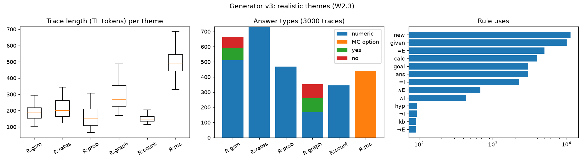

# TL generator v3: realistic themes (PLAN W2.3, goal G8)

Date: 2026-10-10. Code: `RLVL-next/tl/gen3.py`, tests `tl/tests/test_gen3.py`. Figure: `figures/tl_gen3.png`, stats `figures/tl_gen3.json`.

## What it is

Word problems in plain English instead of pseudo-words. Each fact kind has a hand-written sentence template; the
content words are bound by `new` at their first occurrence ("Ada" → c : 𝔼, "apples" → f : 𝔼 → ℝ, "speed" → c : ℝ,
"roads" → a list of pairs). Six themes:

| theme | stories | questions |
|---|---|---|
| R:gsm | 2–4 people; "has N", "N more / fewer than", "twice / three times / half as many as", "X and Y have N together" | one person's count, a sum, "how many more", yes/no "does X have more than Y", value at a unit price |
| R:rates | speed × time, distance ÷ time, joint work (rate sum × hours, total ÷ rate sum), cost, change from a bill, % discount (k90), % of a class, unit price | numeric |
| R:prob | event probabilities in tenths | complement, independent both / neither, exclusive or, union with a joint, conditional |
| R:graph | one-way roads between towns (list of pairs) | reachability k70 (yes/no 50:50), fewest roads k71 |
| R:count | club members, test scores | choose k31, arrangements k85, mean k14, total k3 |
| R:mc | any numeric question above as 3–5 options (k92) | which option |

Proofs: a linear question is one `calc` citing either the value lines of the quantities it uses (stepwise) or the givens behind them; otherwise `=I` + `=E` of each quantity's value + a ground `calc` (products of quantities, division by a quantity, library symbols). Unused true facts on unrelated quantities ("The room has 8 chairs.") are inserted at random places (0–2 per story).

Examples:

- R:gsm (answer 21): *Dan has 4 stickers. Pia has 9 stickers. Pia and Kim have 16 stickers together. Pia and Gus have 12 stickers together. If each sticker sells for 3 dollars, how many dollars are the stickers of Kim worth?*
- R:prob (0.32): *The probability of snow tomorrow is 0.8. The probability of frost tomorrow is 0.4. If snow and frost are independent, what is the probability of both snow and frost tomorrow?*
- R:graph (no): *There are one-way roads from town 2 to town 5 and from town 4 to town 2. Can one drive from town 5 to town 2 on the roads?*
- R:mc (C): *Each ruler costs 9 dollars. The house has 12 windows. Dan buys 4 rulers. Option A is 39. Option B is 38. Option C is 36. Option D is 33. Which of the options A, B, C and D is the number of dollars Dan pays?*

## Checks (`tl.tests.test_gen3`)

- 360 traces (60 per theme) + 1500 mixed: all pass `check` and the strict constrained decoder token by token.
- Every bound word is an English word from the theme vocabularies and is bound in the first sentence that contains it, whose formula uses it.
- Story sentence → formula is a function (4758 distinct sentences, 0 ambiguous). Questions may refer back to the story ("How many dollars does Ben pay?" means the items bought), so they are not audited alone.
- Answers in range: probabilities in [0, 1], counts and prices positive, MC answers are option letters (A 18, B 20, C 10, D 10, E 2 in 60 MC traces).

3000 traces (seed 3), generated in 13 s:

| theme | share | median tokens | answers |
|---|---|---|---|
| R:gsm | 22% | 187 | numeric 510, yes 80, no 75 |
| R:rates | 24% | 200 | numeric 733 |
| R:prob | 16% | 149 | numeric 469 |
| R:graph | 12% | 267 | numeric 167, yes 92, no 93 |
| R:count | 11% | 147 | numeric 344 |
| R:mc | 15% | 488 | option 437 |

Two fixes made while building it: graph yes/no came out 2:1 yes because strongly connected graphs have no unreachable pair and the retry re-drew the answer, so the answer is now drawn first and the graph resampled; sum questions that restate a "together" fact are rejected.

## Limits and next steps

- Narrow logic: rules used are new / given / goal / =I / =E / calc / ∧E / ∧I / ans, plus kb / →E / hyp / ¬I for yes/no. These themes test translation, not deduction; the deductive load stays with gen / gen2.
- Yes/no is 9% of answers (gsm comparisons and graph reachability).
- Not yet in any training mix. Next: `build_sft --gen v3` (mix share to be decided with the W3.5 results) and a held-out v3 eval split for W7, next to GSM8K.
