# TL AlphaZero on Dolci-TL from mid4 — first 50 iterations (W4.1)

2026-10-11 · RLVL-next `tl/az.py` · plan: RLVL-next/PLAN.md (G4/W4) · status as of 15:15

**Bottom line.**
- **Policy target.** The visit-count policy target erodes the midtrained prior within 10 iterations. The Gumbel-style completed-Q target keeps it intact, so completed-Q is now the default.
- **No learning yet.** After 30 guided completed-Q iterations (≈ 960 self-play games, ~1 % solved) the greedy eval is flat (r 0.035 → 0.025, within noise).
- **Search.** MCTS with an untrained value head adds only +1–2 solves per 64 prompts over greedy, in guided and in free mode.
- **Budget-outs.** The dominant failure under the guide is a runaway derivation: one statement grows until it fills the token budget. The fix for that is a design change awaiting the user's decision (§8).

Figures: `figures/2026-10-11_tl_az_dolci_drift.png` (self-play / training curves) and
`figures/2026-10-11_tl_az_dolci_eval.png` (greedy evals every 10 iterations).
Script: `rlvl_data/tl/analysis/plot_az_dolci.py`.

## 1. Setup

**Prompts (Dolci-TL).**
- Built by `tl/build_dolci.py` → `rlvl_data/datasets/tl_dolci_20261010`.
- Source: Dolci-Instruct-RL single-turn prompts that have checkable gold.

  | family | train prompts |
  |---|---|
  | math | 38,585 |
  | dapo | 5,550 |
  | wordprob | 1,156 |
  | yes/no | 480 |

- The gold becomes TL answer tokens: a canonical value term, or ⊤ / ⊥ for yes/no. The knowledge subset was dropped because it has no TL answer term.
- Eval set: the 845 non-knowledge rl_gate rows, shuffled. The evals below use the first 200, and there is no text overlap with train.
- Yes/no is excluded from training. Its "wins" are hacks: the premise is the goal itself, so answering ⊤ is a guess.

**Model and AZ settings.**
- Model: mid4 (Qwen3.5-0.8B-Base + TL tokens, midtrained on random TL traces + 25 % realistic). The value head is fresh.
- Reward: `mul` = valid × correct.
- Search: PUCT; 16 sims × 4 leaves (64 sims in the 19770 arm); Dirichlet 0.3 / ε 0.25; τ = 1 for the first 30 decisions.
- Games: 32 per iteration, drawn from math/dapo/wordprob; max-len 1024.
- Eval: greedy on 200 eval rows at it0 and every 10 iterations.

**Throughput.**
- Model forwards dominate the cost; the search is Python- and launch-bound.
- `--fast-prior 0.99` plays the argmax without search when the prior max is ≥ 0.99. For mid4 that covers 83 % of decisions, which makes search 4.8× faster.
- With fast-prior, an iteration takes ~12–25 min. Searching every move takes 2.6 h per iteration (19464), about 12× slower.

**H100.**
- fla refuses the gated-delta-rule backward on Hopper with Triton 3.5 (fla #640).
- Fix: an opt-in TileLang overlay (`pyext_tilelang` + CUDA 13 nvcc wheels).
- The gradient check against an fp32 reference gives a relative error ≤ 0.5 %.

## 2. Prior drift under the visit-count target

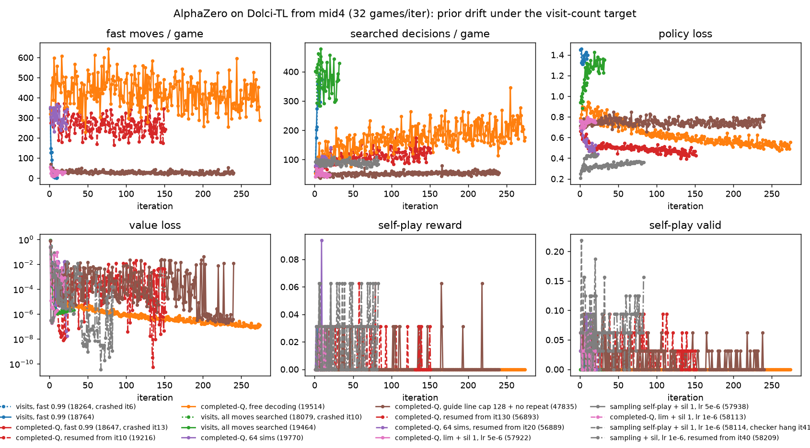

**What happens with the visit-count target** (fast-prior 0.99, 18264 and its relaunch 18764):
- Fast moves per game collapse: 345 → 128 → 42 → 6 → ~1. The root prior falls below 0.99 almost everywhere.
- The value loss goes to ~1e-6 because the value head learns "always lose".

**Why.** Once the value is flat, the policy target is the 16-sim visit distribution, which is shaped by Dirichlet noise. Training on it flattens the prior, with no learning signal behind it.

**The fix: completed-Q target** (`--policy-target completed`, c_visit 50, c_scale 0.1).
- The target is π = softmax(log P0 + (c_visit + max N)·c_scale·q). Unvisited edges get the prior-weighted mean q.
- When Q is flat, π = P0, so the target is the un-noised prior.
- Fast moves per game stay at 250–370 for 30 iterations.

**it10 greedy eval (n = 200):**

| run | r | valid | dead end | budget | math | yes/no | wordprob |
|---|---|---|---|---|---|---|---|
| mid4 (it0) | 0.035 | 0.165 | 0.215 | 0.625 | 0.016 | 0.111 | 0.02 |
| visits, fast 0.99 (18764) | 0.015 | 0.07 | 0.155 | 0.775 | 0.016 | 0.044 | 0.00 |
| completed-Q, fast 0.99 (18647) | 0.045 | 0.15 | 0.18 | 0.67 | 0.032 | 0.111 | 0.04 |

The visits target halves the valid rate (z = 2.6). Completed-Q holds it0 quality.

## 3. Crashes (fixed)

**What crashed.** 18264 (it6), 18647 (it13) and 18079 (it10) all died with a RecursionError in the guide.
- The trigger was degenerate policy output: hundreds of nested `¬` / `−`.
- The guide's `_Ctx.give` / `g_W` and `terms.is_value_term` recursed through them until Python's limit.

**Fix (snapshot `tl_snapshot_20261011c`).**
- A token whose guide step raises RecursionError is treated as illegal.
- A proof the parsers cannot recurse through is scored as failed.
- Test: `tests/test_az_deep.py`.

**Restarts.**
- 18647 resumed from it10 as 19216. The optimizer and replay buffer reset, and the curves are shifted by +10.
- 18079 relaunched from mid4 as 19464.

## 4. Guided vs free decoding (mid4, greedy, n = 200, max-len 1024)

| mode | r | correct | valid | grammatical | complete / budget / dead end | tokens |
|---|---|---|---|---|---|---|
| guided | 0.035 | 0.035 | 0.165 | 0.165 | 33 / 125 / 42 | 706 |
| free | 0.005 | 0.125 | 0.01 | 0.325 | 171 / 29 / 0 | 365 |

**Free mode.**
- It often states the right answer (yes/no 0.33, wordprob 0.14).
- The derivation does not check: invented `kb` lemmas that assert the goal, unchecked `calc` steps, and ⊤ right after `goal`.
- Under `mul` all of these score 0, which is the intended behaviour.

**Guided mode.** It cannot make unsupported steps, but it rarely reaches an answer within the budget.

**Free completed-Q self-play (19514).**
- 0/32 solves at all 23+ iterations.
- From it0 to it10 the greedy eval drifts to longer, less grammatical outputs:
  - budget-outs 0.145 → 0.455
  - tokens 365 → 610
- The drift stops by it20 (r 0.005, valid 0.01).

## 5. Does MCTS find what greedy misses? (mid4, untrained value head, same 64 eval rows)

| mode | decoding | r | valid | correct | budget | time |
|---|---|---|---|---|---|---|
| guided (19481) | greedy | 4/64 | 0.125 | – | 0.69 | 3.4 min |
| guided (19481) | sims 16 × 4, fast 0.99 | 6/64 | 0.156 | – | 0.78 | 42 min |
| free (19730) | greedy | 0/64 | 0.016 | 0.109 | 0.11 | 1.3 min |
| free (19730) | sims 16 × 4, fast 0.99 | 1/64 | 0.031 | 0.141 | 0.13 | 13 min |

**Guided.**
- Search solves a strict superset of greedy: 4 shared rows plus 2 search-only, both yes/no.
- It removes most dead ends (12 → 4), but they turn into budget-outs, not answers.

**Free.** Search adds one solve.

**Reading.** With no trained value, search only sees reward at terminals. Few rollouts reach a terminal within 1024 tokens, so search helps only at the margin. Guided remains the main arm.

## 6. Length is not the bottleneck: runaway derivations

Greedy guided mid4 on 200 rows at three max-len settings:

| max-len | r | valid | budget | mean tokens | last-3 statement length, budget-outs (median) |
|---|---|---|---|---|---|
| 1024 | 0.035 | 0.165 | 0.625 | 706 | – |
| 2048 | 0.03 | 0.16 | 0.63 | 1357 | 645 tok |
| 4096 | 0.035 | 0.16 | 0.64 | 2696 | 1327 tok |

**Statement lengths in budget-outs** (median tokens per statement):

| outcome | first 3 statements | last 3 statements |
|---|---|---|
| budget-out | 4.7 | 645 at 2048, 1327 at 4096 |
| complete | 4.7 | 8.7 |
| dead end | 4.7 | 18 |

The last statement grows to fill whatever budget is left, so more length only buys a longer runaway.

**Shapes of the runaway:**
- Goal or witness terms with ever-deeper λ-nesting and growing function types.
- Valid `=E` / `∧E` cycles that re-derive growing equalities.
- Short repeated tails. Only 24 of 126 budget-outs are exact statement loops.

## 7. 30 iterations of guided completed-Q AZ

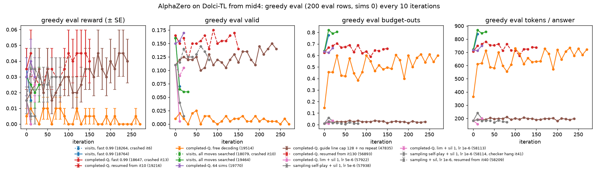

**Guided completed-Q (18647 → 19216), greedy eval:**

| it | r | valid | budget | tokens |
|---|---|---|---|---|
| 0 | 0.035 | 0.165 | 0.625 | 706 |
| 10 | 0.045 | 0.15 | 0.67 | 750 |
| 20 | 0.03 | 0.16 | 0.685 | 762 |
| 30 | 0.025 | 0.12 | 0.705 | 780 |

- The SE of r is about 0.013, so this is flat to slightly down. The drop in valid has z ≈ 1.3.
- Self-play solves 1/32 sporadically: overall iterations 5, 7, 16, 17, 19, 23, 27 and 30 (8 of 30), all dolci_math.
- Each positive game is a single trajectory in a buffer that is otherwise all −1. The value head barely registers it: loss spikes to ~1e-3 and decays again.

**Running arms (as of 15:15):**

| job | arm | status |
|---|---|---|
| 19216 | guided completed-Q, sims 16 | it30 done; next eval at it40 |
| 19770 | guided completed-Q, **sims 64** | Tests the user's hypothesis that tree search with constrained decoding finds solutions fast. it0 eval r 0.03 / valid 0.15; first self-play iteration > 2 h (CPU-bound tree search) |
| 19514 | free completed-Q, sims 16 | 0/32 through it23; evals at it0/10/20: r 0.005 / 0.01 / 0.005 |
| 19464 | visits, all moves searched | 0/32 at it1–2; 2.6 h then 55 min per iteration |

### 7b. Update 20:00: 50 iterations

The evals at it40 and it50 confirm the flat line. The "guided" column is 19216, greedy guided decoding. The "free" column is 19514, greedy free decoding, also with the completed-Q target.

| overall it | guided r | guided valid | guided budget | free r | free valid | free budget |
|---|---|---|---|---|---|---|
| 0 | 0.035 | 0.165 | 0.625 | 0.005 | 0.01 | 0.145 |
| 10 | 0.045 | 0.15 | 0.67 | 0.01 | 0.02 | 0.455 |
| 20 | 0.03 | 0.16 | 0.685 | 0.005 | 0.01 | 0.455 |
| 30 | 0.025 | 0.12 | 0.705 | 0 | 0 | 0.60 |
| 40 | 0.025 | 0.15 | 0.67 | 0.01 | 0.02 | 0.425 |
| 50 | 0.035 | 0.15 | 0.675 | 0.01 | 0.025 | 0.42 |

- **Guided run:** 9 single 1/32 self-play solves after the resume (overall it16, 17, 19, 23, 27, 30, 31, 39, 46), plus the earlier ones at it5 and it7. That is 11 solves in about 1,600 games (≈ 0.7 %). This gives one training game with a nonzero value every 4–5 iterations, which is too sparse to move the eval.
- **Free run:** self-play has solved 0 of 32 in every one of its 51 iterations. The it30 dip in the eval (budget 0.60, valid 0) recovered by it40, so the free arm is stable but not learning.
- **64-sim run (19770):**
  - **Self-play:** 4 solves in 320 games over it1–10 (1.25 %), about twice the 16-sim rate. Most came at it9, which solved 3/32 (2 math, 1 wordprob).
  - **Self-play valid:** crept from 0.03 to 0.09 over it1–9.
  - **loss_p:** fell from 0.75 to about 0.55, so the policy is sharpening rather than drifting.
  - **Greedy eval at it10:** r 0.04, valid 0.155, against r 0.03, valid 0.15 at it0. That is +2 correct of 200, which is within noise.
  - **Iteration time:** about 4,200–4,700 s.
- **Visits-target run (19464):** 0/32 self-play solves at it1–9. Its it10 eval shows the same prior drift as the earlier visits run, even though every move is searched (no fast moves):
  - valid fell from 0.16 to 0.065;
  - budget rose from 0.64 to 0.82;
  - tokens rose from 722 to 868;
  - loss_p rose from 0.94 to 1.32.

  Over the same span, the completed-Q target held valid at 0.15. Searching more moves does not fix the visit-count target.
- **Free run, it60:** r 0, valid 0, budget 0.575. The free eval rises and falls with the budget share.

### 7c. Update 2026-10-12 06:15: 90–100 iterations

All four arms are still flat on greedy eval. The figures were regenerated with all evals up to now.

| overall it | guided r | guided valid | guided budget | free r | free valid | free budget |
|---|---|---|---|---|---|---|
| 60 | 0.035 | 0.155 | 0.69 | 0 | 0 | 0.575 |
| 70 | 0.03 | 0.165 | 0.63 | 0.01 | 0.015 | 0.445 |
| 80 | 0.03 | 0.14 | 0.69 | 0.01 | 0.015 | 0.385 |
| 90 | 0.035 | 0.175 | 0.62 | 0.005 | 0.005 | 0.455 |
| 100 | – | – | – | 0 | 0 | 0.60 |

- **Guided 16-sim run (19216):**
  - **Self-play solves:** after it46, it solved problems at overall it63, it79 (2/32, its first multi-solve iteration) and it85. That makes 15 solves in about 2,900 games (≈ 0.5 %).
  - **Greedy eval:** r has stayed in 0.025–0.045 for 90 iterations, and valid in 0.12–0.175. The it90 valid of 0.175 is the run's best, but it is within noise.
- **Free run (19514):** self-play solved 0/32 in all 100+ iterations, and the eval is at noise level (r ≤ 0.01). Without the guide, MCTS over the free vocabulary never finds a valid, correct proof, so there is no signal to bootstrap from.
- **Visits-target run (19464), it20 eval:** r 0.02, valid 0.06, budget 0.79, tokens 844. The drift seen at it10 has plateaued, but at a level below it0 (valid 0.16). Self-play has solved 0/32 through it20.
- **64-sim run (19770):** it13 solved 1/32, for a total of 5 solves in 416 games (1.2 %), still about 2× the 16-sim rate. Its it20 eval is about 8 h away.

**Reading:** more search per move roughly doubles how often self-play finds a solution. Even so, about 1 % of games carrying a nonzero value is too sparse for value/policy training to move the greedy policy within about 100 iterations. In line with the user's direction ("if not we just wait"), the guided arms keep running.

### 7d. Update 2026-10-12 15:00: guided 120, free 150 iterations

The figures were regenerated with all evals up to now. Greedy eval, n = 200:

| overall it | guided 16-sim r / valid / budget | guided yesno | free r / valid / budget |
|---|---|---|---|
| 100 | 0.045 / 0.15 / 0.635 | 0.156 | 0 / 0 / 0.60 |
| 110 | 0.04 / 0.155 / 0.59 | 0.133 | 0 / 0.005 / 0.55 |
| 120 | 0.045 / 0.155 / 0.645 | 0.133 | 0.01 / 0.015 / 0.465 |
| 130 | – | – | 0 / 0.005 / 0.515 |
| 140 | – | – | 0.005 / 0.01 / 0.48 |
| 150 | – | – | 0.005 / 0.01 / 0.495 |

- **Guided 16-sim run (19216):**
  - Eval r over the last three evals averages 0.043, against 0.032 over overall it10–90. yesno (n = 45) rose from 0.07–0.11 to 0.13–0.16. This is at most a slight upward drift: one or two extra solved rows out of 200, which is within noise.
  - Recounted from the log: 23 self-play solves in the 3,552 games since the resume (0.65 %), the latest at overall it106 and it121.
- **Free run (19514):** 0 solves in 4,800 games (150 iterations). Eval stays at r ≤ 0.01. This arm is the clear negative control: without the guide, search finds nothing to learn from.
- **Visits-target run (19464):** the it30 eval is r 0.025, valid 0.06, budget 0.805. It is plateaued below its it0 level (valid 0.16), with 0 solves in 960 games.
- **64-sim run (19770):** evals at it0/10/20 give r 0.03 / 0.04 / 0.03 and valid 0.15 / 0.155 / 0.17. Self-play has 7 solves in 640 games (1.1 %), about 1.7× the 16-sim rate, but greedy eval has not moved after 20 iterations.

**Reading:** nothing has changed qualitatively. The guide is necessary for any signal; more search raises the solve rate but not the greedy policy, and the visits target hurts. The guided completed-Q arms keep running, following the user's "if not we just wait".

### 7e. Guide limits (2026-10-12 16:30): line cap 128 + no-repeat, arm 46581

User approved two optional guide limits (default off, `tl/guide.py`, tested in `test_limits`):
`--line-max 128` (a line may not exceed 128 tokens incl. ⏎; generator traces have max 322, p99.9 ≤ 173, cap refuses 0/360 traces)
and `--no-repeat` (a non-`hyp` line may not derive a formula already citable in scope). The visit-count arm 19464 was stopped and
its L40 now runs `az_dolci_g_mul_num_f99_cq_lim` (46581): mid4 init, same settings as s64 plus both limits.

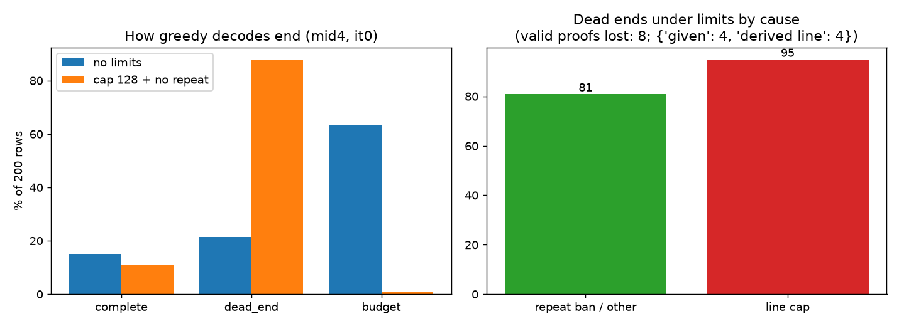

| it0, greedy, 200 rows (mid4, untrained) | r | valid | complete | dead end | budget | tokens |
|---|---|---|---|---|---|---|
| no limits (s64 it0) | 0.030 | 0.15 | 30 | 43 | 127 | 717 |
| cap 128 + no repeat (lim it0) | 0.015 | 0.11 | 22 | 176 | 2 | 183 |

* The limits do what they were for: 125 of the 127 budget runaways now end as dead ends, and decodes are ~4x shorter (183 vs 717 tokens), so self-play iterations are cheaper.
* 95 of 176 dead ends are line-cap hits (runaway λ/term nesting); 81 are repeat-ban refusals or ordinary checker dead ends.
* Cost: 8 valid proofs lost, none gained; all 22 surviving valid proofs were valid before. All 8 losses are repeat-ban refusals:
  4 at `given` lines (the model transcribes two premises to the same formula, e.g. four `given i : p1(c1)`), 4 at redundant derived lines
  (`calc 7 , 8 : f2(c3) = 60` restating line 8; `→E 7 , 4 : p2` re-deriving given line 5). 3 of the 6 correct answers are among them.
* The refusal only fires at ⏎, after the whole line has been decoded, so greedy cannot back out of it. MCTS can, because a dead end backs up value 0 and siblings get tried.
  The deciding number is therefore the self-play solve rate, not greedy it0.
* Decision: keep the ban strict for now (duplicate `given` formulas are formalization errors, and redundant derived lines are what we want to discourage).
  If the lim arm's self-play solve rate trails s64 at matched iterations (it20), the fallback is to exempt `given` lines from the ban.

**Update 2026-10-21 14:20: faithful AlphaZero, steps 1–2. A value head trained on judge-verified outcomes predicts *which problems* get solved well (AUC .89). Within one problem it is weak early in the proof (AUC .54) and good late (.80). At the point where a winning and a losing game first split, it does not beat the policy prior (.52 vs .56). Step 3 (value-guided search vs sampling on deep64) is running.**

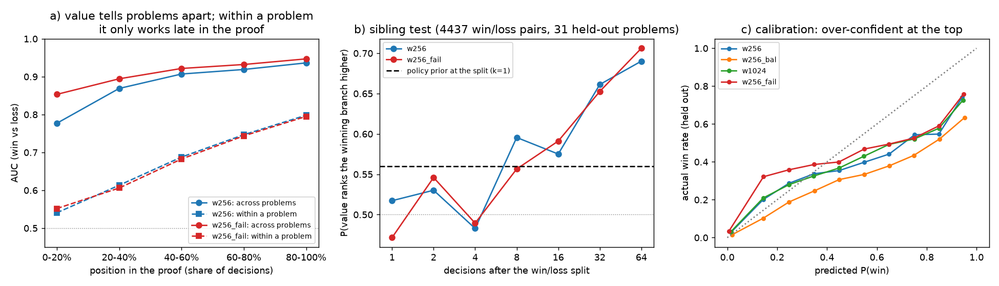

*Plan (user-approved 09:40).* (1) Train a value head on balanced data from train problems. (2) Check offline whether it predicts success. (3) Use it as the leaf value in token-level PUCT (no rollouts) vs best-of-k sampling on deep64. (4) Only if search wins: the AZ loop with sims > 0.

*Step 1, data.* FT3 plays 32 guided games per train problem (1,537 problems, 49,184 games; 101 rows near eval problems dropped). Every checker win was sent to the judge (gpt-oss-120b, v2 gate). Nothing is left unjudged.
* Checker wins: 5,759 games on 505 problems. Judge-verified: 2,519 games on 205 problems.
* Label z = +1 if the proof is judge-verified, else −1, exactly as in AZ. Every decision of the game gets that game's z.
* Training set: the problems with both outcomes, 259 k positions, 38% wins. Variant `_fail` adds 10% of the never-solved problems (795 k positions, 13% wins).
* Held out: 90 problems (325 k positions). 31 of them have both outcomes and carry the within-problem tests.

*Step 2, the head.* AZ value head (Linear → ReLU → Linear → tanh) on the frozen FT3 hidden state at each decision. 20 epochs.
* **Training lesson: plain AZ MSE got stuck.** On a first smoke test (1% wins) the tanh output sat at V = −1 for every input. There the gradient of tanh is zero, so it never moved (AUC .50).
  * Fix: same head, but trained with cross-entropy on P(win) = (V + 1)/2 (as KataGo does). It learns at once.
  * The AZ self-play loop in step 4 needs the same change.

| head (held out) | AUC, all positions | AUC, within a problem | sibling test: value | sibling test: prior |
|---|---|---|---|---|
| w256 | .886 | .682 | .517 | .560 |
| w256_bal (balanced batches) | .888 | .686 | .515 | .560 |
| w1024 (wider) | .884 | .682 | .501 | .560 |
| w256_fail (+ unsolved problems) | .911 | .679 | .471 | .560 |

* **Across problems it works (panel a, solid lines).** Even after the first 20% of the proof, AUC is .78–.85. Most of that comes from knowing which problems FT3 can solve at all.
* **Within one problem it works only late (dashed lines).** AUC .54 in the first fifth of the proof, rising to .80 in the last fifth. Early on, a game that will succeed and one that will fail look the same to the head.
* **Sibling test (panel b).** We take a winning and a losing game of the same problem and find the first token where they differ. Which branch does the head rank higher?
  * At the split itself the head is at chance (.47–.52). The policy prior picks the winning branch 56% of the time, so the head adds nothing there.
  * A few decisions later it becomes useful: .60 after 8 decisions, .66 after 32, .69–.71 after 64. So the head can recognise a failing line once it has gone some way, not when the mistake is made.
* **Calibration (panel c).** Held-out positions given P(win) ≈ .95 win only ~.75 of the time. `w256_bal` is over-confident across the range.
* **More capacity does not help.** Train loss keeps falling while held-out loss is flat from epoch ~3. w1024 is no better than w256. The limit is the data (205 problems with verified wins), not the head.
* **What this means for search.** A head that only recognises failure several decisions after the mistake can still help MCTS: the search reaches those deeper nodes, sees a low value and moves to siblings higher up. Whether that beats sampling is what step 3 measures.

*Step 3, running.* Job 99290 (gruenau11, 1 H100): leaf-value MCTS with w256_bal, `--rollout 0 --fpu parent`, 16 and 64 sims × 8 leaves, 2048 tokens, deep64 eval problems. Then the judge checks the wins and the result goes onto the search-vs-sampling plot.

*Note for step 4.* The fla backward kernel refuses to run on H100 with the current Triton (gated-delta-rule `chunk_bwd_dqkwg`, fla issue #640). AZ training must run on L40 or in a separate venv. Evaluation is not affected.

**Update 2026-10-21 07:37: rollouts to the end of the game (`rfull_s4l8`) also lose to sampling. Checker .313 in ~1060 s per problem vs best-of-64 .322 in 37 s. Judge-verified .078 vs .115. All three search settings now sit below the sampling curve at 5–30× the compute.**

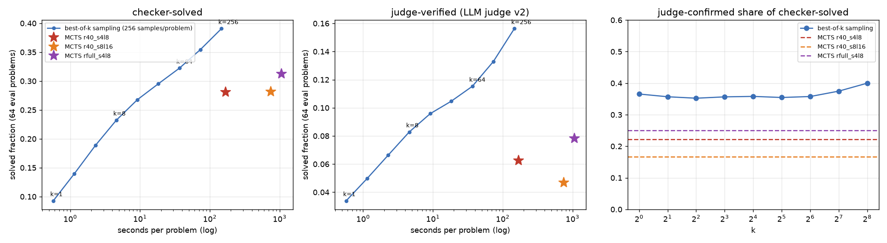

*What was run.* Same 64 problems and baseline. MCTS 4 sims × 8 leaves. Each rollout now runs until the game ends: finished proof, dead end or the 2048-token budget, with no 40-decision cap.
* Pooled from three partial runs (`evals/roll/deep64b`, `deep64c`, `deep64e`), with the 20 s guide guard and `TL_EVAL_BUDGET`.
* The last run (job 96999) finished at 07:33. The judge (job 98373, 1 H100) checked the 5 open proofs by 07:37.

| config (64 problems) | checker | verified | verified / checker | sec / problem |
|---|---|---|---|---|
| sampling, best-of-64 | .322 | .115 | .36 | 37 |
| sampling, best-of-256 | .391 | .156 | .40 | 147 |
| MCTS 4×8, rollouts ≤ 40 | .281 | .062 | .22 | 169 |
| MCTS 8×16, rollouts ≤ 40 | .281 | .047 | .17 | ~750 |
| MCTS 4×8, rollouts to game end | .313 (20) | .078 (5) | .25 | ~1060 |

* **Full rollouts are the best search setting, and still lose.** Checker 20 vs 18 for both capped settings. Sampling matches that with best-of-64 at about 1/30 of the time. Verified, best-of-8 sampling (.083, 5 s) already beats it.
* **Cost.** 1064 s per problem, measured on the last 44 problems. The first 20 were done by runs that were killed and logged no time.
* **How games end:** complete 24, dead end 38, out of tokens 2 (of 64). Full rollouts almost remove the out-of-tokens cases (8 with the 40-decision cap). Those games now end in dead ends instead, not in proofs.
* **What the rollouts see** (last 44 problems, 74 k rollouts, ~110 decisions each): 94% die, 2% run out of tokens, 3.7% reach a finished proof.
  * So a rollout now does return a real outcome, but it is almost always "dead".
  * With only 4 sims per step, the search cannot steer by a signal that is positive in only ~4% of rollouts.
* **Same failure pattern as before.** The only search-only solve (`dolci_math/44358`, 0 of 256 samples) was judged wrong. No problem that sampling solves ≥ 25% of the time was missed.
* **Conclusion for the depth/width sweep.** Neither deeper rollouts (40 decisions → game end) nor 4× wider search beats checker-selected sampling at matched compute, on either the checker or the judge.
  * The search has no estimate of how good a partial proof is. Rollouts tell it only "dead" or "not dead yet", so it ends up acting like slow sampling.
  * Distilling this search into the policy would teach it nothing that best-of-k does not already give.

**Update 2026-10-21 01:12: wider search (8 sims × 16 leaves, rollouts ≤ 40) finished on all 64 problems. It still loses to sampling: checker .281 in ~750 s per problem vs best-of-64 .322 in 37 s. Judge-verified .047 vs .115. Search finds more proofs that pass the checker but are wrongly formalized.**

*What was run.* Same 64 problems and baseline as the block below. MCTS 8 sims × 16 leaves, rollouts ≤ 40 decisions (`r40_s8l16`).
* The run was restarted three times, each on the problems not yet finished. Results are pooled from the partial logs (`evals/roll/deep64b`, `deep64e`). Script: `combine_search.py`. Figure: `fig_search_vs_samp.py`.
* Why the restarts. The first two runs hit the 24 h limit or stalled for hours at 100% CPU and 0% GPU. Cause: the guide (the code that computes the legal next symbols) evaluated nested knowledge-base terms in calc lines exactly, with no limit.
  * Fix 1: `deep_eval.slurm` now sets `TL_EVAL_BUDGET=2000000`, like the AZ training jobs (it never cut a valid proof, see 2026-10-17 18:55).
  * Fix 2: the guide gets a 20 s wall clock per step (`tree_20261020guard`); over it, the state counts as a dead end.
  * In the last 29 problems this fired once, on a matrix calculation. Steps of 2–8 s are still common.
  * The sampling baseline ran without the budget.
* Cost. ~750 s per problem, measured on the last 29 problems only (the harder ones). The killed runs logged no time. Each job uses one CPU core at 100% and leaves its GPU mostly idle: the guide, not the model, sets the speed.

| config (64 problems) | checker | verified | verified / checker | sec / problem |
|---|---|---|---|---|
| sampling, best-of-8 | .232 | .083 | .36 | 5 |
| sampling, best-of-64 | .322 | .115 | .36 | 37 |
| sampling, best-of-256 | .391 | .156 | .40 | 147 |
| MCTS 4×8, rollouts ≤ 40 | .281 | .062 | .22 | 169 |
| MCTS 8×16, rollouts ≤ 40 | .281 (18) | .047 (3) | .17 | ~750 |

* **4× wider search gains nothing.** Checker r is unchanged (.281), verified r is down by one problem. Best-of-32 sampling (.295, 18 s) beats it at about 1/40 of the compute.
* **Search proofs fail the judge more often.** Sampling: ~36–40% of checker-solved problems also pass the judge, at every k. Search: 17–22%. Search picks proofs the checker accepts but that formalize the question wrongly. Both problems that only search solved (0 of 256 samples) were judged wrong: `dolci_dapo/83475` (r40_s8l16) and `dolci_math/44358` (rfull_s4l8).
* **Search never loses an easy problem.** No problem that sampling solves ≥ 25% of the time is missed by search. The loss is on the medium problems that sampling reaches only with many tries.
* **How games end:** complete 25, dead end 31, out of tokens 8 (of 64).
* **Why: still no value signal.** 324 k rollouts: 65% stop at the end of the line, 24% at the 40-decision cap, 11% die, 0.06% reach a finished proof. Without a value head a rollout says only "not dead yet". Wider search spends more on that same signal.
* **Still running:** rollouts to the end of the game (`rfull_s4l8`, job 96999), 31/64 done. On those 31: checker 14 vs sampling 13.0 at best-of-64/256; verified 3 vs 4.4 / 5.0. Its time per problem is not known yet.

**Update 2026-10-19 23:30: token budget 2048 and best-of-k sampling as the baseline. Sampling beats MCTS at the same compute: best-of-256 solves .391 (checker) in 146 s per problem, MCTS 4×8 + rollouts ≤ 40 solves .281 in 169 s. Judge-verified: .156 vs .062 (judging completed 2026-10-20 05:40).**

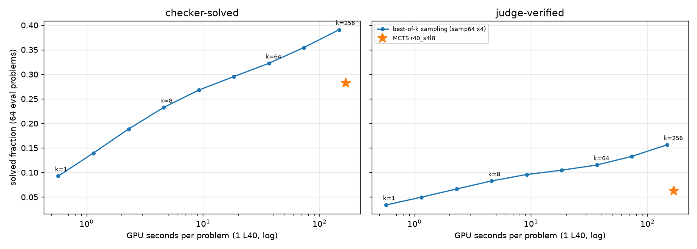

*Why.* The user asked why games run out of tokens, and said to raise the token limit and the search depth until search clearly beats sampling. We distil search into the policy, so search must find proofs that sampling does not.

*What was run.* 64 eval problems, FT3 init (no value head), max-len 2048 instead of 1024. Code: `tree_20261019deep`; sampling with a seed: `tree_20261019deep2` (`--eval-seed`). Runner: `deep_eval.slurm`, tag `deep64`.
* plain decoding (greedy);
* MCTS 4 sims × 8 leaves + rollouts ≤ 40 decisions (`r40_s4l8`);
* the fair baseline: 64 sampled games per problem, temperature 1, 4 independent seeds = 256 samples per problem. The checker picks a correct one if there is one (best-of-k).

The curve is the unbiased pass@k (Chen et al.) over the 256 samples. x = k × seconds per sampled game. Script: `passk_roll.py`.

| config (64 problems) | checker r | verified r | sec / problem |
|---|---|---|---|
| plain decoding (greedy) | .109 | .031 | 1.5 |
| sampling, pass@1 (avg) | .093 | .034 | 0.6 |
| sampling, best-of-8 | .232 | .083 | 4.6 |
| sampling, best-of-64 | .322 | .115 | 36 |
| sampling, best-of-256 | .391 | .156 | 146 |
| MCTS 4×8 + rollouts ≤ 40 | .281 | .062 | 169 |

* **Search loses to sampling.** MCTS costs as much as best-of-256 but solves fewer problems than best-of-32 (.295 at 18 s). Search is about 10× less compute-efficient than sampling.
* **The longer budget does not change the search result.** At 2048 tokens r40_s4l8 gives exactly the 1024-token numbers (.281 / .062). Budget runaways are 9% of its games. Its losses are dead ends (56%), not lack of tokens.
* **Why search loses.** Of its 146 k rollouts, 63% stop at the end of the current line, 23% at the 40-decision cap, 14% die. Only 0.07% reach a finished proof. With no value head, a rollout that does not finish says only "did not die yet". So the search learns only to avoid dead ends. It does not learn which proofs are correct.
* **Judge-verified, sampling also wins, and it keeps rising with k.** Best-of-256 verifies .156 (10/64), MCTS .062 (4/64) at about the same compute. Each problem needs a correct and faithfully formalized proof; about 2/3 of checker-solved problems fail that.
  * *Correction (2026-10-20 05:45).* A first version of this block said verified best-of-k "flattens at .094". That was wrong. 792 statements from seeds 1–3 had not been judged yet and were counted as unverified. The judge (job 95356, gruenau11, TP 2) has now judged all of them; 141 of 792 passed.
* Still running (9+ h, CPU-bound): rollouts to the end of the game (`rfull_s4l8`) and wider search (8 sims × 16 leaves, `r40_s8l16`). They test whether deeper rollouts reach finished proofs often enough to give search a real signal.

**Update 2026-10-19 08:25: token-level MCTS with rollouts (user's direction), first test on 64 eval problems: at 2×4 checker r up, verified r unchanged, dead ends unchanged; at 4×8 (added 11:50) verified r .031 → .063, dead ends .625 → .531.**

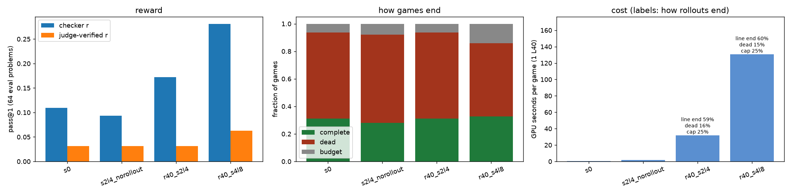

*Correction to the 07:15 block.* Its "next step" (dead-end retry: rewind and resample whole lines) is withdrawn. The user rejected line-level resampling: the policy is a token policy, and real MCTS needs simulation depth. That plan is replaced by the user's direction, token-level MCTS with rollouts (option a).

*What was run.* Same search as AZ: PUCT over tokens, guide full, no-repeat, strict reward. After each new leaf is expanded, a **rollout** continues from it by sampling tokens from the policy until one of three things happens:
* the current proof line closes (value = value head, floored at 0);
* the game ends (dead end / out of budget = −1, correct = +1);
* 40 decisions pass (same value as a closed line).

Every rollout edge is stored in the tree and backed up. Init: FT3. It has no trained value head, so every alive state is worth exactly 0. In this test the search therefore sees only "dies / survives / solves". Code: `tree_20261019roll` (`tl/az.py` `rollout`, `tl/tree.py` `fork`); runner `roll_eval.slurm`; analysis `analyze_roll.py`.

| config (64 problems, 1 sample) | checker r | verified r | dead end | out of tokens | completed | sec / game (1 L40) |
|---|---|---|---|---|---|---|
| plain decoding (greedy) | .109 | .031 | .625 | .063 | .313 | 0.6 |
| search 2 sims × 4 leaves, no rollouts | .094 | .031 | .641 | .078 | .281 | 1.6 |
| search 2 sims × 4 leaves + rollouts ≤ 40 | .172 | .031 | .625 | .063 | .313 | 31.9 |
| search 4 sims × 8 leaves + rollouts ≤ 40 (added 11:50) | .281 | .063 | .531 | .141 | .328 | 130.6 |

*Rollouts end as follows (2 × 4 config, 29.6 k rollouts, 18.5 decisions on average):*
* the line closes: 59%;
* the game dies: 16%;
* the cap is hit: 25%;
* solved: 13 of 29.6 k.

So rollouts usually do reach the end of the line, as intended.

*Checker r rose by .063, but verified r did not move.* All 4 extra checker wins are yes/no prompts (yes/no r .27 → .53). Of the 11 checker-rewarded rollout proofs, the judge (v2, 2 samples) rejected all 9 yes/no ones: 7 newly judged and 2 already cached as fails. So verified r stays at .031, the same 2 word problems in all three configs. The extra proofs are vacuous formalizations: the search found that the cheapest way to pass the checker is to state the claim as a `given` and answer ⊤ (e.g. "Christopher Lee starred in blockbusters" → `given p1(c1) ∧ p1(c2)`, `ans 4 : ⊤`). So stronger search hacks the checker more effectively. In AZ training the verifier gate removes exactly this kind of reward.

*Dead ends: unchanged (40 / 64 games in every config, mostly on the same problems: 37 games are dead ends both with and without rollouts).* 22–23 of the 40 are **runaway lines**: the line grows to the 128-token line cap (`( k 1 7 3 ( k 1 7 3 …`, `( ( ( ( …`, `1 0 0 0 0 …`), and that is what ends the game. The rest end on short lines where the guide had no legal continuation.

Why the rollouts cannot prevent runaway lines: inside one, a rollout cannot reach the line cap within 40 decisions. It hits the rollout cap instead, and a cap scores 0, the same as a valid closed line. So the search cannot tell a runaway line from a healthy one. Line lengths in completed proofs: median 13 tokens, 90th percentile 30, 99th percentile 49, longest 98. Only 14 of 477 lines are longer than 40 tokens, and only 2 are longer than 64. A line still open after 40 decisions is therefore almost always a runaway.

*Cost.* Rollouts make search ~50× slower than plain decoding (32 s vs 0.6 s of L40 time per game). Search without rollouts is 1.6 s per game and slightly worse than greedy.

*Added 11:50: the bigger search (4 sims × 8 leaves).*
* Getting it to run took two out-of-memory crashes:
  * job 91048 at 64 parallel games;
  * job 91231 at 32 parallel games. The cause was likely the first rollout step, which feeds the whole path from the game position to the leaf (100+ tokens) for all rollouts at once.
* Fix: rollout forwards are now chunked by batch × length² (longest first). Job 91567 then ran without problems (2 h 20 min for 64 problems).
* Checker r rises to .281. Verified r rises to .063, i.e. 4 of 64 vs 2 of 64 for every other config. That is a small count and could be noise.
* Word problems: 8 of 17 pass the checker (greedy 3); the judge passes 4 of those 8 (`164595`, `146028`, `155618`, `121762`). All 10 yes/no checker wins fail the judge (different_question).
* Dead ends fall from 40 to 34 games, mainly because 6 greedy dead ends now run out of tokens instead (out of tokens 6% → 14%). Runaway lines are still 22 of the 34.
* Rollouts end the same way as at 2 × 4: line closed 60%, dead 15%, cap 25%.
* Cost: 131 s of L40 time per game, ~200× plain decoding.

*Proposed next step (user to confirm).* Remove the rollout cap inside a line: a rollout always runs until its line closes, or until the line hits the line cap, which is a dead end worth −1. Lower the line cap from 128 to 64 tokens (cuts 2 of 477 observed lines) to bound the cost. Then rerun this 64-problem comparison. If dead ends fall, train AZ with rollouts and the verifier gate.

**Update 2026-10-19 07:15: AZ with the verifier gate stopped at iteration 737 (user's call): no learning; final numbers; next step.**

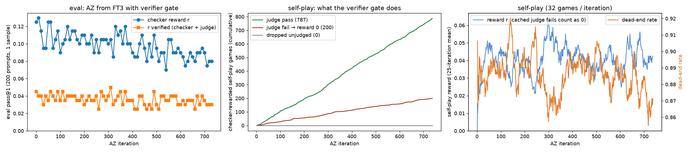

*Stopped.* The user stopped the run at iteration 737 of 960 (~14 h); the judge server was stopped with it. The ETA "about 07:30" in the 00:20 block was wrong: iterations slowed from ~52 s to ~70 s, so 960 would have landed around 12:00.

*Eval (left), mean over evals in each third of the run* (each eval: 200 prompts, 1 sample):

| iterations | checker r | verified r | dead end | out of tokens | tokens |
|---|---|---|---|---|---|
| 0 (FT3) | .125 | .045 | | .055 | 268 |
| 10–240 | .107 | .038 | .611 | .101 | 291 |
| 250–490 | .100 | .036 | .583 | .123 | 304 |
| 500–730 | .087 | .034 | .580 | .125 | 305 |

* Verified r (the number that matters) is flat at ~.035, slightly below FT3's .045.
* Checker r falls by .020 from the first to the last third (≈7 standard errors of the mean, so real). Most of that drop (.016 of .020) is in proofs the judge would reject anyway. That fits the gate removing reward from mis-formalized proofs, but it did not turn into more verified proofs.
* Proofs get longer and run out of tokens more often (5.5% → 12.5%).

*Self-play (right).* Reward per game ~.04 throughout (thirds .037 / .044 / .041), dead-end rate ~88% throughout.

*Gate (middle).* 787 judge passes, 200 fails (20%), 0 dropped. The gate worked as designed for the whole run.

*Conclusion.* With 32 games per iteration, ~88% of self-play games end in a dead end. That leaves ~1.3 rewarded games per iteration to learn from, which is too sparse to move the policy at LR 1e-6. The gate itself is not the problem.

*Next step (proposed, user to confirm).* Make finishing a proof easier before spending more RL:
1. **Dead-end retry, measured offline first (~1 h).** When a line cannot be closed, rewind to the line start and resample it (up to k = 4 tries) instead of ending the game. First evaluate FT3 with retry and no training. If verified r rises clearly (e.g. ≥ .06), retry is a cheap inference-time gain on its own.
2. **AZ with retry.** If step 1 lifts completions, rerun AZ from FT3 with retry in self-play, the same gate and LR 5e-6 (the higher LR is a side ablation, because 1e-6 barely moved anything in 737 iterations). Training still only imitates the lines that were kept.
3. FT4 start: still low priority.

**Update 2026-10-19 00:20: 380 iterations of AZ with the verifier gate: eval still flat; correction on the self-play "drift"; what to change next.**

*Correction.* At 21:45 I wrote that self-play reward "drifts slightly down" (.043 → .031). That was noise: the next three 50-iteration windows are .052, .044, .047. Self-play reward is flat at about .04 per game, like eval.

*Eval (left).* Mean over evals of iterations 10–120 / 130–240 / 250–380: checker r .108 / .107 / .105, verified r .039 / .037 / .038 (start .125 / .045). After ~5.5 h and 380 iterations, there is no improvement.

*Gate (middle).* 402 judge passes, 108 fails (21%), nothing dropped. Working as designed.

*Why nothing is learned: most attempts never finish.* In eval at iteration 270, 117 of 200 proofs ended in a *dead end*, 64 completed and 19 ran out of tokens. At iteration 0 it was 134 / 55 / 11. A dead end means the model wrote a line that cannot be closed validly (e.g. a `calc` result that does not follow from its citations, or a restated `given`), so the guide allows no next token and the game stops. Only 7–14 of those dead ends were exact repeats of an earlier line, so it is mostly invalid steps, not loops. The eval dead-end rate falls only slowly (mean .626 → .595 → .585 over the three windows). In self-play (with exploration) it is ~89%, which leaves ~1.4 rewarded games per iteration to learn from at LR 1e-6.

*Decision.* The run continues to its planned 960 iterations (about 07:30); it costs nothing extra and could still move. Starting the same recipe from FT4 (the PLAN fallback) is unlikely to help, because FT4 ties FT3 and the bottleneck is the sparse signal, not the start. Options for the next run (the user's call):
1. **Retry a line on dead end** (recommended): in self-play, when a line cannot be closed, delete it and resample that line (up to a few tries) instead of ending the game. Expected: many more completed proofs per iteration, so more reward signal. Training still only imitates valid lines.
2. **Higher LR** (e.g. 5e-6) as a cheap ablation alongside, to test whether LR 1e-6 is simply too slow.
3. FT4 start: low priority.

**Update 2026-10-18 21:45: 250 iterations of AZ with the verifier gate: still no learning; self-play reward drifts slightly down.**

*Eval (left).* Still flat. Averaged over 12 evals each, iterations 10–120 give checker r .108 and verified r .039, iterations 130–240 give .107 and .037. The start was .125 and .045. So the policy is no better on held-out prompts after ~3.5 h of training.

*Gate (middle).* Unchanged behaviour: 232 judge passes, 65 fails (22%), nothing dropped. The gate is not the bottleneck; it only removes reward from about one game in 5 that the checker accepts.

*Self-play (right, new panel).* Reward per game in 50-iteration windows: .043, .042, .035, .037, .031 (each window 1600 games, SE ≈ .005), so a small downward drift, not a rise. About 89% of self-play games end in a *dead end*: the grammar/guide allows no further token (e.g. every continuation would repeat a line), so the game stops without a proof. Only ~1 game in 25 gets reward, and SIL can only imitate those few.

*Reading.* With so few rewarded games per iteration (~1.2 of 32) and LR 1e-6, the update signal is tiny. This matches the earlier ungated runs, which were also flat. Plan: let the run reach ~iteration 400 (around midnight). If eval is still flat then, stop it and switch to the PLAN fallback (FT4 start) and/or change what limits learning here: the dead-end rate and the number of rewarded games per iteration.

**Update 2026-10-18 19:10: first 110 iterations of AZ from FT3 with the verifier gate: the gate works, eval is flat so far.**

*Run.* `az_dolci_ft3_vgate_all` (job 88218, gruenau12 L40) with the judge server (job 88217, 4 L40, TP4), launched 17:00 when gruenau12 cards freed up. FT3 start, all four families, sampling self-play + SIL, LR 1e-6, strict reward, ~52 s per iteration.

*Gate (middle panel; the figure is regenerated at every update).* Of 144 checker-rewarded self-play games, the judge passed 112 and failed 32 (22%). Those 32 get reward 0 instead of 1, so the policy is no longer pushed towards them. Every new statement was judged within one iteration (a few seconds each); nothing was dropped.

*Eval (left).* Checker r moves between .09 and .13 and verified r between .03 and .045, with no trend after 100 iterations. With 200 prompts × 1 sample, one standard error is about .014 on verified r, so these wiggles are noise. The earlier sampling + SIL runs (no gate) were also flat over their ~100 iterations (eval r .025–.035), so slow movement is expected with LR 1e-6; the run continues to 960 iterations.

**Update 2026-10-18 15:10: the LLM verifier is now part of the AZ reward (built and smoke-tested; waiting for GPUs).**

*Idea.* So far the v2 verifier only judged proofs after the fact. In RL the policy should only be rewarded for proofs that are both checker-correct *and* a faithful formalization, otherwise it learns to prove easier statements. So the verifier becomes a gate on the reward.

*How it works (code: `tl/tree_20261018az`, `tl.vgate` + `tl.verify_server` + `tl.az --vgate-dir`).*
- The judge (gpt-oss-120b, v2 prompt with `given 0` background lines, 2 samples that must both say "same") runs as a separate long-lived server job. AZ and the server share a directory: AZ drops a request file per new statement, the server appends verdicts to `cache.jsonl`.
- Verdicts are cached per (prompt, extracted statement): the derivation itself is checked exactly by the checker, so all proofs of the same statement share one verdict. The cache is pre-filled with the 4545 v2 verdicts from the S0 gate / FT-data runs.
- In self-play, a checker-rewarded proof whose statement is already in the cache gets its final reward at once (fail = reward of an incorrect proof). Unknown statements are held back as *pending* and enter training as soon as the server has judged them (usually the next iteration); unjudged after 20 iterations they are dropped. AZ never waits for the judge.
- Eval keeps the checker-only `r` (comparable with all earlier runs) and adds `r_verified` (eval waits up to 30 min for its verdicts).
- Safety: AZ stops if the server heartbeat is older than 1 h while proofs are pending.

*Smoke tests (FT3, 64 wordprob games/iteration, fake judge on CPU).* Smoke 3 found a bug: with no waiting the gate never re-read `cache.jsonl`, so pending proofs were never resolved and got dropped. Fixed (re-read every iteration on every rank). Smoke 4:

| iteration | checker-rewarded | new statements | resolved (pass / fail) | rewarded buffer |
|---|---|---|---|---|
| 1 | 9 | 9 | – | 0 |
| 2 | 9 | 9 | 1 / 8 | 1 |
| 3 | 7 | 7 | 6 / 3 | 7 |

Resolved counts match the server's verdicts exactly, and only passing proofs enter the rewarded buffer.

*Next.* The real run (AZ from FT3, all four families since the gate now guards yes/no, sampling self-play + SIL, LR 1e-6, as r40) starts as soon as the judge fits on free cards: one H100 (TP1) or four L40 (TP4); right now hallepat's jobs use every card Slurm would give us.

**Update 2026-10-18 14:10: FT4, trained only on v2-verified proofs, ties FT3 on verified pass@1.**

*Idea.* If the v2 verifier rejects a formalizer proof, that proof teaches a wrong translation, so drop it from the fine-tune data and see whether the model gets more verifiably correct.

*Data check (job 86846, 515 s).* We re-judged every formalizer proof in the FT3 data (1491 candidates, 1268 distinct statements) with v2:

| family | v2 pass |
|---|---|
| wordprob | 912/981 |
| math | 279/285 |
| dapo | 113/128 |
| yes/no without background | 21/26 |
| yes/no with `given 0` background | 46/71 |

Most of the data is fine. The rejects concentrate in yes/no proofs that lean on background lines.

*FT4.* We fine-tuned mid4 on the v2-passing data only (`tl_ft_formal_20261018v`): 1106 proofs on 587 prompts, of which 46 are yes/no (FT3 had 1205/638 and 72). The recipe is the same as FT3: LR 1e-5, eval loss 0.056.

*Result.* Same 200 eval prompts × 64 samples; strict gate, then the v2 verifier on every gate pass:

| run | gate pass@1 | **verified pass@1** | verified pass@64 | prompts solved (verified) |
|---|---|---|---|---|
| mid4 | .024 | .005 | .020 | 4 |
| ft3 | .096 | **.031** | .115 | 23 |
| ft4 | .065 | **.027** | .095 | 19 |

- The paired difference FT4 − FT3 over prompts:
  - verified pass@1 −0.003, 95% bootstrap CI [−0.009, +0.002]: no significant change;
  - gate pass@1 −0.032 [−0.048, −0.018].
- 5 prompts are verified-solved only by FT3 and 1 only by FT4.
- The CI covers prompt sampling only; it does not include the verifier's own randomness.
- Controls are unchanged: gold passes 89/100 and flipped bridges 0/194.

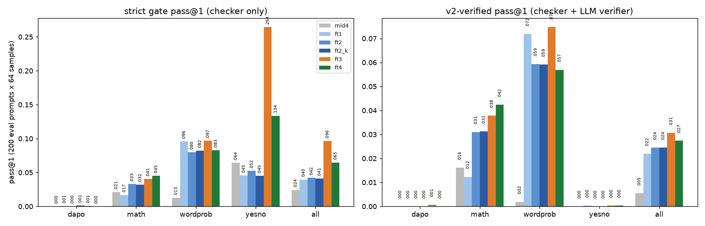

*What happened, intuitively.*
- Cleaning the data removed exactly what the verifier was catching. Yes/no gate pass@1 halves (.264 → .134), but yes/no verified pass@1 was ≈0 before and is ≈0 now.
- The other families barely move: math .038 → .042, wordprob .075 → .057, dapo ≈0.
- So FT3's gate lead over FT4 was almost entirely unfaithful yes/no proofs. Filtering the data did not create new faithful skill; it only removed fake wins.
- The real ceiling is the model's ability to formalize at all: ≈3% verified, concentrated in word problems and math.

*Engineering notes.*
- The first FT4 gate (job 87000) crashed after 44 min of generation. Re-checking one sampled proof from scratch raised "illegal token '2'", although the guide had allowed that token during generation. The cause is unconfirmed.
- Tree `tl/tree_20261018m` now scores such a sample as failed (`end=replay_error`, proof logged) and writes the raw token ids before scoring.
- The rerun (job 87267) produced 0 replay errors.
- The verifier (gpt-oss-120b) also runs on 4 L40s (TP=4, `PICKFREE`), in 524 s.

*Decision for AZ.*
- FT3 and FT4 are tied on what matters (verified). FT3 solves slightly more prompts under verification (23 vs 19), so it gives AZ more positive reward signal.
- Its extra unfaithful yes/no habit gets zero reward once the v2 gate is in the AZ reward.
- **Plan: start AZ from FT3 with the cached v2 gate in the reward**, and keep FT4 as the fallback if yes/no gate-only proofs dominate early self-play.

**Update 2026-10-18 11:40: Re-scoring the gate with v2 changes nothing.**

v2 is now the default background prompt in the scratch judge (`tree_20261018v/tl/judge.py`, the old prompt is kept as `CMP_BG_V1`). Job 86721 took 18 min on 2 H100s. Verified pass@1 (prompts solved) under the 10:45 run with v1 and the new run with v2:

| run | gate pass@1 | verified, v1 | verified, v2 | yes/no verified, v2 |
|---|---|---|---|---|
| mid4 | 0.024 | 0.006 (4) | 0.005 (4) | 0.000 (0) |
| FT1 | 0.040 | 0.022 (17) | 0.022 (18) | 0.000 (1) |
| FT2 | 0.042 | 0.024 (20) | 0.024 (19) | 0.000 (0) |
| FT2-k | 0.041 | 0.024 (17) | 0.024 (17) | 0.000 (0) |
| FT3 | 0.096 | 0.030 (21) | 0.031 (23) | 0.000 (1) |

Controls under v2: 89/100 gold, 1/3 K shots, 0/481 flips. The rejected yes/no proofs are almost all "different question" (2020 of about 2400 chain verdicts). The fix was meant to stop background rules from being called "extra facts", but that is not why these proofs fail. They formalize another question, so a more lenient background prompt cannot rescue them. The 10:45 conclusions stand.

**Update 2026-10-18 11:15: Verifier calibration. On the 29 blind-labelled bad statements, every variant except v3 (1 pass) is 100% precise. Recall on statements that really are good is low and noisy, 20–50%. v2 (holistic compare + truth check, 2 samples, both must pass) is the most robust choice and becomes the reward gate: test 6/16 good, 0/14 bad, 1/248 flips, 0/100 nonsense. Recall can be raised later. A false negative only costs reward signal; a false positive teaches a hack.**

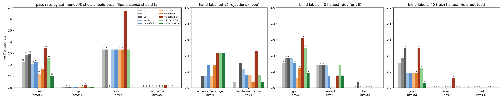

*Figure: pass rate of each verifier variant.*
1. Calibration sets: honest formalizer proofs with background, flipped bridges, K shots, gate nonsense.
2. v2's jloop rejections, hand-labelled.
3. 40 random honest statements, labelled blind. This set became the dev set for v6.
4. 40 fresh honest statements, labelled blind *before* v6 was scored. This is the held-out test.

| variant | honest /257 | flip /248 | K shot /3 | nonsense /100 | jloop acceptable /7 | jloop bad /13 | dev good /16 | dev lenient /7 | dev bad /15 | test good /16 | test lenient /8 | test bad /14 |
|---|---|---|---|---|---|---|---|---|---|---|---|---|
| v1 | 58 | 1 | 1 | 0 | 0 | 1 | 5 | 2 | 0 | 5 | 0 | 0 |
| **v2** | 74 | 1 | 1 | 0 | 0 | **0** | 6 | 2 | 0 | **6** | 0 | **0** |
| v3 | 76 | 1 | 0 | 0 | 1 | 4 | 6 | 2 | 1 | 8 | 0 | 0 |
| v4 strict | 54 | 1 | 1 | 0 | 1 | 3 | 6 | 2 | 0 | 3 | 0 | 0 |
| v4 default | 57 | 1 | 1 | 0 | 2 | 2 | 5 | 1 | 0 | 3 | 0 | 0 |
| v5 strict | 31 | 1 | 1 | 0 | 1 | 2 | 2 | 0 | 0 | 3 | 0 | 0 |
| v5 default | 41 | 1 | 1 | 0 | 2 | 1 | 4 | 0 | 0 | 3 | 0 | 0 |
| v5 default, any chain | 89 | 5 | 2 | 2 | 3 | 6 | 10 | 1 | 0 | 8 | 1 | 0 |
| v4 compare + T3 truth | 66 | 1 | 1 | 0 | 3 | 2 | 8 | 2 | 0 | 4 | 0 | 0 |
| v6 rubric + T3 truth | 27 | 1 | 0 | 0 | 3 | 1 | 3 | 1 | 0 | 1 | 0 | 0 |

How the variants differ:
- **v1–v3:** a single judge prompt in three revisions.
- **v4:** splits the check into compare and truth. The compare is "is the back-translation the same problem?". The truth check is "are the `given 0` lines true?" (T1 strict, T2 default).
- **v5:** hides the background from the compare and uses truth prompt T3.
- **v6:** a rubric compare that asks only (1) is it the same question? and (2) is every stated fact supported?

What we learned:
- **Most "honest" formalizer data is not good.** In the dev sample, 16/40 statements are good, 7 are good if a garbled word gloss is read charitably ("lenient"), 15 are bad, and 2 are unclear. Bad means a wrong question or data, or a background line that is false, specific, or asserts the answer. That is why "honest" pass rates of 20–30% are not a sign of over-strictness on their own.
- **Precision holds everywhere; recall is the problem.** On the dev set the truth check passed 31/40 chains on good items. The compare was the bottleneck: it called a shown background rule an "extra fact", and it said "different question" when "is this factually correct?" had been reduced to its content.
- **Hiding the rules (v5) and a strict rubric (v6) both lower recall.** On good items v6 rejects 28 of 64 chains as "different question". Usually the back-translation never poses the question, because a bare formal goal just gets restated as a fact. The weak link is the back-translator, not the judge.
- **Dev/test gap.** Several variants were tuned on the dev set and then lost recall on the held-out test, e.g. v4 compare + T3 dropped from 8/16 to 4/16. v3 has the best test recall (8/16), but it passes 4/13 hand-labelled bad jloop rejections and 1 dev bad item, so it is out.
- **Decision: v2.** v2 has 0 bad passes on both blind sets, and its recall is stable (6/16 on both dev and test). Its 0/13 on the jloop set proves nothing, because that set *is* v2's rejections; the other variants pass 1–4 of them. A cleaner variant would need more labels, and it isn't worth delaying the reward gate for that.

Process notes:
- My first tentative blind labels from before the context reset didn't hold up on a careful re-read (e.g. #3, #9 and #30 are good). I relabelled from scratch before scoring.
- The v6 examples are generic (dog, camera, soup), so none of the labelled items leaked into the prompt.
- An earlier slip: one calibration job requested 3 H100s, above the half-node cap. It was cancelled and rerun with 2.

**Update 2026-10-18 10:45: LLM verifier on the gate results. Nearly all checker-rewarded yes/no proofs are formalizations of a different question. Verified pass@1 is 0.006 for mid4, 0.022 for FT1, 0.024 for FT2, 0.024 for FT2-k and 0.030 for FT3. FT3's gate pass@1 of 0.096 was mostly this hack. This also corrects the 07:00 block: FT3's yes/no proofs without a background line (0.090) are not real either.**

What we did (the user asked for an LLM truth check on `given 0` lines and for the same LLM to check the formalization):
- One judge (`tl/judge.py` in scratch tree `tree_20261018v`, gpt-oss-120b, 2 samples, every sample must say "same") back-translates the proof's statement into English and compares it with the original prompt.
- `given 0` lines are now included. They are marked as background claims, and each one must be true as general common sense; otherwise the issue is `bad_background`.
- It ran once per distinct (prompt, statement) over every rewarded gate proof of the 5 runs: 1990 statements, 5148 chains, 19 min on 2 H100 (job 86390).
- Script `rlvl_data/tl/verify_gate.py`, outputs in `s0/verify_20261018/`, analysis in `analyze_verify.py`.
- Verified reward = gate reward × judge pass.

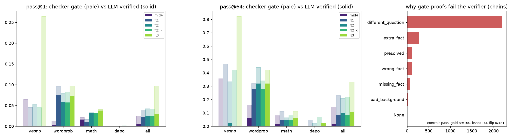

| run | gate pass@1 | verified pass@1 | gate solved /200 | verified solved /200 | verified yes/no | verified wordprob | verified math |
|---|---|---|---|---|---|---|---|
| mid4 | 0.024 | 0.006 | 29 | 4 | 0.000 | 0.003 | 0.016 |
| FT1 | 0.040 | 0.022 | 46 | 17 | 0.000 | 0.074 | 0.011 |
| FT2 | 0.042 | 0.024 | 42 | 20 | 0.001 | 0.059 | 0.031 |
| FT2-k | 0.041 | 0.024 | 44 | 17 | 0.000 | 0.058 | 0.031 |
| FT3 | 0.096 | 0.030 | 66 | 21 | 0.000 | 0.073 | 0.038 |

- **Yes/no (1205 statements):** 1 passes, and that one is trivial too ("her has pain; does anything have pain?").
  - Typical rejected proofs bind symbols to words like "the", "a", "Is" or "write" and ask about them. Back-translated, they become questions such as "does property *the* hold of *check*?" instead of the NLI question.
  - The first chain gives `different_question` for 390 of the 494 background proofs and 620 of the 711 others.
  - Only 6 background proofs are rejected mainly for a false background claim. The shortcut is not a false axiom on a sensible formalization; the whole formalization is nonsense, and the axiom just makes it checkable.
- **Word problems:** 474/684 statements pass (69 %). **Math:** 56/92. **DAPO:** 2/9.
  - Most verified progress is on word problems, where FT1 is clearly better than mid4.
- **Paired sign tests on per-prompt verified pass@1:**
  - FT1 > mid4 (16 wins, 1 loss, p = 3e-4) and FT3 > mid4 (20–1, p = 2e-5).
  - FT2 vs FT1 (8–11, p = 0.65), FT3 vs FT2 (12–7, p = 0.36) and FT2-k vs FT2 (7–11) are not significant.
  - So more people-proof data after FT1 has not measurably helped once the hack is removed.
- **Controls:**
  - Generator gold traces pass 89/100. 8 of the 11 failures are unparsed judge outputs, slightly below the earlier 0.91–0.97.
  - Flipped bridges pass 0/481, but mostly because their originals were already nonsense, so this does not test the truth check alone.
  - **The hand-written K shots pass only 1/3.** "pleased with a product → recommends it" and "enjoys → ¬ rain" are rejected as `extra_fact` (a rule "not stated in the original"), not as `bad_background`. So the verifier is too strict on honest background bridges: it partly ignores the instruction that background claims are allowed. This must be calibrated before the verifier gates AZ rewards (see next steps).

What this means:
- The checker reward can be gamed on yes/no prompts, because any formalization that checks and gets ⊤/⊥ right counts.
- The S0 gate number of record should be the verified one. All five runs are far below the 0.10 pass@1 gate: the best is FT3 at 0.030.
- The checker-only gate was misleading for yes/no.

Next:
1. Calibrate the verifier on honest background proofs: the K shots plus the judged formalizer `given 0` proofs used for FT3. Adjust the CMP_BG wording so that a plausible general rule is not `extra_fact`. Aim for ≥ 0.9 on honest proofs while flips and nonsense stay ≈ 0.
2. Filter the FT data with the background-aware verifier, since FT3's yes/no data likely contains the same kind of formalizations.
3. Then design the cached online verifier as the AZ reward gate.

**Update 2026-10-18 07:00: FT2 (4× more math / dapo proofs) does not beat FT1. FT3 (adds the `given 0` yes/no proofs) nearly reaches the pass@1 gate (0.096 vs 0.10; pass@64 0.33 vs 0.40), but the gain is a shortcut. In two thirds of FT3's correct yes/no proofs, one unchecked background axiom of the form ∀x. A(x) → (¬)B(x) links a fact from the prompt to the question's predicate. Choosing its polarity amounts to choosing the answer. Without these proofs FT3's yes/no pass@1 is 0.090, not 0.264. On the other families FT3 is at 0.048 (FT1 0.038).**

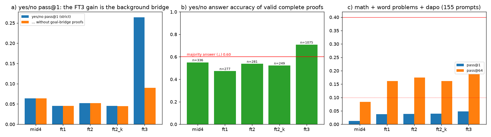

- **Strict S2 gate** (Dolci-TL eval[:200], vLLM + guide, K = 64, line_max 128, TL_EVAL_BUDGET 2e6), pass@1 / pass@64 / prompts solved:

| run | all | math (62) | word problems (50) | yes/no (45) | dapo (43) |
|---|---|---|---|---|---|
| mid4 | 0.024 / 0.145 / 29 | 0.021 / 0.081 / 5 | 0.013 / 0.160 / 8 | 0.064 / 0.356 / 16 | 0 / 0 / 0 |
| ft1 | 0.040 / 0.230 / 46 | 0.017 / 0.113 / 7 | 0.096 / 0.320 / 16 | 0.045 / 0.467 / 21 | 0.001 / 0.047 / 2 |
| ft2 (old tree) | 0.042 / 0.210 / 42 | 0.033 / 0.065 / 4 | 0.080 / 0.440 / 22 | 0.052 / 0.333 / 15 | 0 / 0.023 / 1 |
| ft2 (K tree) | 0.041 / 0.220 / 44 | 0.032 / 0.081 / 5 | 0.082 / 0.340 / 17 | 0.045 / 0.422 / 19 | 0.001 / 0.070 / 3 |
| ft3 (K tree) | 0.096 / 0.330 / 66 | 0.041 / 0.113 / 7 | 0.097 / 0.420 / 21 | 0.264 / 0.822 / 37 | 0.001 / 0.023 / 1 |

- Paired sign tests on per-prompt pass@1 (wins / losses):
  - ft2 vs ft1: 23 / 29, p = 0.49;
  - ft2 (K tree) vs ft2: 24 / 27, p = 0.78. The `@ 0` line alone changes nothing.
  - ft3 vs ft1: 53 / 17, p = 2e-5;
  - ft3 vs ft2 (K tree): 52 / 18, p = 6e-5.
- **FT2: more math / dapo data did not help.** Math pass@1 is 0.033 vs 0.017, but with fewer prompts solved (4 vs 7); dapo is still ≈ 0. Without yes/no, pass@1 is 0.039 (ft1 0.038). ft2 completes more math generations (12.3 % vs ft1 7.2 %; valid 9.9 % vs 5.9 %) but not more correct ones. Dapo is unchanged (complete 5.9 % vs 5.3 %). 87–93 % of math / dapo generations still end in a dead end.
- **FT3: the yes/no shortcut.** Typical correct FT3 proof (dolci_yesno/167629, gold ⊥, "Security check for Santa Clause" ⊢? "Santa clause riding in his sleigh"):
  `given 1 : p1 ( c1 )` · `given 0 : ∀ x1 : 𝔼 . p1 ( x1 ) → ¬ p2 ( x1 )` · `goal 1 : ? p2 ( c1 )` · ∀E · →E · `ans : ⊥`.
  - The background axiom names the goal predicate, and nothing checks that it is true. The strict checker's `background_answer` rule only catches a background line that states the claim itself. The formalize judge back-translates the statement without the `given 0` lines.
  - So the answer is decided by the sign of an unchecked axiom: a guess with a formal wrapper.
  - 502 of 761 strict-correct FT3 yes/no generations (66 %) have a background line that mentions the goal predicate. The earlier models have 0–1.
  - 37 of the 50 distinct yes/no proofs in FT3's training data have the same form. The shortcut is in the judged formalize data (gpt-oss-120b + judge v3), not invented by the student.
  - Answer accuracy among valid complete yes/no proofs: ft3 0.71 (n = 1075). Earlier models 0.47–0.55 (n 249–336). Majority answer (⊥) 0.60 (gold: 27 ⊥ / 18 ⊤).
  - FT3 completes about 4× more yes/no proofs and is somewhat above the majority baseline. The pass@64 of 0.82 on a two-answer task says little.
  - Panel a: yes/no pass@1 without the goal-bridge proofs is 0.090 for ft3 (0.045–0.064 for the others). That is a real but small gain, perhaps from more yes/no examples overall.
- **What it means for the gate and AlphaZero:**
  - As implemented, package K lets a model buy any yes/no answer with one axiom. AlphaZero with the strict reward would learn this template on all yes/no prompts.
  - The S2 gate number for ft3 (0.096) should not count as "nearly passing".
  - Excluding yes/no, the best model is ft3 at 0.048 / 0.187 (29 of 155 prompts solved), far from 0.10 / 0.40.
  - This needs a decision on how background knowledge is verified before AlphaZero uses package K. The options are listed in the next-step note of the project log.
- **Library:** the eval budget (default off) and the K wiring (`prompt_of`, `@ 0` render line) are now in the real `RLVL-next/tl` (backup `RLVL-next/backups/2026-10-18_budget_k/`). Full test suite on the ported library (07:35): 41 of 45 pass, including `test_background_wiring`, `test_eval_budget` and `test_given0`. The 4 failures are not caused by the port: `test_az_fast` needs a model path argument and `test_az_lockstep` segfaults in a torch triton kernel (both fail identically on the pre-port library); `test_az_lora` needs peft, which the vllm venv lacks; `test_az_cache` is a benchmark that hit the 3000 s per-test cap (not rerun on the old library).
- Audit script `scratchpad/ft3_template.py`, numbers `figures/tl_ft3_yesno_audit.json`.

**Update 2026-10-18 05:35: The new collection gives 378 judge-robust proofs on 174 new math / dapo / yes-no prompts (the forecast was ≈160 prompts). FT2 trains on them. It also shows that `given 0` (package K) was never wired into the gate, AlphaZero or the FT replay, so 31 of 44 new yes/no proofs were dropped. The fix is tested in a scratch tree, and an FT3 data build with it is running.**

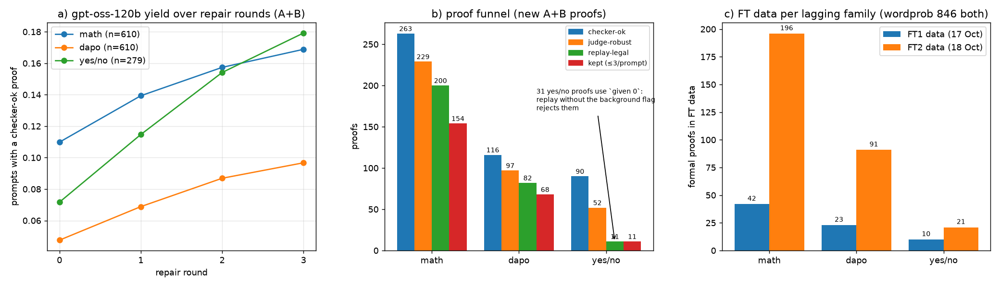

- **Formalize** (81911 chunk A on 4 L40, 40 931 s; 81912 chunk B on 2 H100 NVL, 31 887 s; gpt-oss-120b, 4 attempts × 3 repair rounds, 23 049 calls, 121 M generated tokens):
  - prompts with a checker-ok proof after round 3: math 103 / 610 (16.9 %), dapo 59 / 610 (9.7 %), yes/no 50 / 279 (17.9 %); panel a).
  - Repair rounds matter: round 0 alone gives math 11.0 %, dapo 4.8 %, yes/no 7.2 %; yes/no gains the most (×2.5).
  - Failure mix per round stays 54–57 % checker error, 17–19 % lexer error, 12–15 % unfaithful (in-loop judge).
- **Independent re-judge** (81913 / 81914, judge v3, 2 samples): gold controls 378 same / 14 different / 8 unparsed of 400 verdicts.
  - Robust proofs (every non-gold verdict "same"): 378 of 469 checker-ok (81 %): math 229 on 93 prompts, dapo 97 on 47, yes/no 52 on 34.
  - Against the scale-up's rates (11 / 8 / 15 % robust prompts) this is as forecast for math (15.2 %) and dapo (7.7 %), lower for yes/no (12.2 %).
- **FT2 data** (`datasets/tl_ft_formal_20261018`, `rlvl_data/tl/build_formal_sft2.py`): same recipe as FT1 (strict gate replay, line_max 128, no_repeat, ≤ 3 proofs per prompt, ×4 upsampling, 3000 generator traces + 3000 Dolci replay rows, 10 % of formal prompts held out, eval[:200] text overlap removed).
  - Formal proofs: math 42 → 196, dapo 23 → 91, yes/no 10 → 21, word problems 846 (unchanged); 1154 proofs on 599 prompts; 10 156 train rows. Panel c).
  - Replay filter on the new proofs (panel b): math 200 of 223 legal, dapo 82 of 97, yes/no only 11 of 44.
- **Why yes/no is lost: `given 0` is not wired outside formalize.** 31 of the 33 illegal yes/no proofs fail at the same token, the `0` of a `given 0` background line.
  - `given 0` is legal only on a `Prompt(text, background=True)`. Only `tl/formalize.py` ever sets that flag (from the K tag). The FT builder, the gate (`tl/vllm_guide.py`), AlphaZero (`tl/az.py` `eval_items` / `data_items`) and `tl/eval_hf.py` all build `Prompt(text)`. The student's user turn also never announces sentence 0.
  - So since package K (2026-10-16) no student model could use background knowledge in the gate or in self-play, and every `given 0` proof was dropped from FT1 and FT2 data (FT1 lost 39 scale800 proofs this way: "illegal+bg").
  - Yes/no is still the student's best family without it (ft1 solves 21 / 45 gate yes/no prompts, mid4 16 / 45) because many yes/no items follow from the prompt's own sentences.
- **Fix (scratch tree `rlvl_data/tl/tree_20261018k` = tree_20261017b + K wiring; real library untouched while FT2 imports it):**
  - `tl/prompt.py`: `prompt_of(row)` gives a background Prompt to the K families (`BACKGROUND_FAMILIES = {"dolci_yesno"}`; the formalize K tag covers 98 of 139 yes/no prompts in chunk A, but no tags exist for gate or AZ rows, and the strict checker's `background_answer` rule already bars a background line that states the claim).
  - `Prompt.render()` of a background prompt starts with `@ 0 : (background knowledge, for `given 0` only; numerals 0, 1)`; other families' user turns are byte-identical to before.
  - `vllm_guide` (prompt ids, guide state, `score`), `az` (`eval_items`, `data_items`) and `eval_hf` use `prompt_of`.
  - New test `tl/tests/test_background_wiring.py` (render, AZ items, a K proof is complete + valid + correct + faithful under the strict gate score, the same proof is illegal on a non-K row). `test_given0`, `test_eval_budget`, `test_az_game`, `test_az_target`, `test_dolci` pass in the tree.
- **Running / next:**
  - FT2 = mid4 + FT2 data (job 85472, gruenau11, 159 steps, finished 05:34; held-out loss 0.063). Its strict gate (job 85507: tree_20261017b, TL_EVAL_BUDGET 2e6, `s0/strict_20261018/ft2`) is like-for-like with mid4 / ft1 (no K). A second gate of the same model under tree_20261018k (job 85515, `ft2_k`) isolates the effect of the `@ 0` prompt line.
  - FT3 data (`datasets/tl_ft_formal_20261018k`, `build_formal_sft3.py`) is the same candidates replayed with `prompt_of`. Background proofs kept: 62 (more_A 14, more_B 15, scale800 33), with only 9 still illegal. Yes/no proofs 21 → 72; 1205 proofs on 638 prompts, 10 304 train rows. FT3 (job 85512, gruenau11, same recipe from mid4) then gets a strict gate under tree_20261018k (`s0/strict_20261018/ft3`), submitted automatically.
  - The K wiring and the eval budget go into the real library after FT2's run, with backups.

**Update 2026-10-17 18:55: Calc evaluation budget is tested and ready (default off). Proposed job value: TL_EVAL_BUDGET = 2,000,000 steps. It stops the runaway evaluation that stalled the ft1 gate (1465 s → ≈10 s) and cuts nothing that any gate model wrote validly.**

- **What it is.** Any calc evaluation in the guide or the checker may take at most N nested ground-evaluation steps.
  - Over N, the evaluation raises `EvalBudget`. The checker rejects that calc line. The guide offers no value after `=`, so the line is a dead end, the same way the line cap works.
  - This is sound: it can only turn a correct line into "not evaluable", never accept a wrong one.
  - Steps are counted, not seconds, so the guide stays deterministic.
  - Off unless `TL_EVAL_BUDGET` is set.
- **Code.**
  - `tl/kb.py` (`ground_eval` counter, `EvalBudget`, `EVAL_PEAK`), `tl/check.py` (`calc_value` re-raises), `tl/guide.py` (`calc_target` → no value).
  - New test `tl/tests/test_eval_budget.py`: budget off unchanged; peak counted; over budget, the checker rejects the line and the guide offers no value; within budget, unchanged.
  - Frozen as `tl/tree_20261017b` (+ `budget.patch`). The real library is unchanged until the formalize/judge jobs 81911–81914, which import it, are done.
  - `s0_vllm_guide.slurm` documents `TL_EVAL_BUDGET` and prints it.
- **Calibration on the gate samples.** All 2 × 12800 mid4/ft1 gate samples were replayed through the guide, budget 2e6, with the most steps any single evaluation took recorded (`pass64/eval_peaks_budget2e6.json`). 0 replay errors.
  - Valid samples never need more than **60,818** steps (mid4; for ft1, 6,101). Correct samples need at most 324.
  - Only 2 + 2 samples reach the cap: the two `dolci_math/39994` folds (ft1) and two mid4 math samples. They now stop after ≈6–11 s of guide time.
  - ft1 total guide replay time: 4455 s → 1678 s.
- **Test suite** (27 scripts; budget off, counting only, and 2e6):
  - **Budget off:** 26 of 27 suites pass, unchanged (completed 19:29; gen4 868 s, az_game 14 s, az_target 1 s). The 27th, `test_given0`, failed in that pass only because the scratch copy lacked `TLANG.md`; it passes in the real tree and in the snapshot.
  - **Budget 2e6:** all pass except `test_package_g`. The largest evaluations are KB self-tests and generators, not proofs:
    - `test_package_g` lemma instances: 15.6M steps, the one failure under 2e6;
    - `test_gen2`: 42M steps (≈200 s), and `test_gen4`: 14.0M steps (counted at 19:29); both pass, because the generator skips items it cannot evaluate;
    - `test_package_a`: 1.9M steps (counts over 10⁵ candidates), passes.
  - So the budget is a **job setting for gate / AZ / scoring**. KB tests and data generation run without it.
  - One rerun aside: `test_tree` failed once on a numeric tolerance while the two suites shared the CPU, then passed 3/3 with the budget both off and on. Not budget-related.
- **Why 2e6.** It is 33× the largest valid gate sample and above every proof-like evaluation in the tests. The worst time per step seen (the quadratic fold) puts the cap at ≈10 s per evaluation. A 10× higher cap would allow minutes, which blocks vLLM's batch.

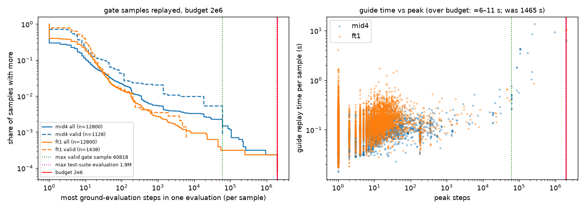

Next: the re-gate after the second FT runs with `TREE=tl/tree_20261017b TL_EVAL_BUDGET=2000000`. The AZ jobs will also use it.

**Update 2026-10-17 18:00: More formal proofs for the lagging families: two judge-loop formalization runs on 1499 new math / dapo / yesno prompts are running, and a default-off budget for `calc` evaluation is being calibrated.**

The user chose option 1 of the 17:20 block: "let's collect more … proofs and train again".
- **Prompts** (`datasets/tl_dolci_formalize_20261017/`, `manifest.json`).
  - Source: the train split. Every example that any earlier formalize run touched is excluded (1754 ids, including all 1156 word problems and the 598 of the scale-up 72637).
  - Shuffled per family with seed 20261017 and split into two chunks:
    - chunk A: math 310, dapo 310, yesno 141;
    - chunk B: math 300, dapo 300, yesno 141.
    - formalize drops its few-shot example ids, so the runs see 759 (yesno 139) and 740 (yesno 140) prompts, 1499 in total.
  - This uses up yesno: only 282 unformalized train prompts are left in that family.
- **Setting**: the same as the scale-up 72637. gpt-oss-120b, 4 attempts × 3 repair rounds, judge-in-the-loop with 2 samples, Dolci few-shots, K few-shots, KB filtered by tags.
  - One change: max model length 131072 instead of 65536. One KB package set gives a 93.8k-token system prompt, which crashed the first chunk-B submission (81851) at tokenization.
- **Jobs**:
  - chunk A: 81911 on gruenau12 (4 L40);
  - chunk B: 81912 on gruenau11 (2 H100 NVL);
  - independent re-judge with `afterok`: 81913 / 81914 (judge v3, 2 samples, 100 gold controls), the same as 75183.
  - Output: `tl/formalize/gpt-oss-120b_jloop_more_{A,B}`, `judge_gpt-oss-120b_v3_jloop_more_{A,B}`.
- **Placement fix**: the first chunk-A submission (81850) landed on an L40 that a process outside Slurm had filled (45 GB) and died with CUDA OOM.
  - `formalize.slurm` and `judge.slurm` now accept `PICKFREE=1`: allocate one spare card (5 L40, within the half-node cap) and run on the TP cards that are empty.
  - They also accept `DATA` (rows to pick from).
  - Backups: `*.slurm.bak_20261017`.
- **Expected**: the scale-up took 7.9 h for 598 prompts at 11.4 % robust prompts (math 11 %, dapo 8 %, yesno 15 %). At those rates the 1499 prompts would give about 160 more robust prompts: roughly math 67, dapo 49, yesno 42, i.e. ≈3× the 75 non-word-problem prompts in ft1's data.
- **Next**:
  - rebuild the FT set (`build_formal_sft.py`, same replay filter and eval-overlap removal);
  - fine-tune again from mid4 (or ft1);
  - re-gate with the strict S2 gate.

**`calc` evaluation budget (default off).** The two ft1 samples that took ≈1465 s each (17:20 block, corrected) evaluate a fold whose exact radical term grows quadratically per step.
- New in a scratch copy of the library (not yet in the real one, which the formalize jobs import): `TL_EVAL_BUDGET=n` caps one top-level `ground_eval` at n nested steps. Beyond that it raises `EvalBudget`. Unset keeps the old, unbounded semantics.
  - In the guide, `calc_target` treats `EvalBudget` as "no value can check", so the line is a dead end.
  - In the checker, it is a failed `calc` (`calc_value` re-raises it instead of answering "unknown").
- Calibration is running: replay of all 25 600 S2 gate samples (mid4, ft1) plus the kernel / KB / generator test scripts, recording the peak steps of any single evaluation. The budget will be set well above every valid proof's peak, and it will be switched on only for new gates / AZ runs, in a tree snapshot.

**Update 2026-10-17 17:20: A small fine-tune of mid4 on the judge-robust formalized Dolci proofs raises the strict S2 gate from pass@1 0.024 / pass@64 0.145 to 0.040 / 0.230 (46 vs 29 prompts solved; paired sign test p = 0.0046). That is significant but still far below the gate (0.10 / 0.40). Most of the gain is on word problems, which make up 92 % of the FT proofs.**

Setup (user 2026-10-17: "Small fine tune then pass check"):
- **Data** (`datasets/tl_ft_formal_20261017/`, `mixture_manifest.json`, builder `build_formal_sft.py`).
  - Sources: judge-robust proofs from the scale-up (72637 + re-judge 75183) and from the word-problem run (66082 + judge v3).
  - Every proof was replayed through the current gate guide (line cap 128, no-repeat, strict reward = valid ∧ correct ∧ faithful). Only proofs that pass the replay are kept.
  - Prompts that overlap eval[:200] by text were removed.
  - Result: **464 prompts, 921 proofs** (≤3 per prompt).
    - By family: wordprob 846, math 42, dapo 23, yesno 10.
    - 10 % of prompts are held out as the FT's own eval.
  - Train mix: formal ×4 (818 → 3272) + 3000 generator traces + 3000 Dolci replay rows from mid4's own mixture (`tl_mid_v4_20261010`) = 9272 rows.
- **Replay filter.**
  - Kept: scale800 95, wordprob 942.
  - Dropped as illegal under the guide:
    - 39 scale800 proofs with K background (`given 0`), which the guide does not accept at that position;
    - 12 + 38 other proofs (repeat ban / line cap);
    - 1 unfaithful (inconsistent givens).
  - Before the replay, `calc` premise lists are sorted ascending and deduplicated. This is the guide's canonical order and is checker-equivalent. Without it, 197 proofs were illegal; with it, 50.
- **Training** (job 79728, `tl/mid/tl_ft1_0.8b_mid4_formal_lr1em5/final`).
  - Same trainer as mid4 (`train_formal_mixture_sft.py`, rows60 head, fp32 DDP), wrapped by `tl/ft_continue.py`. The wrapper makes `init_embeddings` a no-op, so mid4's learned symbol rows are not reset to glosses.
  - lr 1e-5, global batch 64, 1 epoch = 145 steps.
  - train_loss 0.347; eval_loss 0.0431 → 0.0410 → 0.0418 (epochs 0.35 / 0.69 / 1.0).
- **Gate.** Same as the mid4 baseline: vLLM + guide, Dolci-TL eval[:200], K 64, T 1.0, max 1024, line cap 128, no-repeat, `--strict-reward`, patched tree `tl/tree_20261017`.
  - Jobs: mid4 79782, ft1 79793.
  - Output: `tl/s0/strict_20261017/{mid4,ft1}/pass64/`. Comparison: `compare_mid4_vs_ft1.json` (script `compare_ft_gate.py`).
- **Guide bug found on the way.** The first mid4 baseline gate (79729, unpatched library) crashed in the guide's `exi` handler (`TLError: cannot apply (∃ …)`): when it collects the witnesses for an ∃-elimination, it instantiated the binder with every subterm before checking the type, and a predicate-typed binder applied to a non-λ subterm raises. Fix in `tl/guide.py`: check the type first, then instantiate, both inside one try/except `TLError` (backup `guide.py.bak_20261017`, repro test ok). Both gates in the table (mid4 79782, ft1 79793) ran on the fixed snapshot.

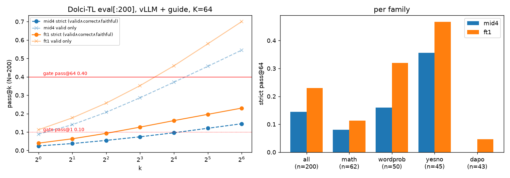

| strict, N 200, K 64 | mid4 (79782) | ft1 (79793) |
|---|---|---|
| pass@1 / pass@64 | 0.024 / 0.145 | **0.040 / 0.230** |
| valid pass@1 / @64 | 0.088 / 0.545 | 0.112 / 0.700 |
| prompts solved (≥1 of 64) | 29 | 46 |
| math (n 62): pass@1 / @64 / solved | 0.021 / 0.081 / 5 | 0.017 / 0.113 / 7 |
| wordprob (n 50) | 0.013 / 0.160 / 8 | **0.096 / 0.320 / 16** |
| yesno (n 45) | 0.064 / 0.356 / 16 | 0.045 / 0.467 / 21 |
| dapo (n 43) | 0 / 0 / 0 | 0.001 / 0.047 / 2 |
| ends: dead end / complete / budget | 0.879 / 0.119 / 0.001 | 0.854 / 0.130 / 0.015 |
| mean tokens | 186 | 250 |
| generation wall time / samples/s | 1546 s / 8.3 | 6102 s / 2.1 |

- **The gain is real.**
  - Paired per prompt: both models solve 21; only ft1 solves 25; only mid4 solves 8. Exact two-sided sign test p = 0.0046.
  - pass@k rises at every k for both strict and valid-only.
- **Most of it is word problems.** wordprob pass@1 rises 7× (0.013 → 0.096) and solved prompts double (8 → 16). This matches the data skew: 846 of 921 FT proofs are word problems.
  - math and dapo gain only at large k (2 and 2 more prompts).
  - On yesno, pass@64 rises (16 → 21 prompts) but pass@1 falls slightly (0.064 → 0.045). The FT had only 10 yesno proofs.
- **Dead ends shift from `given` to `calc`.** Last-line heads of dead ends:
  - mid4: given 3843, calc 2631, goal 2162, `=` 1155, kb 673;
  - ft1: calc 3351, goal 2402, given 2357, `=` 1176, ∧ 535, kb 390, def 226.

  ft1 transcribes the premises more often without breaking a rule, and then fails later, mostly in a `calc` line that the checker rejects or the line cap cuts.
- **ft1 decodes ~4× slower under the guide** (2.1 vs 8.3 samples/s, 525 vs 1549 tok/s). Proofs are only 34 % longer, so length alone does not explain it. Offline replay of the guide on all 12800 saved samples (`time_guide.py`, `pass64/guide_times.json`) finds the cause: **two samples**.
  - Both are ft1 proofs for one prompt, `dolci_math/39994` ("What is the second-largest prime factor of 207143330?").
  - Both write `calc : k24(k201 , 207143330 , k23(2 , k287)) = …`, a fold of `k201` over `k23(2 , k287)`. *(Corrected 2026-10-17 17:45: an earlier version of this block said the range bound was of the order of 207143330. In fact `k287` = 12, so the range is [2 … 12], 11 elements, and `k23` ranges are capped at 1000 elements anyway.)* `k201(r , h)` = π·r² + π·r·√(r² + h²) (the total surface area of a cone) is quadratic in its accumulator. Folding it 11 times from 207143330 squares the accumulator at every step, inside exact terms with π and nested radicals. A 60 s cProfile of the step (scratch `prof_slow.py`) shows 494k definition unfoldings and 3.6 M `ground_eval` calls under `calc_value` → `kb._fold`, still unfinished.
  - At the token after `=`, the guide evaluates the left side to build the allowed conclusion. Each of the two evaluations takes **≈1465 s** of CPU, which is **66 %** of all ft1 guide time (4455 s).
  - Without the two: ft1 averages 0.119 s per sample, mid4 0.090 s (mid4's worst is 61 s, also a `calc`). That is the size difference expected from 34 % longer proofs.
  - The guide's step is synchronous inside vLLM's logits processor, so a stalled step plausibly blocks the whole batch. 2 × 1465 s ≈ 2930 s would then explain about two thirds of ft1's extra 4556 s of generation; I have not checked this in vLLM. The same two samples cost another ≈49 min in the sequential scoring afterwards.
  - The guide caps the size of `calc` conclusions (`CALC_MAX` 256), the library caps range length (1000) and the estimated cost of one enumeration unfolding (`G_UNFOLD`), but nothing bounds the total cost of evaluating one term (definitions without a cost model, nested inside a fold). This is unrelated to the `exi` fix.

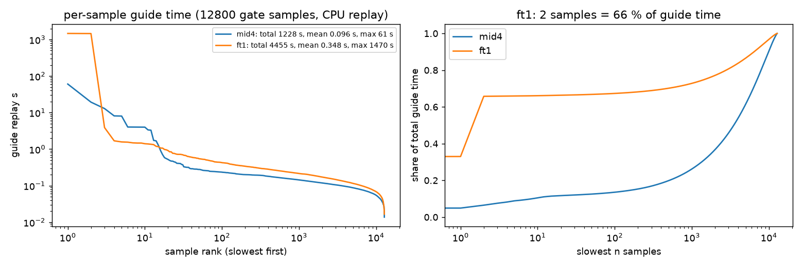
- **Verdict: S2 gate not passed** (needs 0.10 / 0.40). One small FT on 464 prompts moved pass@64 by +0.085. Closing the remaining gap of 0.17 with SFT alone would need several times more judged Dolci proofs, and the non-word-problem families would need far more coverage (only 75 FT proofs).

Next options, ordered by expected value:
1. Grow the judged formal set on the families that lag (math / dapo / yesno), using the same judge loop (≈11 % robust yield per prompt), then FT again.
2. Start AZ / expert iteration from ft1 on the training split anyway, since valid@64 is now 0.70. This uses the strict reward and the guide, and the single-bridge K reward ablation (user, 2026-10-16) can run alongside.
3. Before either: give `calc` evaluation a total budget (e.g. a cap on `ground_eval` steps or on numeral / term size per top-level evaluation; a range-length cap would not catch this case). Over budget, the line becomes a dead end, the same way the line cap works. This is a guide-semantics change, so I will propose it with a test and not switch it on silently. A per-sample timeout in scoring alone would not unblock vLLM decoding.

**Update 2026-10-17 06:00: Scaling the judge loop to 598 prompts keeps the per-prompt yield. 93 prompts are judge-ok in the loop (15.6 %, same rate as the 150-prompt pilot), and 68 survive an independent re-judge (11.4 %, pilot 13.3 %). In-loop acceptance overstates more at scale (93 → 68 vs 23 → 20), almost all of it on yes/no prompts. The 68 robust prompts with 146 data-tier proofs are the first usable judged Dolci-TL training set.**

Setup:
- Job 72637 (`formalize/gpt-oss-120b_jloop_scale800_dolci/`): 598 Dolci prompts (math 200, dapo 200, yesno 198; the 150 pilot prompts included), same settings as the pilot 71136 (20:45 block): `--k-shots` (default), `--judge-samples 2`, `--data-repair` off, 4 attempts × 4 rounds, gruenau12, L40, TP 4. K prompts (nl_judgment / world_knowledge in this run's `tags.jsonl`): 138.
- Independent re-judge of all 195 in-loop accepted proofs: job 75183 (`formalize/judge_gpt-oss-120b_v3_jloop_scale800_dolci/`, v3, 2 fresh samples, 100 gold controls).
- Robust = every re-judge sample says "same" and the proof is not flagged by `check.substantive` (data tier).
- Files: `formalize/jloop_scale_compare.json`; figure data `figures/tl_jloop_scale_dolci.json`.

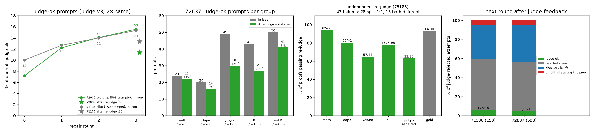

| | 71136 pilot (150 prompts) | 72637 scale-up (598 prompts) |
|---|---|---|
| judge-ok prompts by round 0/1/2/3 | 15/19/21/**23** (15.3 %) | 43/73/84/**93** (15.6 %) |
| judge-ok K prompts by round | 10/11/12/13 of 39 | 18/29/37/43 of 138 |
| judge-ok not-K prompts by round | 5/8/9/10 of 111 | 25/44/47/50 of 460 |
| judge-ok prompts math / dapo / yesno (round 3) | 5 / 3 / 15 | 24 / 20 / 49 |
| re-judge: proofs pass | 40 of 50 (80 %) | 152 of 195 (78 %) |
| re-judge: **robust prompts** (+ data tier) | **20** (13.3 %) | **68** (11.4 %) |
| robust math / dapo / yesno | 5 / 2 / 13 | 22 (11 %) / 16 (8 %) / 30 (15 %) |
| robust K / not K | 12 (31 %) / 8 (7 %) | 27 (20 %) / 41 (9 %) |
| gold control | 97 of 100 | 93 of 100 |
| after a judge rejection: judge-ok / rejected again / check+lex / unfaithful+wrong | 12 / 113 / 75 / 10 (of 210) | 35 / 390 / 287 / 40 (of 753, +1 no proof) |
| judge-repaired proofs that pass the re-judge | 9 of 12 | 22 of 35 |
| wall time / generated tokens / prompt tokens / formalizer calls | 6039 s / 10.6 M / 72 M / 2301 | 28340 s / 44.2 M / 295 M / 9199 |

- **Yield scales linearly.** The in-loop rate is the same as in the pilot (15.6 vs 15.3 %) and keeps growing over rounds (43 → 93; round 0 alone gives 43). The robust rate is 11.4 % vs 13.3 %. The difference sits in the overstatement, not in the formalizer.
- **Reproducibility on the pilot subset:** on the 150 pilot prompts this run has 19 robust prompts vs 20 in 71136, 17 of them shared. That is better agreement than between the two post-hoc runs (13 of 18).
- **In-loop acceptance overstates more at scale.** 25 of the 93 in-loop prompts are lost on the re-judge, 19 of them yes/no (math 2, dapo 4). Proof-level pass: math 62/66, dapo 33/41, yesno 57/88 (65 %).
  - Of the 43 failing proofs, 28 are split 1:1 between the two re-judge samples (the noisy judge near its boundary) and 15 get "different" from both.
  - Re-judge issues on yes/no: missing_fact 14, different_question 10, extra_fact 9, wrong_fact 4, presolved 3. On dapo: presolved 8, different_question 4. Yes/no prompts are short and world-knowledge heavy, so the judge's verdict on whether the `given` facts are "the problem's facts" is the least stable there.
  - Lost prompts mostly had few accepted proofs (15 had one, 9 had two, 1 had three); robust prompts often have 3–4. Several accepted proofs per prompt are a good robustness signal by themselves.
- **Judge-feedback repair holds up.** 35 of 753 judge-rejected attempts (4.6 %) are judge-ok in the next round (pilot 5.7 %), and 22 of them pass the re-judge (63 %, pilot 9 of 12).
- **Data tier:** 8 in-loop ok proofs are flagged non-substantive; 6 of the 152 re-judge passes are among them, so 146 robust proofs remain.
- **Cost:** 4× the prompts took 4.7× the wall time (rounds 6357 / 7595 / 7269 / 7119 s) and 4.2× the generated tokens. Per robust prompt: 417 s and 0.65 M generated tokens (pilot 302 s, 0.53 M). The per-prompt cost is the same; the cost per robust prompt is higher only because of the lower re-judge pass.
- Caveats:
  - One run; vLLM batch drift. The gap of 11.4 vs 13.3 % robust is small: on the pilot subset itself the two runs give 19 vs 20, so the lower rate comes from the new 448 prompts (49 robust, 10.9 %), not from a worse formalizer.
  - The re-judge itself is a 2-sample draw of a noisy judge (gold 93 %). Robust = both samples agree is strict; about 28 proofs sit on the boundary.
- Next levers:
  - (a) Stricter in-loop acceptance to cut the overstatement where it happens (yes/no): accept only with ≥ 3 judge samples all "same", or require ≥ 2 accepted proofs per prompt. Either should be checked against a re-judge of the same proofs.
    - Checked offline at 07:02 for the proof-count filter (same data, no new run). Requiring ≥ 2 accepted proofs (distinct attempts) keeps 59 prompts, of which 49 are robust (83 % precision, vs 68 of 93 = 73 % without it), and loses 19 robust prompts. Requiring ≥ 3 keeps 30 prompts, 29 robust (97 %), and loses 39. By family at ≥ 2: yesno 19 of 28, math 18 of 18, dapo 12 of 13. So the proof count is a good confidence signal, but as a filter it costs too much recall; the post-hoc re-judge stays the better filter, and the proof count can serve as a weight in training data.
  - (b) More attempts per prompt (prompts with several proofs are more robust) instead of more repair signals.
  - (c) Use the 68 robust prompts / 146 proofs (plus the 426 judged word problems from 66082) as SFT data (prompt → TL proof) for the S2 re-gate, the step before AZ (14 Oct plan). *Corrected 2026-10-17: an earlier version of this line said "training set for AZ"; AZ self-play needs only prompts + gold, the proofs are for the SFT warm start.*
  - (d) Single-bridge reward down-weighting and its ablation: still pending.

**Update 2026-10-16 20:45: Judge-in-the-loop repair on top of `given 0` + naming examples lifts yield a little. 23 prompts are judge-ok in the loop, and 20 survive an independent re-judge, against 18 judged post hoc in 68889 / 70227. On K prompts: 12 robust vs 9. The judge-feedback repair turn now works (12 of 210 rejected attempts repaired, 9 of them robust; the old judge loop repaired 1 of 110). One run, so a modest gain, not a settled one.**

Setup:
- Pilot job 71136 (`formalize/gpt-oss-120b_kdef_jloop_dolci/`). Same 150 prompts and hardware as 68889 / 70227 (gruenau12, L40, TP 4).
- `--k-shots` (default) plus `--judge-samples 2`, with `--data-repair` off. An attempt that checks and is right is judged in the loop (v3, 2 samples). If either sample says it is not the same problem, the attempt gets stage `judged` and a `judge_feedback` repair message with the judge's issue in the next round.
- Comparison: the old judge loop 68811 (04:50 block: before `given 0` and the naming examples, other settings equal).
- Because in-loop judging gives each accepted proof extra judge draws (resampling until the noisy judge says yes), all 50 accepted proofs were **re-judged independently** (job 72029, v3, 2 fresh samples, same gold-control protocol).
- Files: `formalize/jloop_compare.json`, `formalize/jloop_rejudge.json`; figure data `figures/tl_jloop_kshots_dolci.json`.

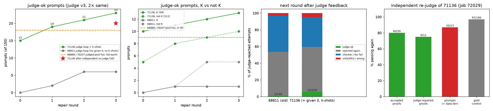

| | 68811 old judge loop | 68889 / 70227 post-hoc judge | 71136 judge loop + `given 0` + k-shots |
|---|---|---|---|
| judge-ok prompts by round 0/1/2/3 | 0/2/6/6 | – / 18 / 18 | 15/19/21/**23** |
| judge-ok K prompts (of 39) by round | 0/1/1/1 | 9 / 9 | 10/11/12/13 |
| judge-ok not-K prompts (of 111) by round | 0/1/5/5 | 9 / 9 | 5/8/9/10 |
| judge-ok prompts math / dapo / yesno | 3 / 1 / 2 | 5/3/10 ; 4/3/11 | 5 / 3 / 15 |
| next round after a judge rejection: judge-ok / rejected again / checker+lex fail / unfaithful+wrong | 1 / 58 / 48 / 3 (of 110) | – | 12 / 113 / 75 / 10 (of 210) |
| attempts rejected by the judge, rounds 0/1/2/3 | – | – | 68 / 70 / 72 / 66 |
| **independent re-judge (72029)**: proofs / prompts (+ data tier) / judge-repaired proofs | – | – | 40 of 50 / **20 of 23** / 9 of 12 |

- **The gain survives the re-judge control, but it is small.** 40 of 50 accepted proofs pass again; gold control 97 of 100 (earlier judges 95, 93). 20 of the 23 judge-ok prompts keep at least one proof that passes the re-judge and the data tier.
  - Lost: dolci_dapo/77782, dolci_yesno/142501 (re-judge says different), dolci_yesno/129540 (its only proof is flagged non-substantive).
  - Robust prompts: yesno 13 / math 5 / dapo 2; K 12 / not K 8.
  - Compared with post-hoc judging (18 prompts in each of 68889 and 70227, union 23): 17 of the 20 robust prompts are in that union. New: dolci_yesno/139174, 144451, 160487. So most of the judge loop's set is the same easy core, plus a few extra yes/no prompts.
- **Judge-feedback repair now does something.** 12 of 210 judge-rejected attempts are judge-ok in the next round (5.7 %, vs 1 of 110 = 0.9 % in 68811), and 9 of the 12 pass the independent re-judge. These repairs are mostly faithful, unlike the data-repair repairs (1 of 14 judged same, 18:55 block): here the feedback targets the judge, not a syntactic filter. Still, 54 % of rejected attempts are rejected again and 36 % fail the checker or the lexer; repair is the minority path. Most of the gain comes from round 0: 15 prompts are judge-ok before any judge feedback, which matches the k-shots baseline.
- **Cost:** 6039 s wall time, 2301 calls, 10.6 M generated / 72 M prompt tokens on TP 4 L40. For comparison: 68889 took 6610 s / 2060 calls / 9.4 M generated tokens, and 70227 took 5708 s / 2066 calls / 9.5 M. Formalizer records sum to 9.9 M generated tokens, so about 0.65 M of the 10.6 M are in-loop judge tokens; `calls` counts formalizer calls only. The formalizer itself generates about 5 % more than in 68889 (it gets more repair turns), and the total is about 12 % more, for 20 robust prompts vs 18. The judge loop mainly turns otherwise-wasted rejected rounds into a few extra prompts.
- Caveats:
  - One run per arm; vLLM batch drift.
  - 18 vs 20 robust prompts is within run-to-run variation: the overlap of the two post-hoc runs was only 13 of 18.
  - In-loop judging needs a matching post-hoc control: the in-loop 23 overstates by 3 prompts (13 %).
- Next levers:
  - (a) Use `--judge-samples 2` for data generation with a post-hoc re-judge. It gives the most robust prompts so far at the same cost, and the repair turn is now faithful.
  - (b) For a real yield change, scale up (more prompts and attempts) rather than add further repair signals. Per-prompt yield is near 13–15 % on this sample, and most failures are checker / lexer / unfaithful before the judge is even reached (stage counts per round: check ≈ 250–300, lex ≈ 100, unfaithful 74–95, of 600 attempts).
  - (c) Single-bridge reward down-weighting and its ablation: unchanged and pending.

**Update 2026-10-16 18:55: Making the naming examples the default reproduces their effect. Data-repair feedback lifts the data tier from 55 to 61 prompts, but judged yield stays at 18 prompts: 13 of the 14 repaired copy_goal proofs fail the judge. The repairs pass the substantive check by turning the statement into a different, weaker question.**

Setup: pilot job 70227 (`formalize/gpt-oss-120b_kdef_drepair_dolci/`) on the same 150 prompts and the same hardware as 68889 (gruenau12, L40, TP 4).
- `--k-shots` is now the default.
- New `--data-repair` flag: an attempt that checks and is right, but fails `check.substantive` (copy_goal / answer_given / unlinked_goal), gets stage `trivial` instead of `ok`. It receives a repair message ("the statement gives the answer away: …; rewrite it so that the given lines transcribe only the problem's facts and the goal its question") in the next round.
- Judge 71041: v3, 2 samples. K = the 39 prompts tagged nl_judgment/world_knowledge in the given-0 tags, the same set as in the 14:15 block.

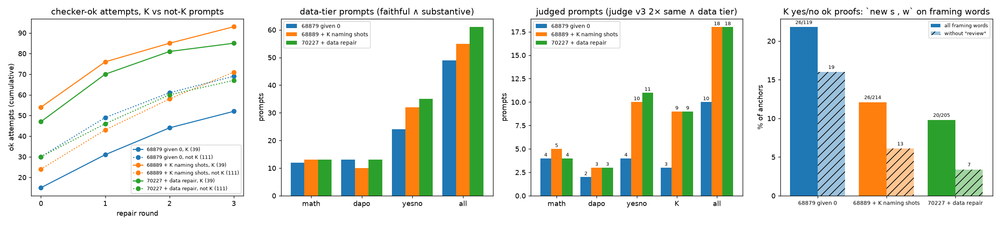

| | 68879 `given 0` | 68889 + K naming shots | 70227 k-shots default + data repair |
|---|---|---|---|
| ok attempts by round, K prompts (39) | 15/31/44/52 | 54/76/85/93 | 47/70/81/85 (+9 trivial in round 0) |
| ok attempts by round, not K (111) | 30/49/61/69 | 24/43/58/71 | 30/46/60/67 |
| data-tier prompts math / dapo / yesno / all | 12 / 13 / 24 / 49 | 13 / 10 / 32 / 55 | 13 / 13 / 35 / **61** |
| proofs "same" in both judge samples | 21 of 121 (17 %) | 28 of 164 (17 %) | 35 of 152 (23 %) |
| judged prompts math / dapo / yesno / K / all | 4 / 2 / 4 / 3 / 10 | 5 / 3 / 10 / 9 / 18 | 4 / 3 / 11 / 9 / **18** |
| K yes/no anchors on framing words (without "review") | 26/119 (19) | 26/214 (13) | 20/205 (**7**) |
| judge issues: different_question / missing_fact / presolved / extra_fact | 113 / 15 / 44 / 9 | 152 / 40 / 34 / 24 | 135 / 32 / 27 / 13 |

- **The naming-examples effect replicates.** On K prompts, round-0 ok attempts are 54 (68889) and 47 ok + 9 trivial = 56 (70227); 68879 had 15. Judged K prompts are 9 of 39 in both runs. The framing-anchor share falls further, to 3.4 % without "review" (6.1 % before). Raw ok counts in 70227 are slightly lower (85 vs 93 cumulative on K), because trivial proofs no longer count as ok. Proofs that 68889 accepted and the data tier later removed are now held back for repair.
- **What data repair does.** 35 attempts on 20 prompts were marked trivial: 36 copy_goal, 5 answer_given and 4 unlinked_goal flags. 14 of these attempts turned ok in a later round (13 on K prompts); 5 were marked in the last round and had no repair turn. Hence the data tier grows from 55 to 61 prompts (yes/no 32 → 35, dapo 10 → 13).
- **But only 1 of the 14 repaired proofs is judged "same"** (dolci_yesno/121796). The other 13 are `different_question` / `missing_fact` / `extra_fact`. The model meets the "don't give the answer away" constraint by changing the question, not by transcribing it. Example, dolci_yesno/153737 (premise "Two friends get caught up over a beer in a local restaurant", hypothesis "Two friends are in a restaurant", gold yes): the repaired statement names "restaurant" both as an entity c1 and as a predicate p2 and asks `given local(c1) ⊢ ? restaurant(c1)`. The friends and the "in" relation are gone. In dolci_yesno/141028 the repaired goal asks "is endothelin-1 *reported* pancreatitis" instead of "is it an aggravating factor". The substantive check is syntactic (does a given state the goal?), so a repair message keyed to it can be met by a weaker or different goal. Only the back-translation judge sees this.
- **Judged yield therefore stays flat (18 → 18 prompts).** The judged sets overlap in 13 prompts; the union of 68889 and 70227 is 23, and with 68879 it is 25. Most of the 18 → 18 equality is sampling variation between runs, not the same prompts being solved.
- **Lesson** (same pattern as the old-line reward hacks): a repair signal from a cheap syntactic filter teaches the model to evade that filter. `check.substantive` remains useful as a filter on accepted data, but repair feedback and any reward must be gated by the judge, not by the filter.
- Caveats: a single run per arm; vLLM batch drift; judge v3 with 2 samples is noisy at this scale (18 prompts).
- Next levers:
  - (a) Re-test judge-in-the-loop repair (`--judge-samples 2`) on top of `given 0` + naming examples. It already exists and gave no gain at 04:50 (job 68811: 1 of 110 judge-rejected attempts repaired; 6 vs 7 judged prompts). But that run was before `given 0` and the naming examples, when K prompts (a quarter of the sample) could not be stated faithfully at all. The prior is weak; it is worth one pilot because the judge, not the filter, is the right repair target.
  - (b) Keep `--data-repair` off by default: on its own it adds checker-ok but unfaithful data.
  - (c) The single-bridge reward down-weighting and its ablation (14:15 block) are unchanged.

**Update 2026-10-16 14:15: Few-shot examples that name predicates after content words (`--k-shots`) almost double judged yield. Judged prompts go from 10 to 18, and on the 39 K prompts from 3 to 9. Of the attempts that use `given 0`, 10 of 70 (8 prompts) are now "same" in both judge samples, against 1 of 31 before. Framing-word anchors in K yes/no proofs fall from 22 % to 12 %.**

Setup: pilot job 68889 (`formalize/gpt-oss-120b_kshots_dolci/`). Same 150 prompts and settings as the `given 0` pilot 68879 (11:15 block), with one change. On K-tagged prompts only, the system prompt adds three worked yes/no examples (dolci_yesno/161374, 140154, 125083; all in `SHOT_IDS`, so they never appear as eval rows) plus a short naming rule (`K_NAMING`). The rule says to bind each symbol to the content word of the premise or hypothesis, never to a framing word (Test, Question, Premise, Hypothesis, Based, Review, Options, Answer). Non-K prompts get the same system prompt as before. Code: `tl/formalize.py` `K_EXAMPLES` / `K_NAMING` / `--k-shots`, tested in `tl/tests/test_given0.py::test_k_examples`; Slurm `KSHOTS=1`. Post-hoc judge v3 job 68890 (2 samples). Comparison: `formalize/kshots_compare.json`, `formalize/kshots_anchors.json`. Figure data: `figures/tl_kshots_dolci.json`.

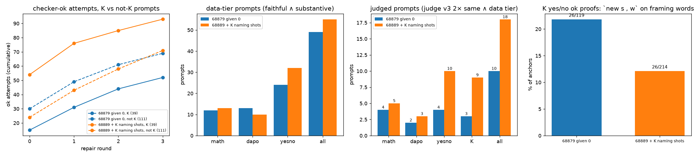

| | 68879 `given 0` | 68889 + K naming shots |
|---|---|---|
| ok attempts by round, K prompts (39) | 15/31/44/52 | 54/76/85/93 |
| ok attempts by round, not K (111) | 30/49/61/69 | 24/43/58/71 |
| prompts with ≥ 1 ok attempt | 59 | 63 |
| data-tier prompts math / dapo / yesno / all | 12 / 13 / 24 / 49 | 13 / 10 / 32 / 55 |
| judged prompts math / dapo / yesno / all | 4 / 2 / 4 / 10 | 5 / 3 / 10 / **18** |
| judged prompts, K / not K | 3 / 7 | **9** / 9 |
| proofs judged / "same" in both samples | 121 / 21 | 164 / 28 |
| `given 0` users judged / "same" in both (prompts) | 31 / 1 (1) | 70 / 10 (8) |
| `given 0` users flagged different_question / missing_fact | 22 / 10 | 37 / 27 |
| framing-word anchors in K yes/no ok proofs | 26 / 119 = 21.8 % | 26 / 214 = 12.1 % |

- **Checker level.** On K prompts, round-0 ok attempts go from 15 to 54 and the final count from 52 to 93. The examples show the model a complete K proof, not just the rules. Non-K prompts are within noise (69 vs 71); see the confounds below.
- **Data tier.** Yes/no rises from 24 to 32 prompts. The main remaining yes/no loss is copy_goal (23 attempts), where the hypothesis is also stated as a `given`. In dapo, 3 attempts are rejected as unlinked_goal and 1 as answer_given; in math, 1 as answer_given.
- **Judge level.** Most of the gain is on yes/no: 4 → 10 judged prompts, 9 of the 18 on K. different_question is still the most common judge issue (152 flags over 164 proofs, against 113 over 121), but it is now less concentrated on `given 0` proofs. missing_fact rises (15 → 40) because there are more `given 0` proofs, and the judge sees the statement without the background line.
- **Naming.** Framing-word anchors halve in share. Their absolute count is unchanged (26), but they are now spread over 214 anchors. "review" is still the most frequent framing anchor (13). The 13 come from five product-review sentiment prompts (155522, 133448, 144451, 122593, 166115; "Is this product review positive?" / "would the user recommend this product?"). There the review is the entity being judged, so `positive(review)` is a sensible formalization, not a framing failure. Three of the five (122593, 133448, 166115) are among the judge-accepted `given 0` prompts. Without "review" in the framing set, the shares are 19 / 119 = 16.0 % (68879) and 13 / 214 = 6.1 % (68889). Lever (c) below is therefore dropped.
- **What the accepted `given 0` proofs say.** All 10 are accepted for 8 prompts: 122593, 133216, 133448, 136845, 138901, 152598, 152694, 166115. Most are a single bridge `∀x. p1(x) → p2(x)` (or `→ ¬p2`) from the premise predicate to the goal predicate. In those, the bridge is the entailment judgment, as the 11:15 caveat said. Example, dolci_yesno/138901 ("Skier in red …" ⇒ "The skier is in blue."?, gold no): `p1` = red, `p2` = blue, `given 0 : ∀x. p1(x) → ¬p2(x)`, answer ⊥. Two (136845, 152694) are more substantive and use relational structure. Example, 136845 ("People walk on a city street near lined parking spaces." ⇒ "The people are walking near the parking area."): `p1` = walk (on), `p2` = near, givens `p1(people, street)` and `p2(street, spaces)`, and `given 0 : ∀x y z. p1(x,y) ∧ p2(y,z) → p2(x,z)`, so ∧I, ∀E and →E give `p2(people, spaces)`, answer ⊤.
- **Confounds.** (1) Hardware: 68889 ran on L40 with TP4 (gruenau12; the H100s were busy), while 68879 ran on H100 with TP2. The MXFP4 kernels differ, so the generations do too. (2) vLLM batch drift: non-K prompts are not a clean control. Their numbers (69 vs 71 ok attempts) are consistent with no effect; I did not test this. The K-prompt effect is large (round 0: 15 → 54; judged K prompts: 3 → 9), but it is one run per arm.
- **Takeaway.** Naming was the bottleneck on K prompts, and three worked examples move it a lot. Next levers: (a) make `--k-shots` the default for K prompts; (b) address copy_goal on yes/no, with a front-end message or a shot that keeps the hypothesis as the goal only; (c) dropped (see Naming); (d) decide whether single-bridge K proofs (premise predicate → goal predicate) should get full reward or be down-weighted against relational ones. Per TLANG §12 K, the reward stays correct × valid, and the bridge is unchecked by design.

**Update 2026-10-16 11:15: Package K (`given 0 : φ` background knowledge) gives many more checker-ok yes/no proofs, but judged yield barely moves. On the 39 K prompts, judged prompts go from 1 to 3, and only one of those comes from a proof that uses `given 0`. The bottleneck on yes/no is now faithful naming, not the language.**

Setup: K pilot job 68879 (`formalize/gpt-oss-120b_given0_dolci/`). Same 150 Dolci prompts, settings and lenient-in-loop front-end as 68861; the only change is that `given 0 : φ` is licensed on the 39 K-tagged prompts (census constructs nl_judgment / world_knowledge, all of them yes/no). Post-hoc judge v3 job 68887 (2 samples, 95 s, 0.05 GPU-h). Comparison: `formalize/given0_compare.json`. Figure data: `figures/tl_given0_dolci.json`.

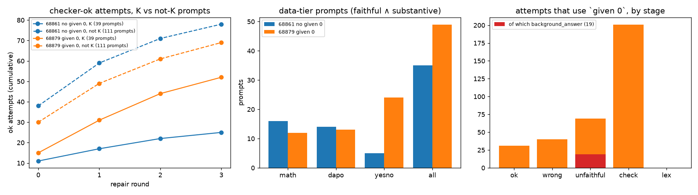

| | 68861 no `given 0` | 68879 `given 0` |
|---|---|---|
| ok attempts by round, K prompts (39) | 11/17/22/25 | 15/31/44/52 |
| ok prompts, K | 18 | 26 |
| ok attempts by round, not K (111) | 38/59/71/78 | 30/49/61/69 |
| data-tier prompts math / dapo / yesno / all | 16 / 14 / 5 / 35 | 12 / 13 / 24 / 49 |
| judged prompts dapo / math / yesno / all | 1 / 6 / 2 / 9 | 2 / 4 / 4 / 10 |
| judged prompts, K / not K | 1 / 8 | 3 / 7 |
| judged proofs (all samples same ∧ data tier) | 22 of 103 | 21 of 121 |

- **Checker level.** `given 0` roughly doubles ok attempts on K prompts (25 → 52). 31 of the 121 ok attempts (18 prompts) use it. Bridge shapes: ∀-form 21, propositional p→q 8, other 3; answers ⊤ 26, ⊥ 5. Most `given 0` attempts still fail: check 201, unfaithful 69 (19 of them `background_answer`), wrong 40. The check failures are ordinary proof errors (=E, →E conclusion, `new` index), not misuse of `given 0`.
- **Data tier.** yes/no rises from 5 to 24 prompts. The remaining yes/no losses are copy_goal (22).
- **Judge level.** The judge rejects most `given 0` proofs: of 31, 22 get `different_question` from at least one sample, 10 get `missing_fact`, and only one (dolci_yesno/133216) is "same" in both samples. Typical failure: the formalizer anchors predicates on arbitrary prompt words ("Question", "Title", "Based"), so the stated problem `given 2 : p1(c1); goal ? p2(c1)` has no recoverable meaning. Its whole content is the unchecked bridge `∀x. p1(x) → p2(x)`. The checker cannot see this; the judge can, which is what it is for.
- **Caveat on what an accepted K proof means.** In a K proof the background line carries the entailment judgment: the bridge is unchecked world knowledge by design, and the judge sees the statement without it. An accepted K proof shows a well-formed, judge-faithful statement plus a correct answer (gold), not that the inference is sound. Example that one of the two judge samples calls "same" (the other says missing_fact, so it is not accepted): dolci_yesno/152598, `given 1 : p1; given 0 : ¬p2; goal ? p1 → p2`. The background line just asserts the hypothesis is false, and `background_answer` does not fire because the goal is p1 → p2, not p2. A stricter rule (the background line must not mention only goal symbols) is a candidate.
- **Corrections to the 09:45 block.** (1) The non-K prompts do not isolate the front-end effect: vLLM generations depend on the batch composition, and only 11 of 444 non-K finals were identical between 68861 and 68879. Non-K differences between those runs (78 vs 69 ok attempts) are sampling variance; I did not test them. (2) The "watch item: `given 0` use on wordprob prompts" does not apply: this pilot has no wordprob prompts, and all 39 K prompts are yes/no.
- **Takeaway.** Package K removes the expressivity block on NLI-style yes/no prompts: checker-ok and data tier move a lot. Judged yield does not, because the yes/no formalizations are mostly not faithful. Next levers: copy_goal and naming on yes/no (shots that name predicates after the hypothesis/premise content words), a stricter `background_answer`, and a K pilot that includes wordprob K prompts.

**Update 2026-10-16 09:45: (1) Running the lenient front-end inside the repair loop adds nothing beyond rescoring afterwards. The in-loop run gets 103/600 checker-ok attempts, 35 data-tier prompts and 9 judged prompts; the offline lenient rescore of 68836 gets 105, 36 and 10. (2) Package K is now implemented as background knowledge `given 0 : φ`, and a K pilot is running.**

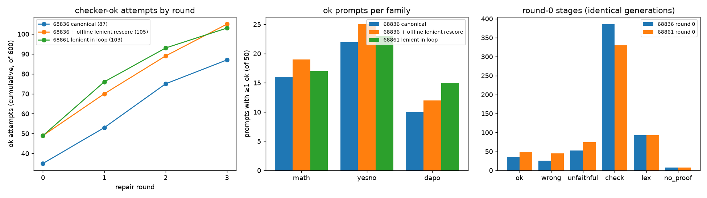

* **Lenient-in-loop setup.**
  - Job 68861 on gruenau11 (TP 2), gpt-oss-120b, `--kb tags`, `--shots dolci`.
  - It used the same 150 prompts and 4 attempts × 4 rounds as 68836 (few-shots).
  - The only difference: `formalize.judge` normalizes spelling before the checker, so the repair turns see the checker's errors on the respelled proof.
  - Judge v3 ran post hoc as job 68877.
  - Run stats: wall 4,977 s, 10.3M generated tokens, 1.3 % truncated, 37 % of records had at least one respelled line.
* **Result** (68836 + offline rescore → 68861 in loop):

  | | ok attempts by round 0/1/2/3 | ok prompts | data-tier prompts | judged prompts (dapo/math/yesno) |
  |---|---|---|---|---|
  | 68836 canonical | 35 / 53 / 75 / 87 | 48 | 28 | 8 (1/5/2) |
  | 68836 + offline lenient rescore | 49 / 70 / 89 / 105 | 56 | 36 | 10 |
  | 68861 lenient in loop | 49 / 76 / 93 / 103 | 55 | 35 | 9 (1/6/2) |

  - Round 0 is identical by construction: the same generations (3,083,620 tokens in both), scored the same way.
  - The repair rounds gain a little earlier in the loop (76 vs 70 after round 1) but end level.
  - Proofs passing the judge: 22/103, against 16/87 canonical.
  - The judge's issues: different_question 93, presolved 46, extra_fact 12, missing_fact 4, wrong_fact 1.
  - **Conclusion:** keep lenient in `formalize.judge` (it is free), but the repair loop's spelling feedback was not the bottleneck.
  - The data tier for yesno stays at 5/23 ok prompts. The cause is `copy_goal` (28 records): NLI proofs restate the hypothesis as a premise, because nothing licenses the world-knowledge bridge.
* **Package K = `given 0 : φ`.** This answers the user's question "isn't this fact the same as just adding another given?": yes, by design. A K bridge is one more given, read from a virtual background sentence 0. The rules:
  - Sentence 0 exists only on K-tagged prompts (census nl_judgment / world_knowledge; 154 of the 2000-prompt census).
  - Its numerals are limited to {0, 1}.
  - The goal must still depend on a real `given s ≥ 1`.
  - New faithfulness reason `background_answer`: a background line must not state the goal claim or its negation. This also covers the claim inside a conjunction or behind a trivial antecedent.
  - The reward stays correct × valid. The judge's back-translation skips `given 0` lines and counts them (`n_background`), so the bridges can be audited separately.
  - TLANG §12 K has the details.
  - Port: real `tl/` backed up to `RLVL-next/backups/2026-10-16_given0/`, 13 suites green, with new tests in `tl/tests/test_given0.py`.
* **K pilot running.** Job 68879 uses the same command as 68861 except the tag. Its non-K prompts get the same system and user turns as before, so it isolates the effect of `given 0` on the K-tagged prompts. Watch item: `given 0` use on wordprob prompts.

**Update 2026-10-16 08:05: two results. (1) Real-Dolci few-shots barely help: 8 judged prompts against 7 for the re-pilot, and 28 data-tier prompts in each run. (2) A lenient front-end that rewrites model TL into canonical spelling before the checker lifts checker-ok prompts by 7–8, data-tier prompts by 6–8 (28 → 34 / 36) and judged prompts by 2 in each run (7 → 9, 8 → 10). Spelling, not content, was the largest single cause of failed attempts.**

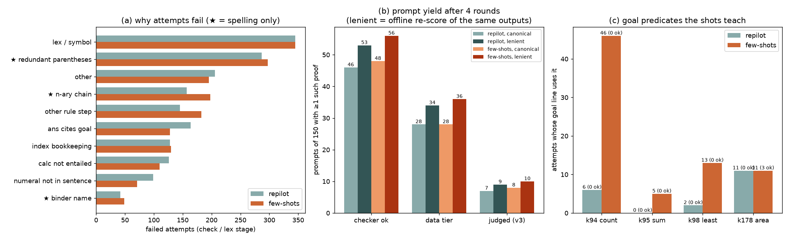

* **Few-shots setup.**
  - Formalize job 68836 on gruenau11 (TP 2), gpt-oss-120b, `--kb tags`, `--shots dolci`, no judge in the loop.
  - It used the same 150 prompts and the same 4 attempts × 4 rounds as the re-pilot.
  - The shots are 5 hand-written real-Dolci math proofs (`DOLCI_EXAMPLES`), using count k94, sum k95, least k98, k94 over ℝ×ℝ, and polygon area k178.
  - Run stats: wall 4,906 s, 10.1M generated tokens, 1.2 % truncated.
  - Judge v3 ran post hoc as job 68852.
* **Few-shots result.** Judged prompts per family:

  | | dapo | math | yesno | total | in scope | package-K |
  |---|---|---|---|---|---|---|
  | re-pilot | 0 | 4 | 3 | 7 | 5 | 2 / 37 |
  | few-shots | 1 | 5 | 2 | 8 | 7 | 1 / 39 |

  - Proofs passing the judge went from 11/86 to 16/87.
  - The judge's issues for few-shots: different_question 88, presolved 37, extra_fact 10, missing_fact 2.
  - The model does pick up the taught predicates. Goal lines using k94 rose from 6 to 46, k98 from 2 to 13 and k95 from 1 to 5, while k178 stayed at 11. But none of the k94/k95/k98 attempts passed the checker, and only 3 of the 11 k178 attempts did (panel c).
  - Those predicate attempts fail on the grammar: n-ary ∧ chains, redundant parentheses, and binder names or letters other than x<depth+1>.
* **Why attempts fail (panel a).** Over the roughly 1,700 check/lex-stage failures in each run, the three spelling-only categories (★) dominate:

  | category | re-pilot | few-shots |
  |---|---|---|
  | redundant parentheses | 287 | 297 |
  | n-ary chain | 157 | 198 |
  | binder name | 42 | 49 |
  | spelling total | 486 | 544 |
  | lex / symbol | 345 | 345 |
  | ans cites the goal line | 164 | 128 |
  | calc not entailed | 126 | 110 |

  - "Lex / symbol" is mostly stray prose and characters such as `’`, `` ` ``, `A` and `n`.
  - The identical 345 in both runs is a coincidence: 329 lex + 16 check-stage errors vs 317 + 28.
* **Lenient front-end** (`tl/lenient.py`, new). It runs in `formalize.judge` before the checker.
  - **What it changes.** Only lines that fail the canonical parse are re-read, with ordinary precedence:
    - → is right-associative; precedence runs ∨ < ∧ < relations < + − < × ÷, and the rest are left-associative.
    - A relation chain `a ≤ x ≤ b` becomes `(a ≤ x) ∧ (x ≤ b)`.
    - Any parentheses are accepted.
    - Binder names are scoped lexically, so `∀ x : ℝ`, `λ a : ℝ` and `∃ p1 : ℝ` all become x<depth+1>.
    - Juxtaposition `k10 x2` is read as application.
    - × chains in types fold left.
  - **What it leaves alone.** Each re-read line is printed canonically. Canonical lines are untouched, so the checker still sees only canonical TL.
  - **What it rejects.** Unbound variables, `c0`, `c1 = 3 c2`, unclosed parentheses and trailing tokens stay errors, and the line is kept as written.
  - **Tests.** `tl/tests/test_lenient.py`:
    - Fixed points: all 12,396 lines of 1,018 canonical proofs (TL_EVAL targets, all few-shots, WORD_EXAMPLE, DOLCI_EXAMPLES) render back unchanged.
    - 15 respelling cases, 5 rejects, and a judge rescue.
    - test_formalize and test_judge are also green.
  - **Port.** Backup is in `backups/2026-10-16_lenient/`. The judge dict now has a `normalized` count.
* **Lenient re-score of the same outputs** (`S/rescore_lenient.py`, offline, all 2,236 + 2,237 records). Judge v3 on the rescued proofs ran as job 68860.

  | | re-pilot canonical | re-pilot lenient | few-shots canonical | few-shots lenient |
  |---|---|---|---|---|
  | records normalized | | 715 | | 774 |
  | checker-ok proofs | 86 | 132 | 87 | 133 |
  | prompts: checker ok | 46 | 53 | 48 | 56 |
  | prompts: data tier | 28 | 34 | 28 | 36 |
  | prompts: judged | 7 | 9 | 8 | 10 |
  | rescued proofs passing the judge | | 22 / 46 | | 25 / 46 |

  - **Transitions of the normalized check failures.**
    - Re-pilot: 46 → ok, 47 → unfaithful, 35 → wrong.
    - Few-shots: 46 → ok, 59 → unfaithful, 68 → wrong.
    - No proof that was ok canonically lost its status.
    - The new "wrong" outcomes are genuine formalization errors (hand-checked), not precedence artefacts.
  - **Newly judged prompts.**
    - Re-pilot: dapo/78346 (⌊1/Σ_{x=2022}^{2064} 1/x⌋ = 47) and yesno/141205 (a three-witness ∃ intro proof, ⊤).
    - Few-shots: dapo/78346 and math/26372 (prime divisors of 42098 = 2·7·31·97; answer 31).
    - All agree with gold. In each, normalization only re-spelled ∧ chains, parentheses or binder names.
  - **Remaining judge issues on the rescued proofs.**
    - Re-pilot: different_question 30, extra_fact 10, presolved 8.
    - Few-shots: different_question 20, presolved 9, extra_fact 5, wrong_fact 2, missing_fact 1.
  - **Errors after lenient.** The spelling categories fall to 44 / 50, and the rest is content:
    - other rule steps: 306 / 361
    - ans cites the goal line: 225 / 186. These come from degenerate presolved proofs and are deliberately not repaired.
    - calc not entailed: 216 / 184
    - index bookkeeping: 150 / 151
* **Take-aways.**
  - The checker's grammar was costing more than the vocabulary. One deterministic front-end recovers +53 % checker-ok proofs and +6–8 data-tier prompts at zero model cost.
  - Few-shots change *which* predicates the model reaches for, but on their own they don't raise the yield.
  - The judged yield is still small (≤ 10/150), because unfaithful statements (different question, presolved) remain the main loss once spelling is fixed.
  - The lenient re-score is offline. In the loop, repair rounds now see content errors instead of spelling errors, which may help further. The next pilot (lenient + dolci shots, same 150 prompts) measures that.

**Update 2026-10-16 04:50: judge-in-the-loop repair gives no gain. With the judge's verdict fed back as a repair turn, the faithful yield on the same 150 prompts is 6 (4.0 %), against 7 (4.7 %) for the re-pilot judged after the fact. On audit, the judge's rejections are correct. The bottleneck is the formalizer: it does not write faithful statements, and a quarter of the sample is outside TL's scope.**

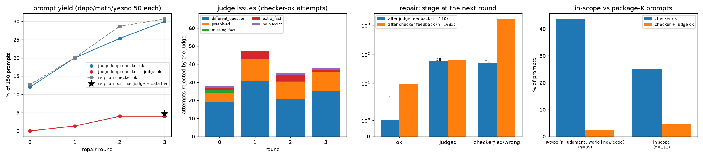

* **Setup.**
  - Formalize job 68811 on gruenau11 (2×H100 NVL, TP 2), gpt-oss-120b, `--kb tags`, `--judge-samples 2`.
  - Prompts and budget: the same 150 prompts and 4 attempts × 4 rounds as the re-pilot.
  - Each checker-ok proof is judged in the job by back-translation judge v3: 2 samples, and it passes only when both say "same".
  - A rejected proof gets its next repair turn from the judge. The turn shows the back-translation and the issue, and asks for a statement that transcribes the problem's facts and question.
  - Code: `tl/formalize.py` gained `judge_feedback`; `tl/judge.py` gained `prepare` / `chains`. Both have tests; backups are in `backups/2026-10-16_judge_in_loop/`.
  - Wall time 5,086 s. 10.7M generated tokens, including the judge's. 0.7 % of outputs truncated.
* **Yield.** % of 150 prompts, by round 0 / 1 / 2 / 3:

  | | r0 | r1 | r2 | r3 |
  |---|---|---|---|---|
  | judge loop: checker ok | 12.0 | 20.0 | 25.3 | 30.0 |
  | judge loop: checker + judge ok | 0 | 1.3 | 4.0 | **4.0** |
  | re-pilot: checker ok | 12.7 | 20.0 | 28.7 | 30.7 |
  | re-pilot: post-hoc judge + data tier | | | | **4.7** |

  - The 6 judge-ok prompts are dapo 1, math 3 and yesno 2. All 6 also pass the data tier (`S/refilter.py`).
  - Only 11 of 600 attempts (1.8 %) end judge-ok.
* **Judge feedback does not repair.**
  - Of the 110 judge-rejected attempts that got another round, the next round ended as:
    - judge-ok again: **1**;
    - judge-rejected again: 58;
    - checker, lex or wrong-answer failure: 51.
  - Checker feedback converts at about the same low rate: 10 of 1,682 checker failures became ok.
  - The rejection mix is stable over rounds. Over all rounds, of 148 rejections: different_question 96 (65 %), presolved 37, extra_fact 9, missing_fact 3, no verdict 3.
  - When told its statement asks a different question, the model rewrites the surface. It does not restructure the formalization.
* **Hand audit of the judge.**
  - **Rejections: 12 sampled (`S/judged_audit.txt`), all correct.** Typical failures:
    - trivial restatements (`given p1(c1)`, goal `? p1(c1)`);
    - planted answers;
    - arithmetic unrelated to the question;
    - forced formalizations of natural-language judgment tasks (sentiment, research abstracts, "does the sentence make sense").
  - **Accepted: all 11 attempts on the 6 prompts.**
    - Faithful (3): matrix rank via k245 (math/21339), percent increase/decrease via k90 (math/50489), list membership via k44 (yesno/121796).
    - Marginal (1): an NLI existence claim with one opaque predicate (yesno/139174).
    - Borderline presolved (2): the toothpick grid, where the def holds the counting formula (dapo/80558), and the crates, where defs and goal give the packing solution formula (math/74973).
  - So the judge's precision is about 3–4 of 6. It is not too strict; if anything it is lenient on formula-carrying definitions.
* **Scope.**
  - By the run's own construct tags, 39 of the 150 prompts are package-K (nl_judgment / world_knowledge). That is 39 of the 50 yesno prompts.
  - Of these 39, 17 got a checker-ok proof (44 %), and 1 passed the judge, the marginal NLI case.
  - On the 111 in-scope prompts: checker ok 25 %, judge ok 4.5 %.
  - The yesno family's high checker yield is therefore mostly unfaithful proofs of out-of-scope prompts.
* **Conclusion.**
  - On these 150 prompts, neither more vocabulary (re-pilot, 02:12 block) nor judge feedback (this run) moves faithful yield off ~4–5 %.
  - The binding constraint is the formalizer's habit of answering instead of transcribing: different_question plus presolved is 90 % of rejections.
  - The next lever is the prompt. Proposal: per-family worked few-shots whose statement lines transcribe the problem and leave the answer to be derived, and in-scope families only.
  - Package K (unchecked `fact` tier, judge model, or leave out) is still the user's decision.
* **Cost.** 0.019 GPU-h per prompt on 2×H100. The projection to the full train set is 862 GPU-h at ~4 % yield, so it does not pay at this yield.
* Data: `rlvl_data/tl/formalize/gpt-oss-120b_judgeloop_kbtags/` (records, summary, refilter). Figure data: `figures/tl_judgeloop_kbtags.json`.

**Update 2026-10-16 02:12: the re-pilot with KB v3 and the filtered KB is done (TLANG §12 order item 5). Faithful yield on the same 150 prompts rose from 3 to 7 (math 2 → 4, yesno 1 → 3, dapo 0 → 0). That is still 4.7 %. The bottleneck is not missing vocabulary: only 5 of the 86 checked proofs use any KB v3 symbol. Most checked proofs state a different or presolved question.**

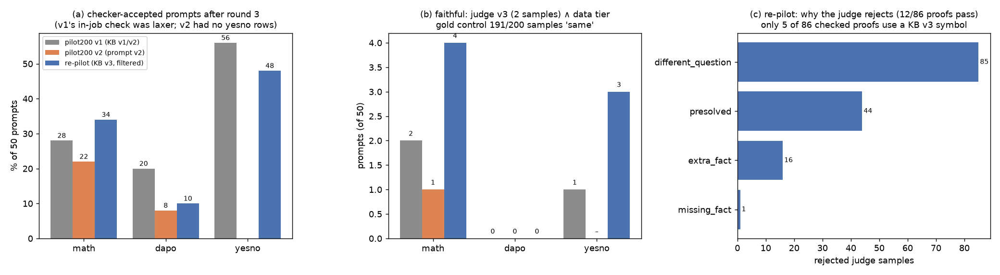

* **Runs.**
  - Formalize job 68802 on gruenau12 (4×L40, TP 4), gpt-oss-120b, `--kb tags`, `--max-model-len 131072`.
  - Prompts: 150 Dolci-TL train prompts, 50 each of math, dapo and yesno, the same rows as pilot200.
  - Attempts: 4 per prompt, over 4 rounds (round 0 plus 3 checker-repair rounds).
  - The prompts used 22 package sets; 1 row was untagged and got the whole KB.
  - Wall time 6,145 s. 9.56M generated tokens, 64.7M prompt tokens, 0.9 % of outputs truncated.
  - Judge job 68806, back-translation judge v3: 2 samples per proof, a proof passes when both say "same". It judged the 86 checked proofs plus 100 gold controls.
* **Checker yield.** These are prompts with a proof that is valid, faithful (in-job strict check) and has the correct answer, as a % of 50 after round 3.

  | | math | dapo | yesno |
  |---|---|---|---|
  | pilot200 v1 (KB v1/v2) | 28 | 20 | 56 |
  | pilot200 v2 (prompt v2) | 22 | 8 | — |
  | re-pilot (KB v3, filtered) | **34** | 10 | 48 |

  - By round, the re-pilot reached 12.7 / 20.0 / 28.7 / 30.7 % of all 150 prompts.
  - v1's in-job check was laxer than today's, so its dapo and yesno numbers are not comparable.
* **Faithful yield.** A prompt counts when one of its proofs is in the data tier (`check.substantive`) and passes judge v3.

  | | math | dapo | yesno | all |
  |---|---|---|---|---|
  | pilot200 v1 | 2 | 0 | 1 | 3 |
  | pilot200 v2 | 1 | 0 | — | 1 |
  | re-pilot | **4** | 0 | **3** | **7 / 150** |

  - The gold control passed 191 of 200 judge samples (95.5 %), in line with the earlier 5/100 gold false rejects.
  - In the re-pilot, 12 of the 86 checked proofs pass judge v3.
  - The data-tier filter removes most yesno proofs: `copy_goal` fired 33 times, because the claim is restated as a premise.
* **The new packages are barely used.**
  - Only 5 of the 86 checked proofs use a KB v3 symbol (k ≥ 94): k245 four times and k228 once.
  - Only one of those prompts is faithful: dolci_math/21339, the rank of a 5×5 matrix (package F). That problem could not be stated with KB v1/v2.
  - The other, dolci_math/20030 (the 10th smallest 5-digit integer whose digit sum is divisible by 3), was turned into "the 3rd term of an arithmetic progression".
* **Why the judge rejects.** Out of 146 rejected samples:
  - different_question: 85;
  - presolved: 44;
  - extra_fact: 16;
  - missing_fact: 1.

  Typical checked-but-unfaithful proofs:
  - "what is 2011 − 1" for a warehouse transport problem;
  - "the value of the first '2'" for a letters-into-boxes count;
  - yesno items that assert the claim and then ask whether it holds.

  The formalizer satisfies the checker with a trivial statement instead of using the listed packages.
* **Last-round checker errors** are mostly surface errors:
  - redundant parentheses: about 58;
  - a `new` index that is not the next free one: about 36;
  - an `ans` line citing a line that is not a formula: about 44;
  - trailing tokens: 10.
* **Conclusion and next.** Extending TL (items 1–4) made dolci_math/21339 statable and doubled faithful math yield. But on math and dapo the formalizer rarely reaches for the new symbols, and the checker loop rewards trivial restatements. Next candidates, cheapest first:
  - (1) few-shot worked examples that use the selected packages, chosen per package set;
  - (2) judge-in-the-loop repair: feed the judge's "why" back as a repair round, as the checker errors are now;
  - (3) clearer checker messages for the four surface errors above.

  Yesno stays tied to the package K decision, which is with the user.
* **Files.**
  - `rlvl_data/tl/formalize/gpt-oss-120b_repilot_kbtags/`: records, summary, refilter.json, accepted_data_tier.json.
  - `rlvl_data/tl/formalize/judge_gpt-oss-120b_v3_repilot_kbtags/`.
  - `figures/tl_repilot_kbtags.{png,json}`.

**Update 2026-10-16 00:22: the formalize prompt now lists only the KB packages for each problem's domain (TLANG §12 order item 4). The whole KB v3 no longer fits one prompt: its system prompt is 91,810 tokens, more than the pilot's 65,536 context. With the filter, the median census prompt is 25.3k tokens and the largest is 57.2k. The re-pilot (item 5) is running as job 68802.**

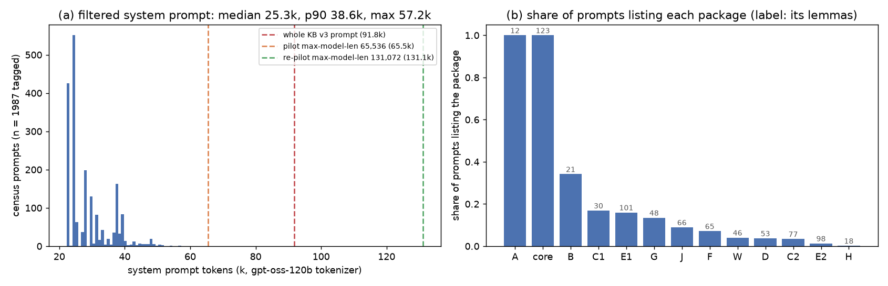

* **Why.** KB v3 has 302 symbols and 758 lemmas. The full listing is 173,200 characters, 81,827 gpt-oss tokens. With the
  few-shots and the instructions, the system prompt is 91,810 tokens. A formalize call with the whole KB would fail at the
  pilot's `--max-model-len 65536` before generating anything.
* **How** (`tl/kbselect.py`, new; `tl/formalize.py`):
  - Each symbol belongs to the package whose number range holds it. The 13 ranges tile k1–k302.
  - Each lemma belongs to the package of the newest symbol it mentions, or core if it mentions none. Lemmas per package:
    core 123, E1 101, E2 98, C2 77, J 66, F 65, D 53, G 48, W 46, C1 30, B 21, H 18, A 12.
  - Every prompt gets core + A. Its census tag (`tl/census.py`: constructs plus the tagger's "missing" list) adds the
    packages it calls for, e.g. statistics → H, units_rates → W, polynomial → D, F, and "determinant" in missing → F.
  - Every shown lemma stays readable: the listing also shows the symbols a listed lemma mentions, with their glosses.
  - `formalize.py` reads the census tags (`--tags`) and tags any remaining rows itself, using the same model and the same
    census prompt. It builds one system prompt per package set, so vLLM's prefix cache is shared within a set, and
    records each attempt's `kb`. The prompt says which packages are listed. `--kb all` restores the whole KB, and rows
    the tagger fails on fall back to it.
* **Size on the 2,000 census prompts** (13 untagged, 73 distinct package sets):

  | package sets per prompt | 2 | 3 | 4 | 5 | 6 | 7 |
  |---|---|---|---|---|---|---|
  | prompts | 426 | 1060 | 403 | 86 | 10 | 2 |

  - System prompt tokens: median 25.3k, p90 38.6k, max 57.2k, against 91.8k for the whole KB.
  - Characters: 3.4× shorter at the median. The old KB v1/v2 pilot prompt was 19.7k tokens.
  - Packages beyond core + A: B 34 %, C1 17 %, E1 16 %, G 13 %, J 9 %, F 7 %, W 4 %, D 4 %, C2 3 %, E2 1.3 %, H 0.2 %.
* **Tests** (`tl/tests/test_kbselect.py`, new):
  - the ranges tile the KB;
  - every census construct is mapped;
  - all 274 defining lemmas (gen2 spec records) sit in their symbol's package;
  - the whole-KB listing is unchanged (identical text);
  - every lemma listed under a package set has all its symbols listed;
  - `select` behaves as expected on hand-written tags;
  - the census median is under a third of the whole KB.
  
  `test_formalize` still passes 8/8. Backup: `RLVL-next/backups/tl_pre_kbsel_2026-10-16/`.
* **Re-pilot (item 5), job 68802.**
  - Rows: the same 150 rows as the first pilot (math, dapo and yesno, 50 each, same seed).
  - Settings: `--kb tags`, `--max-model-len 131072` (the untagged fallback and repair rounds need headroom over 65,536),
    4 attempts, 3 repair rounds.
  - Hardware: gruenau12 on 4 L40s. All four gruenau11 H100s were partly in use outside Slurm, and Slurm would have
    assigned a busy one.
  - `formalize.slurm` gained the `MAXLEN`, `KB` and `TAGS` pass-throughs.
  - The comparison against pilot200 v1/v2 yields follows when the job finishes.
* **The back-translation judge (00:55)** had the same problem: it put the whole KB (181k chars) into a 32k context.
  It now lists core + A + the packages of the symbols the statement mentions, e.g. 38k chars for core + A + H, and
  defaults to `--max-model-len 65536`. test_judge has a new check for the filtered prompt.
* **Re-pilot round 0:** 600 calls, 30 ok (5.0 % of attempts; pilot200 v2 round 0: 3.9 %, on a different family mix).
  Stages: lex 87, check 392, unfaithful 61, wrong 27, no_proof 3. The tagger left 1 of 150 rows untagged.

**Update 2026-10-15 23:41: the generator (gen4) now has themes for packages H and W, 65 new themes in all, so every H/W symbol and lemma appears in the training data in all three roles. The checker and the strict guide accept every trace, and the audit finds 0 ambiguous sentences in 15,086. The calendar templates now state the weekday numbering and the day/month/year order (PLAN W2).**

* **Themes** (`tl/gen4.py`, `PACKAGES["HW"]`). Each theme is drawn 20 times in the test:
  - **6 H symbols**: `V:` themes (calc or unfold), 120 traces (63 unfold / 57 calc).
  - **32 W symbols**, of which **22 are unit constants** (k281–k302, arity 0, such as feet per mile). The constants are
    one-step themes ("how many feet are in a mile?"), so their theme weight is 0.1 instead of 0.4. 640 traces
    (297 unfold / 343 calc).
  - **27 H/W lemmas** (kb 732–758): `U:` themes (find or yes/no), 540 traces (291 find / 249 yes/no).
    `test_package_hw.SKIP = ()`, so every lemma has a theme. The argument sampler `instance(kb, rng)` is the one
    that `test_lemma_instances` already checks.
* **Constants in gen2.**
  - `th_v` and `_largs` now build `K(k)` rather than `app(K(k))` when there are no arguments.
  - `Gen2.np` renders a constant from its template.
  - A numeric hint in the template is not said, so k302 reads "an inch", not "an inch (2.54)", which would give the
    answer away.
* **Calendar wording** (`tl/library.py`).
  - k279 `day_number` now reads "the number of days from 1 January of the year 1 to day d of month m of the year y".
  - k280 `weekday_of` now reads "the weekday number (0 = Monday, …, 6 = Sunday) of day d of month m of the year y".
  - The old forms, "the weekday of the date d / m / y", stated neither the numbering nor the field order, so the
    answer was ambiguous.
* **Tests** (scratch tree first, then the real tree):
  - `test_gen4` passes (EXIT 0, 1291 s).
  - **Theme test:** 3620 traces over 181 new themes (F 63, D 53, H/W 65), 6806 distinct sentences, 0 ambiguous.
  - **Mixed sample:** 3000 traces, token median 223 / p95 671 / max 2093. New-theme share 0.39; answers yes 513,
    no 627, find 1860; 327 themes. No F/D/H/W lemma or symbol is missing.
  - **Audit:** 15,086 sentences, 0 ambiguous.
  - `test_gen2` passes (EXIT 0, 1113 s) and gen2's sampling is unchanged. `test_library` passes (66 s), and so does
    `test_package_hw` (7 s, 16 wrong rules refuted).
  - After the port, `diff -rq` shows the real `tl` identical to the scratch tree.
* **Figure** `figures/tl_gen4_hw.png`:
  - (a) proof and question modes for each package;
  - (b) token lengths, new themes (median 275) against the mixed sample (median 223);
  - (c) where the mixed sample comes from: gen2 1832, F 447, D 342, H 71, W 140, H/W lemmas 168.

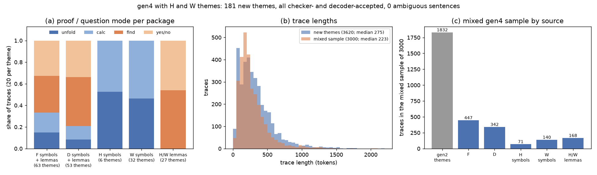

* **Backup** made before the port: `backups/tl_pre_hwgen_20261015_2345/`.
* **Still open:**
  - package K: waiting for the user to choose (a) an unchecked `fact` tier, (b) a judge model, or (c) leaving the
    480 world-knowledge prompts outside TL;
  - the domain-filtered KB list (TLANG order, item 4);
  - the re-pilot (item 5).

**Update 2026-10-15 22:16: calc lines may now be 256 tokens long (the old cap was 96, with 90 in the generator), and `calc` understands cited definitions, conjunctions, implications and product hints. The new KB v3 packages H (statistics) and W (word-problem relations, calendar, units) make Dolci question terms 1.6× shorter at the median and up to 18× shorter. 15 of 15 hand-formalised prompts now fit one calc line, against 11 of 15 with the definitions inlined (TLANG §3, §6, §12; PLAN W1).**

* **Why:** the user asked why one calc line was limited to 90 tokens, and asked for whatever further packages TL
  needs to state any kind of reasoning briefly while keeping the vocabulary small. The old cap came from the first
  pilots, where calc lines were short arithmetic. With KB v3, a calc line now states a whole question term (a sum
  over a list, a polynomial remainder, a date difference), and longer questions were cut off by the cap rather than
  by any limit of the logic.
* **Calc front end** (`check.calc_front`, guide and checker share it):
  - the conclusion is capped at **256 tokens** (`CALC_MAX`, generator `CALC_CAP = 250`);
  - numeral runs keep the 12-digit cap only where the value is not forced, so a forced answer of any length still
    fits;
  - cited definitions `n = t` and `∀ x1 … . n(x1 , …) = t` are substituted (chains too; a cycle is refused, and
    contradictory definitions are flagged);
  - cited conjunctions are split, and a conjunction may be the conclusion;
  - a cited `P → Q` gives Q when the other citations entail P;
  - up to 3 hints `@ t` each add 0 ≤ t × t, and with a hint or a nonlinear monomial the first 8 cited inequalities
    are multiplied pairwise (`CALC_PRODUCTS`), so AM–GM-type and squared-difference steps become one line;
  - `tl/tests/test_calc_front.py`, 10/10: definitions, chains and cycles, non-definitions, conjunction and
    implication, nonlinear hints and products, hint lines, check and guide agree on every proof, contradictory
    definitions, numeral caps, conclusion cap.
* **Package H, statistics** (k265–k270): `median` (mean of the two middle values for an even length), `modes`
  (sorted list of the most frequent values), `variance`, `sample_variance`, `stdev`, `range_of`. All are undefined
  on lists that are too short.
* **Package W, word-problem relations, calendar and units** (k271–k302). The planned package I was merged into W.
  - Relations: `increase_by(x , p)`, `decrease_by(x , p)`, `percent_change(a , b)`, `as_percent(a , b)`,
    `share(x , r , i)` (the i-th part of x split in ratio r), `compound(x , p , n)`.
  - Calendar (proleptic Gregorian): `is_leap`, `days_in_month`, `day_number(y , m , d)`, `weekday_of(y , m , d)`
    (0 = Monday). A month past 12 rolls into the next year.
  - Units: 22 definitional numerals with glosses (seconds per minute … feet per mile, cm per inch = 127 ÷ 50). A
    word problem cites them instead of writing bare numbers, and calc substitutes them. This is the only world
    knowledge calc can check.
  - Every symbol is a definition with a fast evaluator; kb 694–731, extra lemmas kb 732–758. Next free: k303,
    kb 759. The vocabulary grows by 38 `k` symbols and no new token type.
* **Tests** (`tl/tests/test_package_hw.py`):
  - 40 exact worked examples and 11 terms that must stay unevaluated;
  - fast evaluators against the unfolded definitions: 555 agree, 45 are refused by the cost cap, **0 disagree**;
  - the calendar agrees with Python's `datetime` on 3000 dates in years 1–2500;
  - the 65 definitions and lemmas on 150 random instances each: **0 counterexamples**;
  - all 16 deliberately wrong rules are refuted;
  - 15 hand-formalised Dolci prompts reproduce their gold.
* **How much shorter** (figure, left): the 15 question terms with H/W symbols against the same terms with every
  H/W definition inlined (A–G only); the two give the same value for all 15.
  - Median 1.6× shorter, at most 18.4× (80536: 234 against 4314 tokens).
  - One prompt (71188) is one token longer with the symbol (36 against 35).
  - Fitting one calc line (right): with H/W, 14 at the old cap 90 and 15 at 256; inlined, 9 and 11.

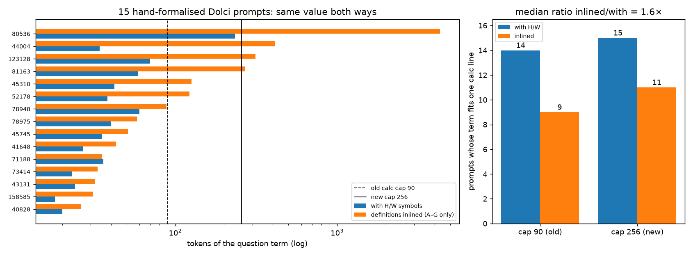

* **Fixes this needed:**
  - **Guide:**
    - calc lines (like ∃I lines) have no `terms` aux, so three guide checks now skip them;
    - `∃I` candidates now include the ∃ subformulas of cited lines. Before this, the guide could not offer some
      ∃I steps the checker accepts.
  - **Hang in the generator theme for `c_poly_eval`:**
    - Cause: test_gen4 hung for about 2 h. At a symbolic point (`c1000`), the 4096-unit cost estimate for a
      degree-7 polynomial let the Horner unfold run, and its nested `c_mul` / `c_add` unfoldings never settle.
    - Fix: `c_poly_eval` now unfolds only at a pair `k16(a , b)`.
    - Its fast path is now exact at every a + b i with a and b² rational: the remainder r1 x + r0 modulo
      x² − 2ax + a² + b² gives (r1 a + r0 , r1 b), where before only constant remainders were exact.
    - Package D afterwards: 541 fast-path results agree with the definition (532 before), 4 are evaluated by the
      definition only (13 before), 0 disagree. 1200 draws of the theme (seeds 0–399) run without a hang.
  - **Test updates:**
    - test_gen2 skips the H/W lemmas and symbols until they have generator themes;
    - test_formalize reads TLANG.md;
    - lines over 120 characters were wrapped.
* **Regression:** all 29 suites pass on the real tree (28 + the newly ported test_gen4; test_gen2 1045 s, test_gen4 1082 s). Before the port the scratch tree passed all 28.
  - test_gen4: 116 new F/D themes × 20 traces; a mixed sample of 3000 traces (30 % new themes); 0 ambiguous sentences in 12,966; every rule and every F/D symbol and lemma covered.
  - Its mixed check no longer asks for gen2's rarest lemmas: they appear 2–7 times in 3000 gen2 traces, and with 30 % of the draws on new themes, two runs missed different ones (kb 82/83/90/94/102, then kb 114). test_gen2 still covers them.
* **Still open:**
  - **K** (natural-language judgments: NLI, sentiment, factual claims) needs the user's decision: an unchecked
    `fact` tier, a judge model, or leaving the 480 prompts outside the checked TL line.
  - Then generator themes for F, D, H and W, a domain-filtered KB list, and re-piloting.

**Update 2026-10-15 18:23: KB v3 package D (polynomial arithmetic and complex roots) is implemented and tested. TL can now state Dolci's polynomial questions directly ("the remainder when … is divided by …", "the coefficient of x⁶ in (3x + 2)⁸", "the product of f(r) over the roots of g", "the sum of the real parts of the roots"), and `calc` evaluates them exactly. It reproduces the gold answer on 648 of the 670 Dolci train prompts that ask for the second largest root of a polynomial (one template), and on all 29 hand-formalised prompts of other kinds (TLANG §12, PLAN W1).**

* **Why:** after F, TL had polynomial values and exact real roots but no polynomial arithmetic, so a question
  such as "the remainder of x⁵ when divided by x² − 2x − 1" could only be stated with the answer planted. Several
  Dolci questions also range over complex roots, which TL had no term for.
* **New symbols** k254–k264, kb 641–651. Next free: k265, kb 694.
  - A polynomial is its coefficient list [ℝ] from the constant term up, as in F.
  - `coef(p , i)`, 0 outside the list or at a non-natural i. `degree` and `leading` are undefined for the zero
    polynomial.
  - `poly_add`, `poly_mul`, `poly_pow(p , n)` for whole n, and `poly_comp(p , q)` = p(q(x)).
  - `poly_quo` and `poly_rem`: long division by a nonzero polynomial. The remainder has exactly degree(divisor)
    coefficients. The planned `poly_divmod` pair became two symbols, so a question can name either part.
  - `c_poly_eval(p , z)`: the value at a complex number (ℝ × ℝ), by Horner's rule with `c_add` / `c_mul`.
  - `roots(p) : [(ℝ × ℝ)]`: the complex roots with multiplicity, sorted by real and then imaginary part.
    - It is the only axiom. The ∀-characterisation says that a sorted list of length degree(p) with
      c_poly_eval(p , z) = leading(p) · Π (z − rᵢ) at every z is roots(p).
    - All other new symbols are definitions.
* **Complex roots, exactly:**
  - The real roots are exact, as in F (numerals and `root_k`).
  - Each non-real pair of a rational quadratic factor becomes (a , ± √s).
  - These factors are read off floating-point roots of each squarefree factor (Durand–Kerner) and rounded to
    rationals. They are accepted only when exact division confirms them and the cofactor has only real roots.
    For example, x⁴ + 5x² + 4 gives ±i and ±2i.
  - **Limitation:** a polynomial with an irreducible factor of degree ≥ 3 that has non-real roots stays
    unevaluated (e.g. x³ − 2 has no exact term for its non-real roots).
    - This affects random integer polynomials: 8/8 have a roots list at degrees 1 and 2, 3/8 at degree 3, and 0/8
      from degree 4 on.
    - It does not affect the structured family (products of rational linear factors and quadratics), which
      gives 100 % at every degree up to 16, with median calc time ≤ 0.03 s (panel 4).
* **Fast evaluators:** exact arithmetic over ℚ.
  - Results with more than 400 coefficients (and powers or compositions of degree ≥ 400) are refused.
  - Panel 3, random integer coefficients:
    - degree-64 products take 0.016 s;
    - cubes of degree-64 polynomials 0.05 s;
    - long division of degree 128 by 64 takes 0.017 s for the quotient and 0.04 s for the remainder;
    - composing two degree-16 polynomials 0.43 s; at degree 32 the composition (degree 1024) is refused.
  - `unfold` evaluates the definitions themselves within the cost cap only for small inputs: products up to
    degree 4, the others up to degree 2 (panel 3, dotted).
  - `c_poly_eval`:
    - It is exact at rational points and at real points (as `poly_eval`).
    - At a + b i with a and b² rational, it is exact when the remainder modulo x² − 2ax + a² + b² is constant,
      which includes every root that `roots` returns.
    - Elsewhere it unfolds Horner's rule only for short polynomials.
    - Before this cost cap, unfolding at a `root_k` point took 34–40 s, because realeval re-examines every
      intermediate term; the fast path now answers in ≤ 0.02 s.
    - A separate probe of 400 random cases found 162 equal to the unfolded definition, 238 refused by the fast
      path (left to the definition), and no mismatch.
* **Lemmas:** EXTRA kb 652–693 (42):
  - coefficients and degree (6): entries inside the list, 0 beyond it, the degree is below the length, the
    leading coefficient is nonzero, coefficients above the degree vanish, the value is the sum of the terms;
  - sums (5): commutative, coefficientwise, the value of a sum, degree ≤ the maximum, = the maximum when the
    degrees differ;
  - products (7): commutative, associative, distributive, the value of a product, degrees add, leading and constant
    coefficients multiply;
  - powers (3): the value, the binomial theorem, the degree;
  - composition (2): the value, degrees multiply;
  - division (6): dividend = divisor · quotient + remainder, the remainder's degree, the remainder theorem, the
    factor theorem, the quotient's degree, dividing by a constant;
  - complex values (3): at a real point, at the conjugate, of a product;
  - roots (8):
    - every listed root is a root;
    - there are degree-many roots (fundamental theorem of algebra);
    - Vieta's sum and product;
    - the imaginary parts cancel;
    - Newton's sum of squares;
    - the real roots are those with imaginary part 0;
    - the conjugate of a root is a root;
  - the quadratic formula (2): a negative discriminant gives non-real roots; otherwise it gives the real roots.
* **Tests** (`tl/tests/test_package_d.py`, 6/6, 41 s):
  - **38 exact worked examples**, e.g.:
    - `roots([1 , 1 , 1])` = [(−1/2 , −√(3/4)) , (−1/2 , √(3/4))];
    - `roots([− 2 , 0 , − 1 , 0 , 1])` = [(−√2 , 0) , −i , i , (√2 , 0)], with √2 as a `root_k` term;
    - `poly_quo(x³ − 1 , x − 1)` = x² + x + 1.
  - **11 terms that must stay unevaluated**, e.g.:
    - the degree of the zero polynomial;
    - division by 0;
    - a negative or fractional power;
    - the roots of x⁴ + x² + 2 and of x³ − 2.
  - **29 Dolci prompts with their gold answers**, formalised by hand:
    - remainders (10);
    - coefficients of products, powers and iterated products (8);
    - complex-root questions (5): sums of real parts of the roots (two), Π f(r) over the roots of g (two), and
      the product of two polynomials' values at a non-real cube root of unity;
    - second-largest-root prompts whose wording the template does not cover (6).
  - Fast evaluators against the unfolded definitions: 532 agree, 55 are refused by the cost cap, 13 are evaluated
    by the definition only, and **none disagree**.
  - `roots` against its characterising axiom on 276 random polynomials (556 roots; 3 polynomials unsupported):
    - the count and order premise is exact ⊤;
    - the product form holds at 4 complex points, 996 times exactly and 108 times in floating point;
    - c_poly_eval = 0 holds **exactly** at all 556 roots.
    - The floating-point cases are products of several distinct `root_k` terms, which realeval cannot yet reduce to
      one closed term.
  - **Every definition and lemma on 150 random instances**, evaluated exactly:
    - the 52 formulas give 6,734 confirmed, 124 undecided, 942 with a false premise and **0 counterexamples**;
    - `roots` (kb 651) is covered by the axiom check above instead;
    - the fewest confirmations are kb 656 (44: coefficients above the degree vanish; the sampler rarely picks such
      an index) and kb 653 (53);
    - 12 formulas use structured samplers (▼ in panel 1): quadratic and real irrational points for c_poly_eval,
      cancelling leading terms, binomials, planted factors, and polynomials with known roots for the eight root
      lemmas.
  - **Negative controls:** all 14 deliberately wrong rules are refuted, most at the first true-premise draw
    (panel 2). Examples:
    - the degree of a sum is the larger degree (12 draws: it fails only when leading terms cancel);
    - degrees multiply;
    - composition commutes;
    - Vieta without the sign;
    - every root is real;
    - Σ z² = (Σ z)².
* **Dolci check** (panel 5): a regex formaliser reads the prompt's definitions (polynomials, derivatives, scalar
  lets, linear equations, compositions) into D/F terms (`poly_add`, `poly_mul`, `poly_pow`, `poly_comp`,
  `poly_deriv`). The prompts ask for n + m where the second largest root is n/m in lowest terms, so the answer
  term is numerator(r) + denominator(r), with r the second entry of reverse(dedup(real_roots(p))), the second
  largest distinct real root. `calc` reproduces the gold in 648 of 670 prompts, in 4.4 s of calc in total.
  - **21 prompts are outside the template:** their coefficients come from a two-equation linear system.
  - **1 differs (31032):** −4(10b + 3)³ = 0 has only the root −3/10, so there is no second distinct root. The
    gold 7 = −3 + 10 counts the triple root with multiplicity.
  - Counting with multiplicity everywhere instead (no dedup) matches 602 and breaks 47 other golds, which
    use distinct roots. So 31032 is a Dolci inconsistency, not a TL gap.
* **Figure** `reports/figures/tl_kb3_package_d.png`:
  - confirmations per lemma group;
  - the controls;
  - calc time against degree;
  - exact roots lists by degree for both families;
  - the Dolci coverage.

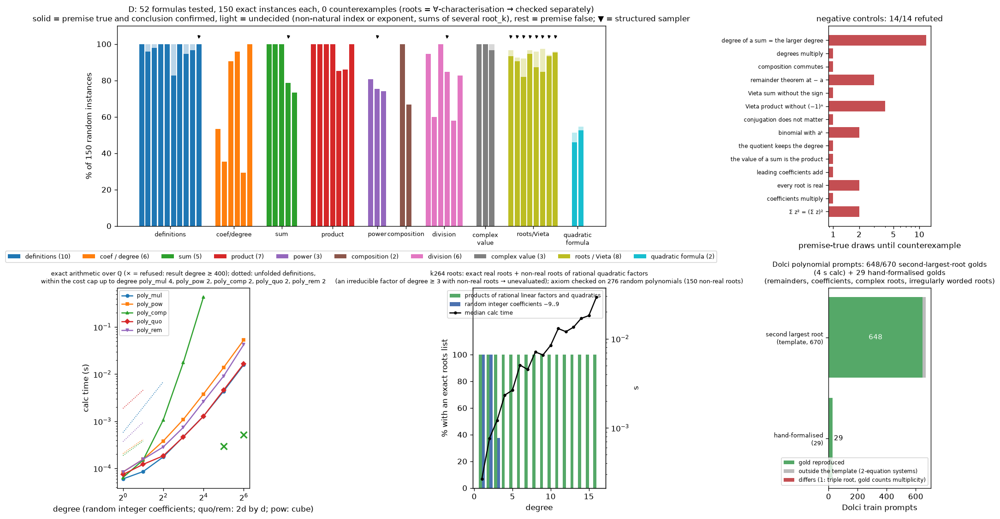

* **Regression:** all 26 suites pass on the real tree (`test_trie` on the venv python, 28 s). The longest are test_gen2 (1093 s), test_gen3 (273 s), test_gen (240 s) and test_package_e2 (200 s); test_package_d takes 42 s.
* **Test fixes this needed:**
  - test_library counts kb 652–693 as EXTRA lemmas;
  - 40 entries have no definition (`roots` is the new one);
  - test_gen2 skips D until it has generator themes;
  - the regression script runs `test_trie` with the venv python, because it imports torch.
* **Next:** generator themes for F and D, a domain-filtered KB list for the policy prompt, a template for
  two-equation linear systems, then re-piloting.

**Update 2026-10-15 16:45: KB v3 package F (matrices, polynomial values and exact real roots) is implemented and tested. TL can now state Dolci's linear-algebra questions directly ("the determinant mod 1000", "the rank", "an entry of the inverse of A / 96", "the sum of |eigenvalues|", "the rounded sum of the singular values"). `calc` evaluates them exactly, irrational eigenvalues included, and reproduces the gold answer on 2421 of the 2423 Dolci train prompts with a literal matrix that a template formalises (TLANG §12, PLAN W1).**

* **Why:** about 2.4k Dolci train prompts are generated linear-algebra questions about literal integer matrices.
  Before F, TL could only state them with the answer planted in the statement. Their eigenvalues and singular
  values are mostly irrational, and Dolci asks for floats rounded to integers, so `calc` needs exact real
  algebraic numbers to answer them soundly.
* **New symbols** k233–k253, kb 576–596. Next free: k254, kb 641.
  - A matrix is a list of rows [[ℝ]]; a polynomial is its coefficient list [ℝ] from the constant term up.
  - Matrices: `transpose`, `mat_add`, `mat_scale`, `mat_mul`, `mat_vec`, `identity`, `mat_pow`, `trace`,
    `submatrix`, `sign_perm`, and:
    - `det` by the Leibniz formula;
    - `inverse` by cofactors;
    - `rank` as the size of the largest nonzero minor;
    - `charpoly` = det(t I − A) by principal minors;
    - `eigenvalues` = real_roots(charpoly(A));
    - `singular_values` = the square roots of the eigenvalues of the smaller of A Aᵀ and Aᵀ A, largest first.
  - Polynomials: `poly_eval`, `poly_deriv`, `root_mult` (via `least`: the first k at which the k-th derivative
    does not vanish), `real_roots`, and `root_k(g , i)`, the i-th real root.
  - Every symbol except `real_roots` is a definition. `real_roots` has a characterising axiom: the list is sorted,
    every entry is a root, and every root x appears root_mult(p , x) times. `root_k` is an entry of `real_roots`.
* **Exact real roots** (new `tl/algebraic.py`, about 300 lines, no sympy):
  - squarefree split by Yun's algorithm;
  - rational roots split off by the rational-root test;
  - irrational roots isolated by Sturm sequences, up to degree 24 and 4096-bit coefficients.
  - A rational root is a numeral. An irrational root is `root_k(g , i)` with g monic, squarefree and free of
    rational roots, so equal roots of different polynomials get the same term.
  - Decision kept on purpose: √q of a rational non-square stays `sqrt(q)` (the existing behaviour). realeval
    decides `sqrt(2) = root_k([− 2 , 0 , 1] , 2)`.
  - realeval compares, floors, rounds and takes |·| of root_k terms through certified isolating intervals.
    `list_max`, `list_min` and `abs` now work on lists of closed real terms, which is what Dolci's "largest
    eigenvalue by absolute value" needs.
  - `poly_eval` and `root_mult` at any closed real term go through realeval's exact sign. This generalisation
    was found by the tests: `root_mult([4 , 0 , − 4 , 0 , 1] , sqrt(2))` was stuck and is now 2.
* **Fast evaluators:** exact elimination over ℚ for rectangular matrices up to 64 × 64 (det, rank, inverse by
  Gauss–Jordan, charpoly by Faddeev–LeVerrier).
  - `unfold` evaluates the definitions themselves only while their `cost` stays under 5000 steps: det and charpoly
    up to 4 × 4, rank and inverse up to 3 × 3 (panel 3, dotted).
  - Panel 3, the fast evaluators on random integer matrices:
    - det and rank take 0.04 s at 32 × 32, inverse 0.18 s, charpoly 3.3 s;
    - eigenvalues take 0.15 s at 12 × 12, 12 s at 24 × 24, and are refused at 32 × 32 (degree > 24);
    - singular values take 1.7 s at 12 × 12 and are refused from 16 × 16 on, because √ of a degree-g root needs
      a degree-2g polynomial. The refusal at 24 × 24 still costs 38 s, which only matters far beyond Dolci's
      ≤ 6 × 6.
* **Lemmas:** EXTRA kb 597–640 (44):
  - det (7): the transpose; a product; the identity; c·A gives cⁿ det A; the inverse; det = 0 exactly below full
    rank (two directions);
  - trace (4): a sum, a scalar multiple, trace(AB) = trace(BA), the transpose;
  - products and transposes (6): associative, distributive, (AB)ᵀ = BᵀAᵀ, transposing twice, the identity is
    neutral, mat_vec is the product with a column;
  - inverse (2): A · A⁻¹ = I, (A⁻¹)⁻¹ = A;
  - rank (3): at most either dimension, the transpose, a product has at most the rank of each factor;
  - charpoly and eigenvalues (9):
    - the constant term is (−1)ⁿ det, the next-highest coefficient is − trace, monic of degree n;
    - Cayley–Hamilton;
    - when all eigenvalues are real, their sum is the trace and their product the determinant;
    - every eigenvalue is a root of charpoly;
    - a triangular matrix has det = the product of its diagonal and its diagonal as eigenvalues;
  - singular values (3): there are min(m , n), none is negative, the nonzero ones count the rank;
  - powers (3): Aᵐ⁺ⁿ = Aᵐ Aⁿ, A⁰ = I, det(Aⁿ) = (det A)ⁿ;
  - roots (7):
    - every listed real root is a root, and every root is listed;
    - at most degree-many real roots, listed in increasing order;
    - a multiple root is a root of the derivative;
    - Taylor's formula for a quadratic;
    - multiplicity 0 exactly at non-roots.
* **Tests** (`tl/tests/test_package_f.py`, 6/6, 21 s):
  - **53 exact worked examples**, e.g. `singular_values([[1 , 1]])` = [sqrt(2)] and
    `root_mult([4 , 0 , − 4 , 0 , 1] , sqrt(2))` = 2, plus 18 Dolci prompts with their gold answers.
  - **8 terms that must stay unevaluated:** a singular inverse, an out-of-range root index, the zero and empty
    polynomials, a fractional or negative matrix power, and others.
  - Fast evaluators against the unfolded definitions: 443 agree, 77 are refused by the cost cap, 80 are
    evaluated by the definition only (ragged shapes, irrational scalars), and **none disagree**.
  - `real_roots` against its characterising axiom on 417 random polynomials: sorted, every count equals
    root_mult, and poly_eval = 0 at every entry.
  - **Every definition and lemma on 150 random instances**, evaluated exactly. The 63 formulas give 7,176
    confirmed, 431 undecided, 1,843 with a false premise and **0 counterexamples**.
    - root_mult and real_roots (kb 592/593) are covered by the axiom check above, not here (`least`, and an
      axiom).
    - The fewest confirmations are kb 602 (25: det = 0 below full rank, since random matrices rarely have low
      rank) and kb 639 (32).
    - Eleven formulas use structured samplers (▼ in panel 1): matrices with real spectra, triangular matrices,
      polynomials with planted roots and with a squared factor, valid submatrix positions and permutations, and
      in-range root indices.
    - The undecided cases are ragged inputs and sums of irrational eigenvalues that realeval cannot settle as one
      closed term.
  - **Negative controls:** all 14 deliberately wrong rules are refuted, most of them at the first true-premise
    draw (panel 2). Examples:
    - det is additive;
    - trace is multiplicative;
    - products commute;
    - det(cA) = c det A;
    - the singular values are the |eigenvalues|;
    - a polynomial has as many real roots as its degree;
    - rank = the number of nonzero eigenvalues.
* **Dolci check** (panel 5): regex templates turn every Dolci train prompt that contains a literal matrix into a
  TL term, and `calc` evaluates it.
  - Of 2424 such prompts, 2423 fit a template, and 2421 give the gold answer. In total this takes 17 s of `calc`.
  - The two misses are Dolci artefacts:
    - in 21798 two entries tie at ±1536/23, and Dolci's float argmax picked −67;
    - in 38720 an entry is −7.5; Dolci rounds half to even (−8), while TL's `round` rounds half up (−7).
  - Kinds of prompt:
    - rank 663;
    - inverse entries and sums 337;
    - products 311;
    - powers 287;
    - det mod 1000 259;
    - largest |eigenvalue| 176;
    - Σ|eigenvalue| 145;
    - singular-value sum, difference and maximum 92, 82 and 71.
* **Figure** `reports/figures/tl_kb3_package_f.png`:
  - confirmations per lemma group;
  - the controls;
  - calc time against matrix size;
  - real roots by degree, with the share that is irrational and the median time (≤ 0.06 s up to degree 24);
  - the Dolci coverage.

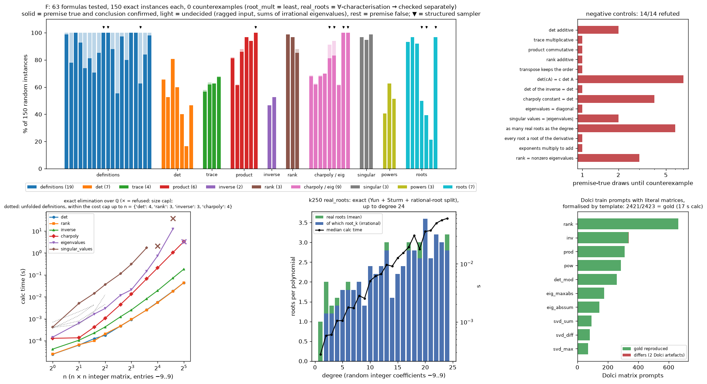

* **Regression:** all 25 regression suites pass on the real tree (16:44); the J run covered 19.
  - test_library and test_trie were rerun on their own after a fix and pass. test_library failed first because
    it had no generator for [[ℝ]]; test_trie needs torch, so it runs in the tf5 venv.
  - Times: test_gen2 1054 s, test_gen3 263 s, test_gen 202 s, test_package_e2 193 s, test_guide 94 s,
    test_package_a 93 s, test_package_c 72 s, test_mc 56 s, test_library 54 s, test_package_f 22 s.
* **Test fixes this needed:**
  - test_library has a matrix generator for [[ℝ]];
  - `root_mult` and `root_k` join the definitions that never unfold;
  - 39 entries have no definition (`real_roots` is the new one);
  - test_gen2 skips F until it has generator themes.
* **Next:** package D (`poly_add`, `poly_mul`, `poly_divmod`, `degree`, `leading`, complex `roots`), then
  generator themes for F.

**Update 2026-10-15 15:25: KB v3 package J (processes, sequences and games) is implemented and tested. TL can now state problems about rule-defined sequences, repeated processes, stopping times and two-player games: "term 2023 of this recurrence", "how many steps until the process stops", "who wins with a pile of 30". `calc` evaluates them exactly up to fixed size caps and leaves the rest unevaluated (TLANG §12, PLAN W1).**

* **Why:** the census gives package J 9 % of train prompts; after A, B, C, E, G and J, the greedy order covers 88 % cumulatively.
  Dolci has many recurrences (Fibonacci-style, a_{n+1} = f(a_n), sequences given by their prefix), iterated
  processes (Collatz, digit maps, "repeat until"), arithmetic and geometric progressions, and take-away games.
  Before J, each of these needed a hand-written closed form, which plants the answer in the statement.
* **New symbols** k219–k232, kb 508–521. Next free: k233, kb 576.
  - `ite(c , a , b)`, if-then-else on any type. It is the only new primitive: definitions by cases cannot be built
    from earlier symbols without it.
  - Sequences given by a rule:
    - `seq_list(f , xs , n)` and `seq_term(f , xs , n)` extend the start terms xs by `f : [α] → α`, applied to the
      whole prefix;
    - `recur(f , xs , n)` is the window recurrence, where f sees only the last len(xs) terms.
  - Processes:
    - `orbit(f , x , n)` = [x , f(x) , …, fⁿ(x)];
    - `steps_until(f , p , x)` is the fewest applications after which p holds, defined with `least`;
    - `scan(g , b , xs)` lists the running results of a fold.
  - Progressions: `is_arith`, `is_geom`, `ap_term(a , d , n)`, `gp_term(a , r , n)`.
  - Games use the move functions `m : α → [α]` from package G:
    - `reach_all(m , s)` is everything reachable;
    - `forced_win(m , s , n)`: the player to move can force, within n own moves, that the opponent has no move;
    - `win_pos(m , s)` is `forced_win` with n = the number of reachable places, which is enough in a finite game.
  - The planned `wf_rec` (well-founded recursion) was not needed. `least` over `iterate` covers stopping times,
    and games recurse on the move graph.
* **Caps.** Beyond any cap the term stays as it is; `calc` never guesses. Three of the caps were found through
  tests that hung:
  - Window recurrences on plain values detect a repeated window. Term 10¹⁸ of a periodic recurrence therefore
    costs one period: 0.003 s for Fibonacci mod 10 (period 60) and 0.11 s for Fibonacci mod 997 (period 1996), at every n
    (panel 3).
  - Full-prefix rules stop at 2100 terms, and also when the prefixes read so far hold more than 2·10⁷ bits. Without
    the bit budget, one `seq_term` (the running mean with growing fractions) took **183 s** at n = 2100; the worst
    case is now 1.6 s.
  - Any number over 4096 bits stops iteration. Fibonacci without a period is therefore evaluated up to n = 1000
    and left unevaluated at 10⁴ (0.26 s).
  - Orbits and searches stop at 2·10⁴ steps, and move graphs at 2·10⁴ reachable places. test_library's random
    arguments include infinite move graphs such as x ↦ [x + 1 , x − 1]. With the first caps (10⁵ places) and
    quadratic win sets, test_library ran for **more than 10 min** (40 s before J).
  - Games are now solved by one linear backward pass (retrograde analysis): a place is won when some move leaves a
    lost place, and lost when every move leaves a won one. The last 64 graph searches are kept, so the cost check,
    the evaluator and the game share one search. Every J call now takes ≲ 1 s, and test_library's evaluator check
    takes 52 s.
* **Lemmas:** EXTRA kb 522–575 (54).
  - `ite`: the two branches, equal branches, a negated condition swaps the branches, a function applied to a
    choice.
  - Sequences:
    - the first terms are the given ones;
    - one more term is the rule applied to the terms before;
    - a window recurrence is a sequence whose rule reads the last r terms;
    - a window that comes back after p steps gives period p.
  - Orbits:
    - n steps give n + 1 places;
    - place i + 1 is the value after i steps;
    - m + n steps are n steps followed by m steps;
    - a start that comes back gives a period.
  - Stopping times:
    - 0 steps when p holds at the start;
    - otherwise one more than from the next place;
    - p holds at the stopping time, and the stopping time is at most any step where p holds;
    - p fails before the stopping time.
  - `scan`: one more value than the list; it starts with the start value and ends with the fold.
  - Progressions:
    - consecutive differences and ratios;
    - the terms themselves;
    - the AP sum n·(first + last)/2 and the GP sum;
    - the middle term of three is the arithmetic or geometric mean.
  - Reach: the start is reachable; reach is closed under moves and contains every n-move walk; fewer moves than
    there are reachable places suffice; an invariant that holds at the start holds everywhere reachable.
  - Games:
    - a player who cannot move does not win;
    - a win is a move after which every answer leaves a win (stated as "some move, every answer", which stays
      sound for loopy games);
    - no win within 0 moves;
    - winning within n moves implies winning within n + 1;
    - taking 1..k from a pile, the first player loses exactly when k + 1 divides the pile.
* **Tests** (`tl/tests/test_package_j.py`, 6/6, 34 s):
  - **32 exact worked examples**, e.g.:
    - Fibonacci 30 = 832040, by `seq_term` and by `recur`;
    - term 2023 of Fibonacci mod 10 = 7;
    - term 2023 of aₙ = aₙ₋₁ / aₙ₋₂ from [2 , 3] (period 6) = 2;
    - 2aₙ + 1 → 1023;
    - Collatz from 27 takes 111 steps;
    - the AP/GP terms 21 and 48;
    - a 10-cycle reached by +3 mod 10;
    - take 1..3: pile 7 is a win in 2 own moves (not in 1), and pile 8 is lost;
    - a game that cycles through 0 → 1 → 2 → 0 forever, which nobody wins.
  - **7 terms that must stay unevaluated:** a non-whole index, 3000 prefix terms, a stopping time that never comes, an infinite reach set, and others.
  - Fast evaluators against the unfolded definitions: 382 agree, 18 are refused by the cost cap, and none disagree.
  - `steps_until`, `reach_all` and `win_pos` unfold to `least` over an unbounded search, which `calc` cannot
    decide. They are checked against equivalent closed formulas instead:
    - `reach_all` equals `fn_reach` at its own length, with no repeats;
    - `win_pos` equals `forced_win` at that length;
    - the orbit up to the stopping time fails p everywhere except at the last place.
    - 150 + 150 + 93 cases, 0 mismatches.
  - **Every definition and lemma on 200 random instances**, evaluated exactly. The 65 formulas give 9,804
    confirmed, 221 undecided, 2,975 with a false premise and **0 counterexamples**.
    - Every formula except two has at least 37 confirmed instances. The exceptions are kb 545 (16) and
      kb 547 (13), the stopping-time rules, which need an orbit that meets p within the cap.
    - The undecided cases are caps (no cycle within 2·10⁴ steps, numbers over 4096 bits).
    - Five formulas use structured samplers (▼ in panel 1): cyclic maps for the period and stopping-time rules,
      and subtraction games for kb 575.
  - **Negative controls:** all 16 deliberately wrong rules are refuted, 11 of them at the first true-premise
    instance. Examples:
    - interchangeable branches;
    - n + 1 terms;
    - a window shifted by one;
    - "every recurrence is periodic";
    - steps that multiply;
    - "win iff no move to a win" (false in loopy games);
    - a subtraction game modulo k instead of k + 1;
    - "everything is reachable in one move";
    - "a longer game wins nothing more".
* **Figure** `reports/figures/tl_kb3_package_j.png`:
  - confirmations per lemma group;
  - the controls;
  - calc time against index n for two periodic recurrences (flat up to 10¹⁸) and three that are unrolled until a
    cap (× = left unevaluated);
  - `win_pos` for seven subtraction games on piles 0–30, decided by `calc`. Take 1..k loses exactly at multiples
    of k + 1; take {1 , 3 , 4} loses at s ≡ 0 , 2 mod 7;
  - Collatz stopping times for starts 1–100, all by `calc` (max 118 at s = 97).

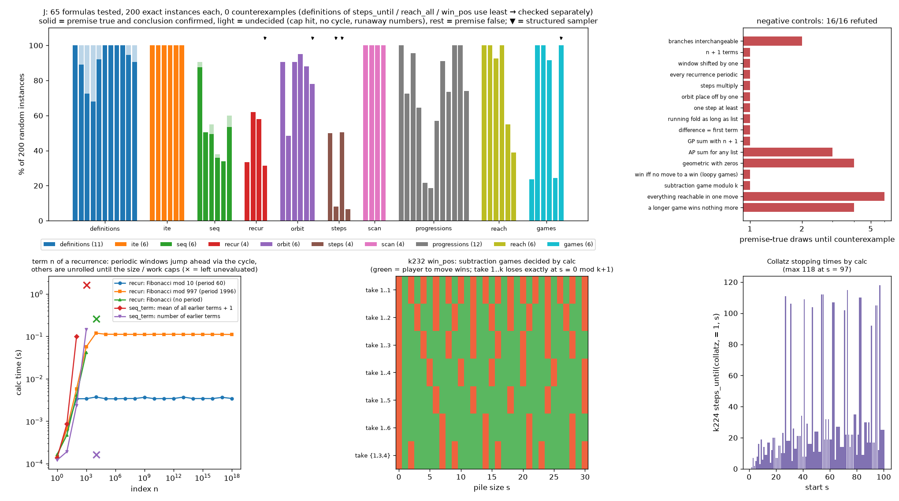

* **Regression:** all 19 suites pass on the real tree (15:40). test_gen2 1031 s, test_gen3 250 s, test_package_e2
  198 s, test_gen 189 s, test_tree 154 s (it needs torch, so it runs in the tf5 venv), test_package_a 95 s,
  test_package_c 71 s, test_mc 53 s, test_library 52 s, test_package_c2 35 s, test_package_j 34 s,
  test_package_g 18 s; the rest take under 10 s.

**Update 2026-10-15 14:00: KB v3 package G (combinatorics and finite chance) is implemented and tested. TL can now state counting questions directly as the size of an enumeration: arrangements of a multiset, words, selections, necklaces up to rotation, lattice paths, weighted draws and reachability. `calc` evaluates them exactly up to 10⁵ objects and leaves larger ones unevaluated (TLANG §12, PLAN W1).**

* **Why:** the census gives package G 17 % of train prompts (cumulative 64 → 79 % after E, A, B, C), and
  `finite_count` is the most common construct (44 %). Package A counts solutions of a predicate in a box;
  G adds the objects themselves: lists of arrangements, selections, blocks and walks that a count runs over.
* **New symbols** k205–k218, kb 453–466. All are definitions with fast evaluators. Next free: k219, kb 508.
  - Builders: `perms_of` (the distinct orders of a multiset), `tuples(xs , k)`, `sublists`, `combos(xs , k)`
    (by position), `rotations`, `windows(xs , k)` (consecutive blocks), `prefixes`, `list_product` (pairs).
  - `num_classes(r , xs)`: how many elements are not related to an earlier one, which for an equivalence is the
    number of classes ("up to rotation", indistinguishable boxes).
  - Chance with weights: `wprob(p , w , xs)` and `wexpect(f , w , xs)`. A uniform draw is the existing `k83`.
  - Moves: `walks(m , s , n)` lists every walk of n moves, where `m : α → [α]` gives the places reachable in one
    move (a grid, a graph, a game). `fn_reach(m , s , n)` is everything reachable within n moves, and
    `fn_dist(m , s , t , n)` is the fewest moves (n + 1 if more than n are needed).
  - TLANG's draft named `partitions` and grid `neighbours`. They are not needed: partitions are classes of tuples,
    and a grid is a move function.
* **Caps:** the fast evaluators enumerate at most 10⁵ objects. Library entries have a new `cost` field, and
  `unfold` refuses an unfolding whose estimated work exceeds 5000. Beyond either cap the term stays as it is;
  `calc` never guesses (panel 3).
* **Lemmas** EXTRA kb 467–507 (41):
  - counting formulas: n! for distinct elements, the multinomial, lenᵏ tuples, ordered selections, stars and
    bars, 2ⁿ sublists, C(n , k) selections, Σₖ C(n , k) = 2ⁿ, Pascal, k85 = C·k!;
  - symmetry: rotations are arrangements, the classes of equality are the distinct elements, necklaces by
    Burnside (1/k Σ m^gcd);
  - blocks: n − k + 1 windows, every window has length k, prefixes;
  - chance: wprob and wexpect with constant weights are k83 and the mean, the complement, linearity,
    inclusion–exclusion, the complement count, independence on a product, the expectation of a sum;
  - pigeonhole (more things than boxes ⇒ not injective), and the length of a join;
  - walks: the first-move recursion, "every walk of n moves ends in fn_reach", reach ⇔ some walk, fn_dist = 0
    exactly at the start, the target is reached in fn_dist moves, fewer moves do not reach it.
* **Tests** (`tl/tests/test_package_g.py`, 5/5, 17 s):
  - 38 exact worked examples (derangements of 4 = 9, MISSISSIPPI-style multisets, 6 lattice paths to (2 , 2),
    necklaces 6 / 11 / 24, a fair-die sum, …) and 6 terms that must stay unevaluated.
  - The fast evaluators against the unfolded definitions: 600 random arguments (numbers, nested lists, pairs).
    561 agree; 39 are refused by the cost cap; none disagree.
  - Every definition and lemma on 200 random instances, evaluated exactly. Totals: 9,489 confirmed, 175 undecided,
    1,336 with a false premise, **0 counterexamples**. Every formula has ≥ 46 confirmed instances.
    - The undecided cases are definitions at a non-whole count (`tuples(xs , 1/2)`) and weighted chance with
      total weight 0. Neither has a value.
    - Rules with a membership premise were rewritten as `all(…)` over the enumeration: kb 479, 484 and 501. In the
      form "x ∈ walks(…) → …", random lists almost never met the premise (1/200 for kb 501).
    - Pigeonhole and necklaces use structured samplers: the boxes are the values of the things, and
      the necklace inputs have mⁿ ≤ 27 colourings. Before that, the instance run took more than 12 min; it now takes 16 s.
  - **Negative controls:** all 15 deliberately wrong rules are refuted, 7 at the first true-premise instance:
    n! despite repeats, n·k tuples, selections counted with order, stars and bars off by one, necklaces = mᵏ/k,
    "every arrangement is a rotation", or-count = sum of counts, independence of two events on one draw, weights
    ignored, walks = (first degree)ⁿ, "one move iff a neighbour", pigeonhole with ≤, a wrong Pascal, n − k blocks,
    classes = elements.
* **Figure** `reports/figures/tl_kb3_package_g.png` has four panels:
  - confirmations per lemma group;
  - the controls;
  - the enumeration sizes against n up to the cap. n! stops at n = 9, 2ⁿ at 17 and C(n , n/2) at 20; n³ and n²
    run up to n = 40;
  - all 1,024 walks of 5 unit moves on the grid, coloured by end point, with `fn_dist` in each cell.

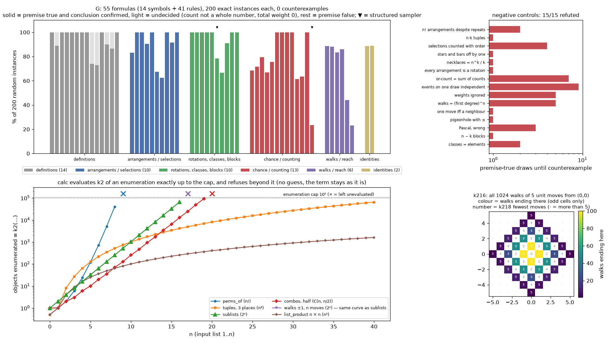

* **Regression:** all 18 suites pass with package G in place (rc 0 at 14:16; test_gen2 1022 s, test_gen3 235 s, test_package_e2 200 s, test_gen 181 s, test_package_g 19 s).

**Update 2026-10-15 13:00: KB v3 package E2 (3D vectors, measures of figures, `area_of`, `length_of`) is implemented and tested. TL can now state solid-geometry and mensuration problems (volumes, surface areas, sectors, areas of regions bounded by curves, total lengths of solution sets) without planting the answer, and `calc` evaluates every closed formula exactly, e.g. `sphere_volume(3)` = 36π (TLANG §12, PLAN W1).**

* **Why:** E1 covered the plane; the rest of package E (18 % of train prompts in the census) is 3D figures, the
  textbook area/volume formulas, and "the area of the region …" / "the total length of the set …" questions.
* **New symbols** k181–k204, kb 355–378. Next free: k205, kb 453.
  - 3D vectors are lists `[ℝ]` (no new type): `vdot`, `vadd`, `vsub`, `vscale`, `vnorm`, `vdist`, `cross3`,
    `vangle`, `triangle_area3`, `tetra_volume`, `plane_dist`. All are definitions, so `calc` evaluates them; a
    zero vector, collinear corners or lists of the wrong length leave them unevaluated.
  - Plane measures: `circle_area`, `circumference`, `sector_area`, `arc_length`.
  - Solid measures: `sphere_volume`, `sphere_area`, `cylinder_volume`, `cylinder_area`, `cone_volume`, `cone_area`,
    `pyramid_volume`.
  - `area_of : ((ℝ × ℝ) → 𝔹) → ℝ` and `length_of : (ℝ → 𝔹) → ℝ` take a predicate (the region or set) and are
    **axioms only**. The axiom of `area_of` is "the region under a non-negative continuous graph on [a , b] has
    area ∫ₐᵇ f" (C2's `integral`), and the axiom of `length_of` is "[a , b] has length b − a". `calc` never
    evaluates them; a proof cites the lemmas below.
* **Lemmas** EXTRA kb 379–452 (74):
  - 31 on vectors (bilinearity, Cauchy–Schwarz, the cross product is orthogonal, |u × v|² = |u|²|v|² − (u·v)²,
    triple product, the tetrahedron and plane-distance formulas against each other);
  - 13 on measures (Archimedes' 2/3, a cone is 1/3 of its cylinder, d/dr of the disc area is the circumference, the
    ball from its disc slices, the unrolled cone side is a sector, …);
  - 19 on `area_of` (between two graphs = ∫ (g − f), rectangle, open and closed disc, triangle, convex polygon via
    the E1 shoelace, ellipse πab, annulus, sector, invariance under moves, rotations and reflections, axis
    stretch by |st|, monotonicity, additivity across a vertical line, segments have area 0);
  - 11 on `length_of` (open intervals, shift, mirror, stretch by |c|, finite sets have length 0, additivity at a
    point, monotonicity, |x − c| ≤ r has length 2r).
* **Fix in the library loader:** the `$name` back-reference regex also matched digits, so `$cross3` became
  `$cross` + `3` → `k1493`. It is now `\$([a-z][a-z_0-9]*)?`.
* **How the lemmas are tested** (`tl/tests/test_package_e2.py`, 6/6, about 3.3 min):
  - 30 exact values (e.g. `tetra_volume` of the unit corner = 1/6, `cone_area(3 , 4)` = 24π) and 11 deliberately
    unevaluated terms (including `area_of` and `length_of` of a closed predicate).
  - 22 definitions against an independent float model, 40 draws each.
  - `area_of` and `length_of` have no evaluator, so the harness measures sets numerically: regions are sampled from
    14 kinds (disc, ellipse, triangle, convex and star polygons, rectangle, annulus, union, region under a graph,
    half disc, polygon ∖ disc, segment, points, empty). The bounding box grows until no member lies on its edge;
    the area is adaptive Simpson over x of the exact y-measure of each column slice (4000 y-points plus 44-step
    bisection of every transition). Against closed forms (12 regions per kind;
    unions have none) the relative error is < 5e-8 for every kind, < 1e-10 for discs, ellipses and annuli;
    lengths are exact to 1e-15.
  - The stats run (second panel row): 98 formulas (24 definitions + 74 lemmas), 14,803 instances with a true
    premise, 14,129 confirmed, 674 undecided, **0 counterexamples**. The `area_of` / `length_of` lemmas run 30
    instances each (about 0.1–0.2 s per area); the convex-polygon lemma kb 428 gets only 8 decided instances.
* **Negative controls:** all 16 deliberately wrong rules are refuted, 9 at the first true-premise instance:
  - vectors: |u|·|v| ≤ |u·v|, a symmetric cross product, |u − v|² with + 2u·v, a tetrahedron volume of
    base × height / 2;
  - measures: the ball volume as half its cylinder, d/dr of the ball volume as the disc area, the cone surface with
    the height instead of the slant height;
  - `area_of`: an axis stretch by st without |·|, an enlargement by s² in the wrong direction, additivity over
    overlapping unions, the disc of radius r without r ≥ 0, the triangle region without orientation, the area
    between two graphs without f ≤ g, and "a subset has *at least* the area";
  - `length_of`: a stretch by c without |·|, and |x − c| ≤ r with length r.
* **Figure** `reports/figures/tl_kb3_package_e2.png`: confirmations per lemma group; area and length errors per
  region kind with mean time; the 16 controls; and polygon ∖ disc measured with 2,733 adaptive slices (8.21350652
  vs exact 8.21350660).

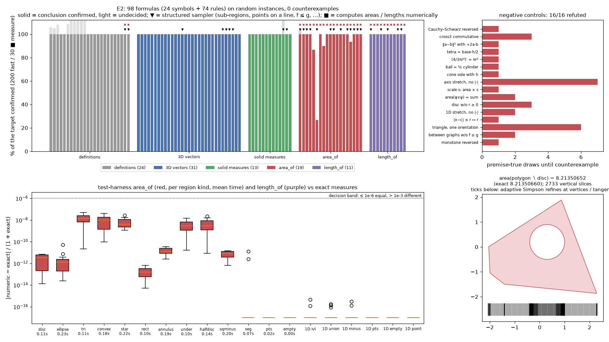

* **Regression:** all 17 suites pass (rc = 0; 32 min in total, test_gen2 963 s, test_gen3 219 s, test_package_e2 195 s, test_gen 169 s).

**Update 2026-10-15 12:05: KB v3 package E1 (plane geometry) is implemented and tested. TL can now state olympiad-style figures (triangle centres, circles, tangents, inversion, polygons) without inventing coordinates, and `calc` evaluates every construction on concrete, non-degenerate points (TLANG §12, PLAN W1).**

* **Why:** the census gives package E 18 % of train prompts. E1 covers the plane. E2 (3D solids, `area_of`,
  `length_of`) comes later.
* **New symbols** k148–k180, kb 252–284. Next free: k181, kb 355.
  - Vectors: `dot`, `cross` (signed parallelogram area), `scale`, `midpoint`.
  - Incidence: `collinear`, `between`, `parallel`, `perpendicular`.
  - Angles: `deg` (degrees → radians) and `angle(A , B , C)` ∈ [0 , π].
  - Maps: `rotate`, `foot`, `reflect_line`, `reflect_point`, `invert`.
  - Lines and circles: `line_meet`, `line_dist`, `tangent_line`, `tangent_circles`, `perp_bisector`,
    `angle_bisector`, `polar`, `second_meet`.
  - Triangle centres: `circumcenter`, `circumradius`, `centroid`, `incenter`, `inradius`, `orthocenter`, and the
    predicate `concyclic`.
  - Polygons are lists `[( ℝ × ℝ )]`: `polygon_area` (shoelace), `convex_polygon`, `regular_polygon`.
* **Design.**
  - A line is a pair of distinct points, and a circle is a centre and a radius. "P is on the circle" is written
    `dist(P , O) = r`, with no extra symbol.
  - A synthetic figure is unknown point constants plus the stated givens. Lemmas kb 285–293 (isometry
    invariance) let a proof place the figure in coordinates without the statement doing so.
  - Every symbol is a **definition** over coordinates, with no axioms. Closed points therefore evaluate in
    `calc`, exactly where the radicals and π-multiples of C1 allow (example below). Degenerate input stays
    unevaluated, never a guess: coincident points, parallel lines, a collinear "triangle", an angle off the
    π/12 table.
  - Lesson: `ground_eval` does not short-circuit `⊥ ∧ stuck`. `regular_polygon` first indexed its reference side
    as corners 1, 2, 3, so a two-point list got stuck instead of giving ⊥. It now indexes cyclically.
* **Lemmas** kb 285–354 (70), so a proof cites a rule instead of expanding coordinates:
  - 15 isometries and maps: rotations, translations, reflections and feet preserve distance, angle, area and
    centres;
  - 16 metric facts: law of cosines, Pythagoras, angle sum π, the sine area formula, Heron, Apollonius, the
    shortest distance to a line;
  - 14 triangle centres: the circumcentre is equidistant, the incircle touches the sides, the Euler line with HG = 2 GO,
    Euler's OI² = R² − 2Rr, the law of sines, abc / 4R, r·s, the angle bisector theorem, the midline;
  - 11 circle facts: Thales, inscribed and central angles, the cyclic quadrilateral criterion, Ptolemy, power of a point,
    tangents, touching circles;
  - 8 on inversion and polars: involution, OP · OP′ = r², the distance formula, La Hire, the polar of an
    outside point;
  - 6 on polygons: a diagonal split, angle sum (n − 2)π, a regular polygon is cyclic, side 2R sin(π / n).
* **Exact example** (last panel). For the triangle (0 , 0), (6 , 0), (1 , 4), `calc` gives:
  - circumcentre (3 , 11/8) and R = √(697/64);
  - centroid (7/3 , 4/3) and orthocentre (1 , 5/4);
  - inradius 24 / (√41 + √17 + 6), with the incentre in the same radicals.
  - The Euler line through O, G and H is itself lemma kb 321.
* **How the lemmas are tested** (`tl/tests/test_package_e.py`, 5/5, 6 s):
  - 51 exact values and 9 deliberately unevaluated terms.
  - Definitions vs. an independent float geometry: 60 draws per symbol.
  - Lemmas in the three-valued model of C2: Kleene logic plus a tolerance band. Structured samplers build the
    premises (points on a circle, convex and regular polygons, tangent configurations, lattice angles on the
    π/12 table).
  - The stats run (200 instances per formula, first panel): 103 formulas (33 definitions + 70 lemmas), 20,631
    instances with a true premise, 20,600 confirmed, 31 undecided, **0 counterexamples**.
  - Per symbol: `angle` stays unevaluated on 47 of 200 random draws (off-table angles). For the rest, the few
    unevaluated draws are degenerate cases (≤ 6 of 200).
* **Negative controls:** all 16 deliberately wrong rules are refuted, 14 at the first true-premise instance.
  - The wrong rules are:
    - the law of cosines with + 2ab cos C, and the angle sum 2π;
    - Ptolemy with a minus sign, and OP · OP′ = r instead of r²;
    - Euler's formula as R² − Rr, the central angle equal to the inscribed angle, and the area as ½ ab cos C;
    - the centroid as midpoint(A , midpoint(B , C)), and a reflection that keeps the orientation;
    - the regular-polygon angle (n − 1)π / n, and the convex angle sum (n − 1)π;
    - two perpendiculars to one line being perpendicular, the incentre equidistant from two corners, and the
      angle bisector theorem with the ratio swapped;
    - two that take more draws: the inscribed-angle rule without "same side" (5 draws), and the polar with r
      instead of r² (3 draws).
* **Regression:** all 16 suites pass (test_gen2 935 s, the longest; test_package_e 6 s).
  - The older suites only needed their counts and skip sets moved past the new numbers, and test_library needed a
    random generator for `[( ℝ × ℝ )]`.
* **Next:** E2 (3D, `area_of`, `length_of`), then G, J, F, D. After that: generator themes for A–E, a
  domain-filtered KB list in the formalize prompt, and the math/dapo formalization re-pilot.

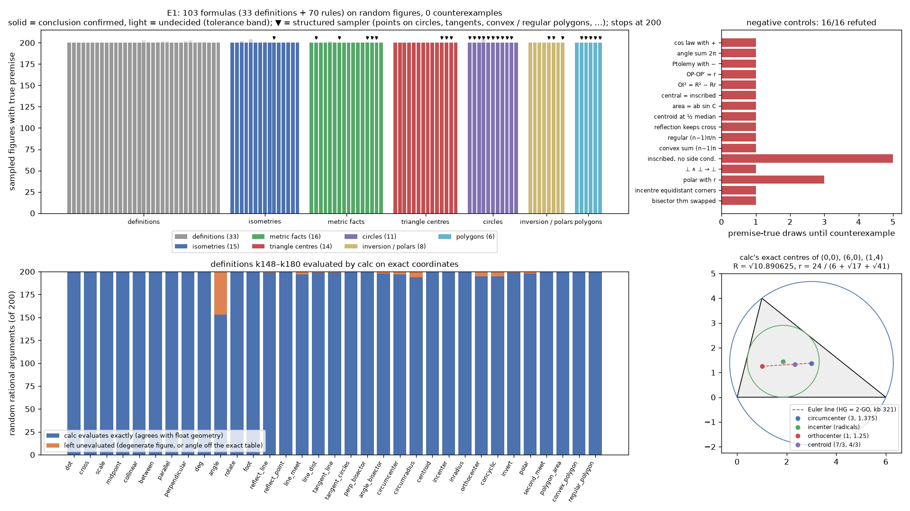

**Update 2026-10-15 11:40: all 1,155 Dolci word problems formalized and judged. 426 prompts (37 %) yield a checked, data-tier, judge-approved TL proof, below the 45 % the pilot predicted (PLAN W: formalization).**

* **Runs.**
  - Formalization: job 66082, gpt-oss-120b at TP = 2, 4 attempts × (1 + 3 repair rounds). It took 4.6 h
    (≈ 9.3 GPU-h), with 15,831 calls and 56 M generated tokens.
  - Judge v3: job 67672, 2 samples per proof. It took 11 min (0.38 GPU-h). Some CUDA OOM warnings appeared, but it completed.
  - Outputs: `rlvl_data/tl/formalize/gpt-oss-120b_wordprob_all/`
    and `judge_gpt-oss-120b_v3_wordprob_all/`.
* **Yield (cumulative over repair rounds 0–3, left panel):**

  | stage | r0 | r1 | r2 | r3 |
  |---|---|---|---|---|
  | checker-verified | 293 | 435 | 520 | **578 (50 %)** |
  | + data tier | 273 | 399 | 480 | **532 (46 %)** |
  | + judge v3 (both samples "same") | 224 | 334 | 392 | **426 (37 %)** |

  - Repair rounds add +146 / +58 / +34 judged prompts, so a fourth round would add little.
  - Data-tier rejects: 85 with the answer given, 16 with an unlinked goal.
  - The judge passes 981 of 1,365 proofs (72 %), at least one sample for 1,108, and the two samples agree on 1,237.
* **Judge issues (right panel):**
  - different_question 270, presolved 242, wrong_fact 51, extra_fact 40, missing_fact 31.
  - The first two are the known formalizer habits: goals that ask for an intermediate quantity, and answers planted as `given`.
* **Why it is below 45 %.** The pilot estimate came from a ~100-prompt sample. I have not yet analysed which
  problems the full set loses.
* **Use.** The 426 prompts (one or more proofs each) are the first faithful Dolci-TL SFT/RL seed set. Word problems are only 2.5 % of train,
  so the main lever stays the TL extension (packages A–E1 done) and the math/dapo re-pilot after it.

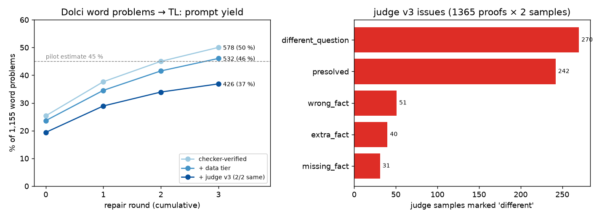

**Update 2026-10-15 11:10: KB v3 package C2 (limits, continuity, derivatives, integrals, series) is implemented and tested. TL can now state calculus problems such as ∫₀¹ x² dx = 1/3 or Σ 1/n² = π²/6, and proofs cite 70 rule lemmas. `calc` decides none of these (TLANG §12, PLAN W1).**

* **Why:** the census gives package C 20 % of train prompts, and 26 % of those name calculus (derivatives 11 %,
  limits and series 10 %, integrals 5 %, continuity 3 %), so about 5 % of all train prompts need C2.
* **New symbols** k133–k147, kb 167–181. Next free: k148, kb 252.
  - Predicates, as ε-δ definitions: `tends_at(f , a , L)` (punctured), `tends_right`, `tends_infty`,
    `tends_seq` (over whole n), `continuous_at`, `differentiable_at`, `series_converges`.
  - Values: `lim_at`, `lim_right`, `lim_infty`, `lim_seq`, `deriv`, `integral`, `series`, `inf_prod`.
    - Each lim_* has the axiom tends_* → lim = L. That is sound for a total symbol because a limit is unique.
    - deriv, series and inf_prod are definitions through lim_*.
    - integral is characterised by the fundamental theorem of calculus (f continuous on [a , b], F′ = f inside,
      F one-sided continuous at the ends). The intended model is the oriented Riemann integral, 0 where f is not
      integrable.
* **Lemmas** kb 182–251, so a proof cites a rule instead of re-deriving it from ε-δ:
  - 8 identities left over from C1: cos of a sum, sin 2x, cos 2x, ln of a power and of a quotient, exp and ln increasing, exp > 0;
  - 11 limits at a point: sum, product, quotient, constant, identity, composition, locality, sin x / x → 1, one-sided limits;
  - 12 limits at ∞ and of sequences, including rⁿ → 0, (1 + 1/n)ⁿ → e and the squeeze theorem;
  - 21 derivatives: the algebra rules, chain rule, the derivatives of exp, ln, sin, cos, tan, atan and √,
    L'Hôpital, Fermat, monotonicity from the sign of f′, the extreme value theorem;
  - 6 integrals: FTC, antisymmetry, linearity, additivity over intervals, monotonicity;
  - 12 series: geometric, exp series, p-series iff p > 1, Basel, linearity, splitting off a term, telescoping,
    terms → 0, comparison, absolute convergence, Leibniz.
* **No evaluator.** These symbols are opaque to `calc`, so a limit or integral is only ever proved through the
  lemmas. A numeric estimate could check final answers in the reward later, but it will never enter `calc`.
* **How the lemmas are tested** (`tl/tests/test_package_c2.py`, 5/5): a numeric model of the 15 symbols checks
  every formula on random instances.
  - Functions come from a pool of 17 (polynomials, |x|, floor, √, exp, ln, sin, cos, atan, 2⁻ˣ, 1/x and
    other rational functions) and reals from 9 values. A premise's limit argument is set to its numeric limit 85 % of the time, so premises hold
    often.
  - The logic is three-valued. A comparison inside its tolerance band is "undecided", never ⊤. The model
    raises "undefined" outside a function's domain.
  - Methods: limits at h = 10⁻⁵…10⁻⁷ (at ∞, x = 10⁵…10⁷, with Richardson extrapolation); derivatives as one-sided
    quotients against a central difference; Simpson integrals (n = 400); series as partial sums at 4000 and
    8000 terms with Richardson. Quantifiers inside a formula range over a grid around the instance values.
* **Results (left panel):**
  - 75 formulas (5 characterising axioms and 70 lemmas) took 6.9 s. They have 2602 instances with a true
    premise: 2578 confirmed, 24 undecided, 0 counterexamples.
  - Five formulas have fewer than 5 confirmed instances:
    - sin x / x → 1, (1 + 1/n)ⁿ → e and Basel are closed facts with one instance each, by design.
    - Squeeze (3) and comparison (2) have narrow premises.
  - The 8 identities: 475 instances proved outright by `calc`, 725 confirmed numerically, and 840 perturbed
    instances refuted.
* **Negative controls (right panel):** the harness refutes all 15 deliberately wrong rules, 13 of them at the first
  instance with a true premise.
  - The wrong rules include (fg)′ = f′g′, the chain rule without the inner derivative, the quotient rule with +,
    sin′ = −cos, L'Hôpital upside down, FTC with the sign flipped, Σ xⁿ = 1/(1 + x), Basel = π²/8, p-series iff
    p > 0, and "the harmonic series converges".
  - "continuous → differentiable" takes 20 draws, because it needs |x| at 0.

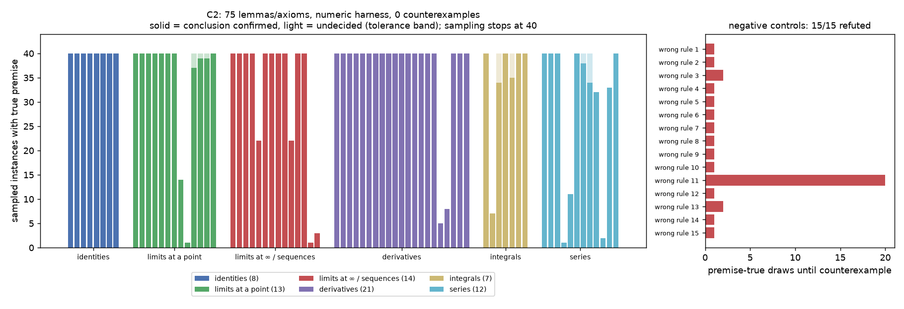

* **Regression:** all 15 suites pass (test_gen2 849 s, the longest; test_package_c2 35 s). The older suites
  only needed their counts and skip sets moved past the new numbers.
* **Next:** packages E (plane geometry), G, J, F, D, then generator themes for A–C2, a domain-filtered KB list in
  the formalize prompt, and a formalization re-pilot on math/dapo.

**Update 2026-10-15 10:50: KB v3 package C1 (π, exp, ln, log, trig, inverse trig, cube root, cis, complex argument; 20 % of Dolci prompts) is implemented and tested. Exact values at multiples of π/12 and for rational logarithms; certified intervals for the rest (TLANG §12, PLAN W1).**

* **Stamp correction:** the two blocks below were stamped 10:15 and 11:05 by mistake. Their figures were written at
  09:48 and 10:01, so they now read 09:50 (package A) and 10:05 (package B).
* **New symbols** k120–k132, lemmas kb 144–156, extra lemmas kb 157–166. Next free: k133, kb 167.
  - `exp`, `ln`, `sin`, `cos`, `tan`, `atan`, `asin`, `acos`, `log(b , x)` (base first), `cbrt`.
  - `pi` (k124) is a bare constant of type ℝ, so π/6 is `k124 ÷ 6` and e is `k120(1)`.
  - `cis(θ)` = k16(cos θ , sin θ) and `c_arg(z)` ∈ (−π, π], both carried over from package B.
  - There is no separate `rpow`: k9 is the general power, and kb 161 says x^y = exp(y · ln x) for x > 0.
* **Axioms:** each is a true fact about the standard function, and together they characterise it.
  - exp: the addition law and 1 + x ≤ exp x.
  - ln: x > 0 → exp(ln x) = x, and ln(exp x) = x.
  - sin and cos:
    - cos(x − y) and the sine of a sum;
    - sin² + cos² = 1;
    - sin x ≤ x for x ≥ 0, and x cos x ≤ sin x on (0, π/2);
    - sin π = 0 ∧ 3 < π < 4.
  - Inverse functions by their ranges, with f(f⁻¹ x) = x.
  - Definitions for tan, log and cis.
  - Lemmas for ln of a product, sine odd, cos x = sin(x + π/2) and √x = x^(1/2).
* **Evaluation** (`tl/realeval.py`):
  - **Exact layer:** `pi_linear` writes a closed term as a + rπ, with a in the exact radical field.
    - sin, cos and tan at multiples of π/12 are exact radicals. For example, sin(100π + π/6) = 1/2 and
      sin(π/12) = (√6 − √2)/4.
    - asin, acos and atan of table values give exact multiples of π, so asin(1/2) = π/6 is ⊤.
    - log(b , x) is exact when it is rational: log(4 , 8) = 3/2 is checked exactly as b^n = x^d (4³ = 8²).
    - cbrt is exact on rational cubes, and exp(ln 5) = 5.
  - **Other values:** certified interval comparisons with adaptive precision, so k7(1000 × π) = 3141 and
    exp(1) < 3 are ⊤.
  - An equation between two irrational values is never certified unless both sides are exact. `calc` cannot claim
    sin 1 = 5/6, and an off-table argument is left as atan(y ÷ x) (± π).
  - Undefined inputs stay unevaluated: ln 0, asin 2, log(1 , x), tan(π/2), c_arg(0), and exp of an argument above
    4096.
* **Census (left panel):** 20 % of train prompts need package C.
  - By topic: trig 42 %, roots and real powers 13 %, exp/log 13 %, inverse trig 1 %.
  - 26 % of package-C prompts also name calculus: derivatives 11 %, limits and series 10 %, integrals 5 %,
    continuity 3 %. That is C2, which comes next.
* **Cost (right panel):** a certified comparison f(x) < c takes 0.4–1.7 ms when the gap is up to 16 digits, and
  3–9 ms at 48 digits (cold caches).

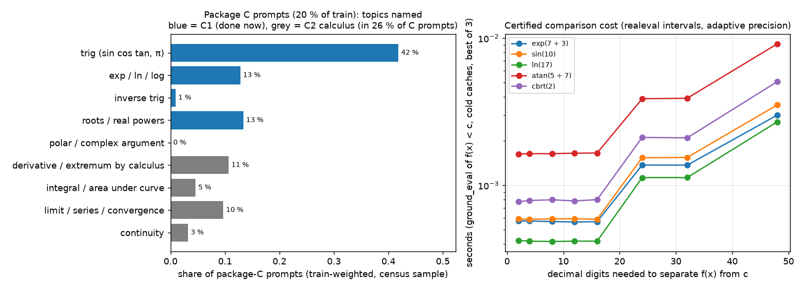

* **Tests** (`tl/tests/test_package_c.py`, 6/6 pass):
  - 50 exact values, each also refuted when off by 10⁻⁶;
  - 304 interval comparisons that agree with floating point;
  - 11 inputs that must stay unevaluated;
  - axiom instances at random rationals, π multiples and exp values: 2641 instances, none refuted, 780 proved
    outright (exact cases), and 1523 perturbed instances refuted;
  - `calc` in the checker (sin(π/6) = 1/2, log(2 , 1024) = 10, k7(100π) = 314; sin(π/6) = 1/3, exp 1 < 2 and
    ln 0 = 0 are rejected).
* **Regression:** all 14 suites pass (test_gen2 819 s, the longest). One fix: test_package_a asserted the full EXTRA
  list, which C1 extends, so it now checks only the entries below 128.
* **Next:** C2 (lim_seq, lim_at, deriv, integral, series, continuous_at with characterising axioms and no evaluator;
  double-angle and log-rule lemmas), then E, G, J, F, D.

**Update 2026-10-15 10:05: KB v3 package B (numbers: ℚ, digits, valuations, totient, ℂ, modular powers; 36 % of Dolci prompts) is implemented and tested. The kernel power now folds exponents up to 4096 (TLANG §12, PLAN W1).**

* **New symbols** k104–k119, lemmas kb 128–143. Next free: k120, kb 144.
  - ℚ: `is_rational` (∃ definition), `numerator` and `denominator` (characterising axioms: lowest terms, positive
    denominator), `is_nat`.
    - The `is_rational` evaluator says ⊤ for numerals and decides closed real terms in the exact radical field, so
      `is_rational(√2)` is ⊥.
  - Digits and number theory: `from_digits(ds , b)` (fold, most significant digit first), `digits(n , b)`
    (characterising axiom: digits in [0, b), no leading zero, so digits(0 , b) = [0]), `padic_val(p , n)` and
    `totient`.
  - Complex numbers as pairs `(ℝ × ℝ)`: `c_add`, `c_sub`, `c_mul`, `c_div`, `c_pow` (whole exponent), `c_abs`, `conj`.
    `c_arg` and `cis` need trigonometry and move to package C.
  - `pow_mod(a , n , m)` = k8(k9(a , n) , m). Its evaluator is Python's three-argument pow, so 7^2026 mod 100 = 49
    is checked by `calc` without building 7^2026.
* **Kernel change:** `ground_eval` used to fold k9(a , n) only for 0 ≤ n ≤ 20. It now folds whole exponents up to
  4096 while the result has at most 4096 bits, so k9(10 , 300) folds and k9(7 , 2026) stays unevaluated.
* **Unfolding:** a definition may now unfold to a "settled" value: a closed value, a closed real term with an exact
  radical value (e.g. `c_abs(1 , 1)` = `k86(2)`), or a pair of these.
* **Census (left panel):** 36 % of train prompts need package B. A third of those (12 % of train) only need integer
  domains, which `is_integer` k10 already covers. Of the named topics, divisibility/gcd/mod is 37 %, digits and bases
  17 %, lowest terms, complex numbers and rational/irrational about 3 % each, p-adic valuation and totient under 1 %.
* **Cost (right panel):** every evaluator stays below 0.04 s up to 3000-digit inputs. Totient runs in ~30 µs below its
  10¹² trial-division cap.

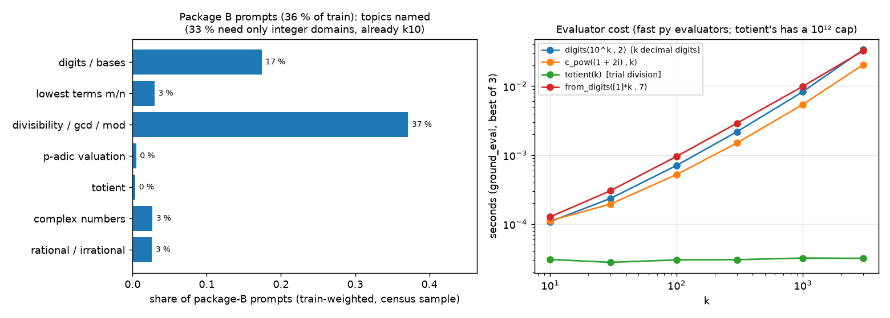

* **Tests** (`tl/tests/test_package_b.py`, 6/6 pass):
  - value cases, plus cases that must stay unevaluated (e.g. k9(7 , 2026), digits in base 1, a non-prime p in padic_val, complex division by 0);
  - 4500 axiom instances: evaluator answers satisfy each characterising axiom, and wrong candidates falsify its
    premise;
  - definitions vs Python (totient, all complex operations vs Python `complex`, c_abs² = norm, pow_mod, from_digits);
  - 200 `is_rational` cases (126 ⊤ with a checked witness, 74 ⊥);
  - `calc` in the checker, e.g. pow_mod(7 , 2026 , 100) = 49.
* **Regression:** all 14 earlier suites pass with package B in place (checked in the package C1 regression below).
* **Next:** package C (π, exp, ln, trig via `realeval`; exact trig values via `radicals.cos_pi`; `c_arg`, `cis`), then
  E, G, J, F, D.

**Update 2026-10-15 09:50: KB v3 package A (predicate operators, 60 % of Dolci prompts) is implemented and tested. `calc` now decides counts, sums, extrema, unique solutions and closed ∀/∃ over finite domains (TLANG §12 layer 4, PLAN W1).**

* **New symbols** k94–k103, lemmas kb 115–124, plus three extra lemmas kb 125–127. Next free: k104, kb 128.
  - `count_all`, `sum_all`, `prod_all`, `is_finite`, `least`, `greatest`, `infimum`, `supremum`, `the` (ι) and `solutions`.
  - Each one takes a predicate `λ x : α . φ`. Its defining axiom has a uniqueness or finiteness premise, so an
    infinite or non-unique predicate leaves the value unconstrained, and nothing false can be derived.
  - `is_finite` only ever evaluates to ⊤.
* **Evaluator** (`tl/finite.py`): it reads a finite candidate box off φ, then decides every candidate with
  `ground_eval`.
  - The box comes from integer type facts, bounds, `x = closed t` conjuncts (a single candidate), divisibility, and
    pairs.
  - Divisor candidates are used only for a positive integer divisor, because `mod` and `divides` are axiomatised only
    there.
  - Closed `∀` / `∃` in `ground_eval` now go through the same engine. `∀ x . A → B` is decided by the candidates of
    `A ∧ ¬B`, so an empty negation box gives ⊤ without enumerating A.
  - Caps: MAX_CAND 10⁵ candidates per operator, MAX_QUANT 10⁴ per quantifier, MAX_SEARCH 10⁵. Nested quantifiers
    split the budget. Over a cap the term stays unevaluated, which costs under 1 ms.
* **Cost:** about 53 µs per candidate. A count over 10⁵ candidates takes 3.7–5.2 s; ∀ over 10⁴ takes 0.41 s.

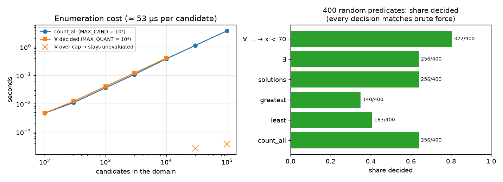

* **Tests** (`tl/tests/test_package_a.py`, 9/9 pass):
  - 28 value cases, e.g. the sum of the divisors of 360 is 1170, the least CRT solution is 14, the greatest prime
    below 100 is 97, and ι gives 7 ÷ 2.
  - 16 cases that must stay unevaluated: a non-integer or negative divisor, an infinite set, a real interval, no least
    element, a non-unique ι, over-cap domains, a function domain, an irrational summand.
  - 60 pair cases checked by brute force and 600 instances of the extra lemmas.
  - 400 random predicates (right panel). Every decision matches brute force over a grid. The undecided ones lack a
    finite box, e.g. no upper bound for `greatest`.
  - `calc` in the checker accepts `count = 33` and rejects `= 34` and the unsound divisor case.
* **Regression** (all 12 tl suites). Two fixes so far:
  - **gen2** had no V themes for k94+, so package A is excluded from the gen2 V-theme pool. Package A generator
    themes come later.
  - **test_formalize:** two tl_mid_v4 gold traces cite kb 24 without the new `0 ≤ x2` premise (see 09:30). The test
    now counts them as stale; the remaining 292/300 are judged OK.
    - tl_eval has 7/1000 such rows, so tl_mid_v4 must be regenerated as **tl_mid_v5** before any new SFT.
  - **test_library:** the numbering check now allows the gap left by the opaque MC symbols k92/k93.
    `is_finite` is exempt from the definition-unfold check, since its definition never unfolds to a value.
  - **finite.py** imports `kb` lazily, which breaks the import cycle finite ↔ kb ↔ library.
* **Next:** package B (ℤ/ℚ/ℂ: numerator, denominator, complex numbers over pairs), then C (π, exp, ln, trig via
  `realeval`, exact trig values via `radicals.cos_pi`), then E, G, J, F, D.
  - After that: package A generator themes, a domain-filtered KB list in the formalize prompt, and a re-pilot on
    math/dapo/yesno.

**Update 2026-10-15 09:30: the user extends TL to cover all of Dolci. A census sets the work order, a soundness hole in the power axiom is closed, and exact radicals plus certified intervals now feed `calc` (PLAN W: formalization, TLANG §12).**

* **Decision (user):** "I think we need to extend TL so it can represent everything in dolci." The scope is all four
  families, 45,771 train prompts (math 38,585, dapo 5,550, wordprob 1,156, yesno 480). The design is TLANG §12, "KB v3".
  - There are no new tokens and no new types. Every new construct is a KB symbol (k94 on, lemmas kb 115 on) with a
    defining lemma or a characterising axiom and an optional sound evaluator.
* **Census** (`tl/census.py`, job 66745). gpt-oss-120b tagged 2,000 stratified prompts with the constructs a
  faithful statement needs; 1,987 parsed (629 s, 325 k generated tokens).
  - The tags were mapped to work packages and weighted by train share.
  - Matrix problems were mostly left untagged by the tagger: 189 rows are templated "find the rank / SVD" prompts.
    Mapping the named missing symbols to packages raised the F share from 0.7 % to 6.1 %.

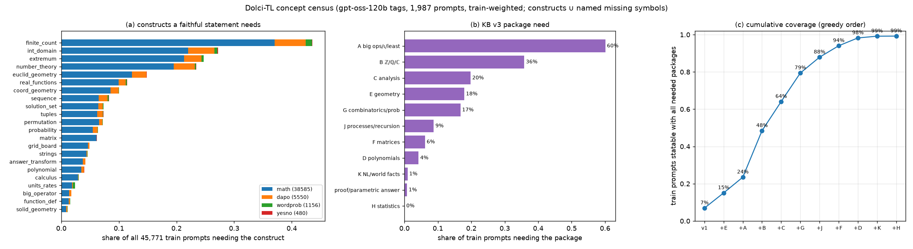

| package | content | share of train prompts that need it |
|---|---|---|
| A | predicate operators: count / sum over {x : φ}, least / greatest, ι | 60 % |
| B | ℤ / ℚ / ℂ: integrality, numerator, complex numbers over pairs | 36 % |
| C | analysis: π, exp, ln, trig, limits, derivatives | 20 % |
| E | Euclidean and coordinate geometry | 18 % |
| G | combinatorics and probability | 17 % |
| J | processes and recursion | 9 % |
| F | matrices | 6 % |
| D | polynomials | 4 % |
| K | natural-language judgments and world facts (yesno) | 1 % |
| H | statistics | 0.1 % |

  - TL v1 alone can state 7 % of the prompts.
  - Greedy order E, A, B, C, G, J, F, D, K reaches 15, 24, 48, 64, 79, 88, 94, 98, 99 % cumulative coverage.
  - The top constructs are finite_count 44 %, int_domain 27 %, extremum 25 %, number_theory 23 %, euclid_geometry
    15 %, real_functions 11 % and coord_geometry 10 %.
  - yesno is 68 % nl_judgment and 20 % world_knowledge. Package K is therefore a decision for the user: an unchecked
    fact tier, a judge oracle, or excluding the family.
  - The tagger's "TL v1 can state it" verdict (math 63 % yes) only means statable with quantifiers. It does not mean
    that `calc` can evaluate it or that the KB can prove it.
* **Soundness hole closed.** kb 24 read `∀ x1 x2 : ℝ . k9(x1 , x2 + 1) = x1 × k9(x1 , x2)` with no condition.
  - Together with kb 23 (`x^0 = 1`), instantiating at x1 = 0, x2 = −1 gives 1 = 0 × k9(0 , −1) = 0, so any
    statement was provable.
  - kb 24 now carries the premise `0 ≤ x2`, and `gen.py` (th_L24) emits the `calc` line for it.
  - The exploit proof is now rejected ("kb: conclusion does not follow").
  - Consequence: old SFT/AZ traces that cite kb 24 without that premise no longer check. Any such data has to be
    regenerated before it is reused.
* **KB v3 layers 2–3 are wired into `calc`.**
  - `tl/radicals.py` is new. It does exact arithmetic in ℚ(√2, √3, …): canonical form, division by repeated
    conjugation, denesting √(x + y√m), and exact cos / sin of kπ/12. Every size bound returns None rather than
    guessing.
  - `tl/realeval.py` is new. It decides comparisons and floors on closed real terms (numerals, + − × ÷, abs, floor,
    ceil, round, √, power):
    - first exactly in the radical field;
    - otherwise by the certified intervals of `tl/reals.py` (tested against mpmath).
  - `kb.ground_eval` folds a term only when its value is exactly rational or the comparison is decided.
  - Examples now decided: `√2 × √2 = 2`, `√(3 + 2√2) = 1 + √2`, `⌊1000√2⌋ = 1414`, `8^(1/3) = 2`, `2^√2 < 3`,
    `√2 < 1.42` (true) and `√2 < 1.41` (false).
  - These stay undecided on purpose: `√(−1)`, `0^(−1)`, `(−8)^(1/3)` (the power axioms do not fix negative bases),
    `2^(2^1000…)` (size guards), and terms with free names.
  - Tests: `tl/tests/test_realeval.py`, 4/4 pass. The full regression of the older suites is running.
* **Next:** packages A, B, C, then E, G, J, F, D, each with evaluators, axioms and tests. Then a domain-filtered KB
  list in the formalize prompt, and a re-pilot on math, dapo and yesno.

**Update 2026-10-15 06:45: the re-pilot did not change the goal form. The 06:00 standard is withdrawn in favour of a "translation" standard. Judge v3 matches the hand labels. Only word problems survive, so a word-problem-only formalization run is underway, and the math/dapo route needs a decision (PLAN W: formalization).**

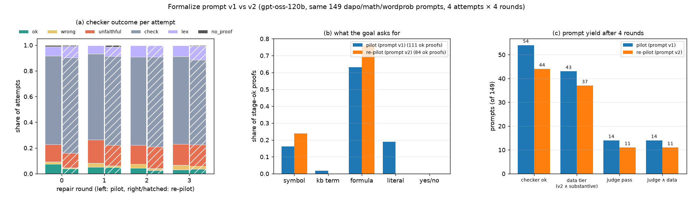

**Re-pilot.** Job 65852 ran prompt v2 with gpt-oss-120b on the same 149 dapo/math/wordprob prompts, with 4 attempts × 4 rounds. It took 3295 s on 2 H100 NVL.

| same 149 prompts | pilot (prompt v1) | re-pilot (prompt v2) |
|---|---|---|
| prompts with a checker-ok proof (dapo / math / wordprob) | 54 (10 / 14 / 30) | 44 (4 / 11 / 29) |
| data tier (v2 ∧ substantive) | 43 | 37 |
| goal of stage-ok proofs is an arithmetic formula | 70/111 | 64/84 |
| word problems only: formula goal | 48/69 | 44/60 |
| judge v2 ∧ data, prompts | 14 | 11 |
| judge v3 ∧ data, prompts | 23 | 22 |

- **Prompt v2 did not do what it was meant to.** The model kept writing formula goals at the same rate (76 % vs 63 %) even though step 3 told it not to. Where it did declare a symbol for the asked quantity, the formula simply moved into a `given` or `def`. Yield fell slightly. Across rounds, the share of prompts solved went 8.1 % → 17.4 % → 23.5 % → 29.5 %.

**The 06:00 standard was wrong and is withdrawn.**
- The 06:00 decision read: "every arithmetic combination in the statement must be stated by the problem text, sentence by sentence; combining the data is the derivation's job." It was my rule, not a user decision.
- It cannot be met. TL has no axioms for "total", "per item", "times as many" or "% of". A word problem's question can only be stated in TL as arithmetic on its data, so for word problems the formalization *is* that translation. The derivation then evaluates it, through several `calc`/`=E` steps when there are intermediate quantities.
- **New standard ("translation"):** a statement is faithful when its facts and goal transcribe the text. A goal or given formula that transcribes everyday wording is fine: a total as the sum of the stated parts, "3 times as many" as 3×, "% of", rate × count, a unit conversion. A statement is BAD when it has:
  - the answer or a solved value planted;
  - the inverse of a stated relation (solving it for the unknown), or a derived relation;
  - a formula from a solution method or insight (a counting formula, a Bayes quotient, a series closed form, a chosen multiplier);
  - a wrong or unrelated question;
  - a dropped fact.
- **Hand audit under the new standard.** I labelled 39 re-pilot proofs: 20 GOOD (19 word problems + math/23475) and 19 BAD (10 math, 5 word problems, 4 dapo). The labels are in `formalize/hand_labels_translation.json`. I excluded 4 multi-part questions and 1 ambiguous one. Judge v2 passed only 7 of the 20 GOOD.

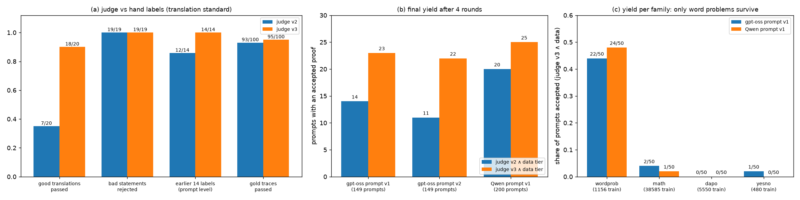

**Judge v3.** Only the comparison prompt's "presolved" bullet changed: it now lists what counts as presolved and states that a transcription of the wording is not presolved. Job 66063 judged both pilots, the re-pilot and 100 gold traces, 1040 back-translations in 3.3 min.

| | judge v2 | judge v3 |
|---|---|---|
| GOOD translations passed (20) | 7 | **18** |
| BAD statements rejected (19) | 19 | **19** |
| earlier 14 prompt-level labels | 12 | **14** |
| gold traces wrongly rejected (100) | 7 | **5** |
| "different" by issue | presolved 289, different_question 268 | different_question 289, presolved 108 |

- **Caveat:** these labels were written while the rule was revised, so the agreement above is in-sample.
- **Fresh spot check:** 16 v3 passes from the prompt-v1 pilots, none of them labelled before.
  - About 12–13 of the 14 distinct statements are good: 125741, 50489, 23475, 162817, the gpt-oss version of 168130, 74973, and others.
  - One is clearly bad: Qwen's 168130 goal `(c5 − c2×c3) ÷ c4` solves the "spent $360 in total" relation for the unknown, an inverse relation the judge missed.
  - One is not math: 124195, "write a Python script", formalized as a product of keys.
  - Precision on word problems is therefore roughly 85–90 %.
- **The two GOOD proofs v3 rejected** were each rejected by one sample of two. 153270 got "presolved" for money = 400 + 40 + 10. 166982 got "extra_fact" for a stray `𝔼` symbol. Both are sampling noise at T = 0.7.

**Only word problems survive, and that is a TL limit, not a judge one.** Panel (c) shows judge v3 ∧ data per family, for 50 prompts per family in each prompt-v1 pilot:

| | wordprob | math | dapo | yesno |
|---|---|---|---|---|
| gpt-oss-120b | 22/50 | 2/50 | 0/50 | 1/50 |
| Qwen3.5-122B | 24/50 | 1/50 | 0/50 | 0/50 |
| train prompts | 1,156 (2.5 %) | 38,585 (84 %) | 5,550 | 480 |

- **Math and dapo already fail at the checker.** Only 10–14 of 50 prompts ever produce a checker-ok proof.
- **The ones that get through are mostly garbage the checker cannot see:**
  - dapo/81248 "product of the real roots of x⁴+…" becomes `? x1 . −2 = x1`;
  - math/22792 (a modular count) becomes `1 = x1`;
  - math/70912 (infinite products) plants m = 1, n = 3;
  - math/20659 plants the divisor 2·31·5039;
  - dapo/79007 plants the divisor-count formula.

  The judge rejects all of these correctly.
- **Why:** these problems need vocabulary TL does not have (polynomial roots, infinite products, integrals, modular solution counts, combinatorial configurations). The formalizer then games the checker.
- **The math passes are plain arithmetic:** math/23475 (evaluate an expression) and math/50489 (percent change).

**Decisions and status.**
- **Prompt.** Step 3 now follows the translation standard: the goal may be "arithmetic on the data that only transcribes the question's wording". The prohibited list stays: the answer, a value known only after solving, the inverse of a stated relation, a method formula. Everything else in prompt v2 is kept: givens for stated relations, the 168130 worked example, `--drop-families`. `python3 -m tl.tests.test_formalize` passes, and the previous version is backed up as `formalize.py.bak_20261015b`. The two prompt versions gave the same yield (23 vs 22 prompts), so this is about consistency with the standard. The edited wording itself is not yet validated.
- **Word problems at full scale (done; result in the 11:40 update: 426 prompts = 37 %).** Job 66082 runs gpt-oss-120b at TP = 2 on all 1,155 train word problems (`--drop-families dolci_math,dolci_dapo,dolci_yesno`, N = 4000). Expected cost is ≈ 14 GPU-h, ≈ 7 h. Expected yield is ≈ 45 %, ≈ 500 judged examples. Judge v3 and refilter follow.
- **Math/dapo: not scaled.** Formalizing all 38.6k math prompts would cost about 475 GPU-h for an estimated 2–4 % yield (3 of 100 piloted prompts, a very noisy estimate), roughly 1k examples, and only the arithmetic-evaluation kind. The options need a decision from the user:
  - (a) A cheap pre-screen. A small LLM pass would tag the math prompts TL can express (arithmetic, percentages, gcd/lcm and the other existing KB ops) and formalize only those.
  - (b) Extend TL with the missing vocabulary (polynomials and roots, finite sums/products, counting) under the TLANG spec. This is large spec and generator work.
  - (c) Accept that Dolci-TL's formalizable part is about 2–5 % of Dolci, and midtrain on generator data plus the formalized word problems. The S2 gate would then be measured on a TL-expressible subset.
- **Outputs:**
  - `formalize/judge_gpt-oss-120b_v3/`;
  - `formalize/judge_v2_v3_compare.json`;
  - `formalize/repilot_v2_compare.json`;
  - `formalize/hand_labels_translation.json`;
  - the scripts `judge_v3_cmp.py` and `repilot_cmp.py` in the session scratchpad.

**Update 2026-10-15 06:00: back-translation judge (gold hidden). It works, but it showed that the formalization prompt invites presolved goals. The prompt is fixed and a re-pilot is running (PLAN W: formalization).**

Setup:
- New `tl/judge.py` (tests in `tl/tests/test_judge.py`; Slurm script `rlvl_data/tl/judge.slurm`). It uses gpt-oss-120b with TP = 2.
- **Step 1, back-translation.** The model sees only the statement lines of a stage-ok proof: `new` (each annotated with its problem word), `given`, `def` and `goal`. It writes the English problem they pose. It never sees the original text, the derivation or the answer.
- **Step 2, comparison.** A second call sees the original problem and the back-translation. It returns `same`, or `different` with one issue from: presolved, different_question, missing_fact, extra_fact, wrong_fact.
- A proof passes when both samples say `same`.
- **Gold control:** 100 family-balanced generator traces from tl_eval, which must pass.
- **Cost:** 436 proofs × 2 samples take about 2.5 min on 2 H100 NVL (0.08–0.10 GPU-h). Judging all 45.8k train prompts (≈ 1 stage-ok proof each) would cost about 12 GPU-h, which is small next to formalization.
- **v1 → v2 changes:**
  - The comparison prompt now spells out that an evaluate-this-formula goal encoding the solution method is presolved, unless the original itself states that computation.
  - Rewordings that keep the mathematics are not differences.
  - The back-translation turn now lists the gloss of every KB symbol the statement uses, so no `k75` is left undecoded.
  - Verdict parsing now also handles gpt-oss replies that carry an extra `<|constrain|>JSON` tag before the answer.

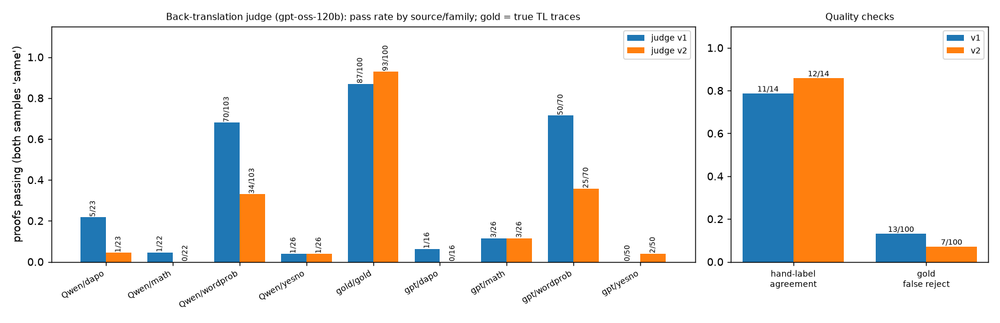

| proofs passing (both samples `same`) | judge v1 | judge v2 |
|---|---|---|
| gpt-oss dapo / math / wordprob / yesno | 1/16 · 3/26 · 50/70 · 0/50 | 0/16 · 3/26 · 25/70 · 2/50 |
| Qwen dapo / math / wordprob / yesno | 5/23 · 1/22 · 70/103 · 1/26 | 1/23 · 0/22 · 34/103 · 1/26 |
| prompts with ≥ 1 passing proof (gpt-oss + Qwen, of 200 each) | 26 + 28 | 17 + 20 |
| gold control false rejects | 13/100 | **7/100** |
| agreement with hand labels (14 prompts) | 11/14 | **12/14** |
| unparsed verdicts | 10 | 6 |
| "different" by issue | different_question 276, presolved 97 | different_question 233, presolved 221 |

Findings:
- **Judge v1 was too lenient on closed formulas.** It agreed with all 8 earlier Qwen hand labels, but it accepted goals that evaluate the solution formula. Three examples:
  - dapo/80558 toothpicks, `((c1+1)×c2)+((c2+1)×c1)`;
  - dapo/79351, a Bayes quotient;
  - math/51014, `k31(6,3)×k31(8,4)`.

  About half of v1's distinct math/dapo passes were of this kind. v2 rejects 80558 and 51014.
- **Remaining v2 errors on hand labels:**
  - It still passes one attempt of 79351.
  - It now rejects the honest math/74973, where one of the two samples says presolved.
  - Borderline proofs flip between samples at T = 0.7. Several word problems pass with one attempt and fail with another that has the same goal formula.
- **v1's gold false rejects had three causes:**
  - undecoded KB symbols (`k75`, `k78` left as names);
  - an unparsed `<|constrain|>JSON` channel;
  - comparison misreadings of wordings such as "[7] followed by [3, 2]" and "from 8 up to 5".

  v2 fixes most of them (13 → 7).
- **Word-problem rejections in v1 are real.** A random 8 were all correct. Examples:
  - 160950 asks for 500 ÷ 5;
  - 136020 changes "medals = non-medalists − 9" into a relation with all participants;
  - 137917 gives a = 10 and b = 99 outright;
  - 158683 sets π = 1 and asks for c1;
  - 124195 drops the "write a Python script" task.
- **Root cause of the presolved goals: our formalization prompt.** Step 3 of the instructions told the model to build the goal term t "from the declared symbols". So for word problems the model writes the whole solution into the goal, e.g. 168130 `((c5 − (c2×c3)) ÷ c4)`. The TL proof is then a single `calc`, and none of the problem's reasoning is in TL.
  - v2 rejects these. On the gpt-oss pilot, 65 word-problem proofs that passed v1 fail v2, and most of them are this pattern.
  - Some of the same attempts were also correctly formalized elsewhere. For example, gpt-oss attempt 1 round 3 of 168130 has the given `((c2×c3)+(c4×c5)) = 360` and the goal `c5`, and the derivation solves the linear equation.
- **Decision: the faithfulness standard for the data.** *(Superseded at 06:45 by the "translation" standard; see the update above. This rule cannot be met in TL.)*
  - Every arithmetic combination in the statement must be stated by the problem text, sentence by sentence.
  - The goal asks for the quantity the question names: a declared symbol, or a KB term the question names.
  - Combining the data is the derivation's job.

  This keeps the reasoning inside the TL proof, which is the point of formal CoT. It costs yield: v2 passes about half as many word problems as v1 under the old prompt.
- **Fix, upstream.** `tl/formalize.py` INSTRUCTIONS steps 2–3 now spell this standard out. The real gpt-oss proof of 168130 (checked, faithful, correct) is added as a 13th worked example (test `test_word_example`). The prompt is backed up as `formalize.py.bak_20261015a`.
- **Re-pilot running.** Job 65852 runs gpt-oss-120b on the same 200-prompt pick, minus the 50 yesno prompts and 168130, so 149 prompts, at TP = 2 (`--drop-families dolci_yesno`). The judge on its output (65854, gold 0) follows automatically. Outputs: `formalize/gpt-oss-120b_pilot200_v2/` and `formalize/judge_gpt-oss-120b_pilot200_v2/`.
- Outputs of this update:
  - `formalize/judge_gpt-oss-120b_pilot{,_v2}/{judge.jsonl,summary.json}`;
  - `formalize/judge_v1_v2_compare.json`.

**Update 2026-10-15 04:30: Dolci → TL formalization pilot, gpt-oss-120b vs Qwen3.5-122B-A10B-FP8. Use gpt-oss-120b, drop yesno, and add a judge before scaling (PLAN W: formalization).**

Setup:
- New `tl/formalize.py` runs offline vLLM batch formalization. It has its own CPU tests in `tl/tests/test_formalize.py`, and the Slurm script is `rlvl_data/tl/formalize.slurm`.
- The system prompt holds the TL spec, the KB list and 12 worked examples. It is built once so vLLM's prefix cache can reuse it.
- Each Dolci prompt is shown sentence by sentence, with word indices and the numerals it may use.
- The last fenced block is lexed and checked, then scored with `faithful` and compared with the gold answer.
- Each prompt gets 4 attempts at T = 0.7 with up to 16k tokens. Up to 3 repair rounds feed back the checker error (never the gold).
- Pilot: 200 Dolci train prompts (50 per family), each model with TP = 2 on gruenau11 H100 NVL.
- Model settings: gpt-oss uses `reasoning_effort=medium`. Qwen runs in thinking mode and needs `VLLM_USE_DEEP_GEMM=0`, because gruenau has no CUDA toolkit for DeepGEMM.
- Outputs are in `rlvl_data/tl/formalize/<model>_pilot200/`: `records.jsonl`, `summary.json`, `refilter.json` and `accepted_data_tier.json`. The model comparison is `pilot_compare.json`.

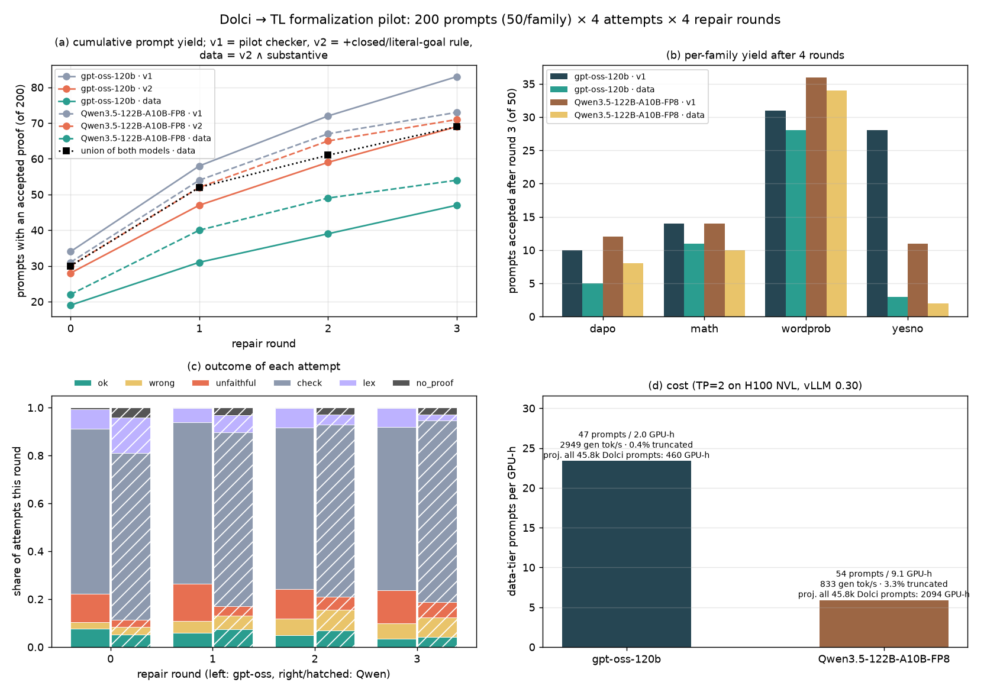

| 200 prompts, 4 attempts × 4 rounds | gpt-oss-120b | Qwen3.5-122B-A10B-FP8 |
|---|---|---|
| prompts accepted, pilot checker (v1), rounds 0 → 3 | 34 → 58 → 72 → **83** | 31 → 54 → 67 → **73** |
| … with the new `trivial_goal` cases (v2) | 69 | 71 |
| … v2 ∧ `substantive` (**data tier**) | **47** | **54** |
| data tier per family: dapo / math / wordprob / yesno | 5 / 11 / 28 / 3 | 8 / 10 / 34 / 2 |
| union of both models, data tier | 69 | (same) |
| attempts accepted (v1) | 20.3 % | 21.8 % |
| GPU-h for the pilot | **2.0** | 9.1 |
| generation throughput, 2 GPUs | 2,949 tok/s | 833 tok/s |
| generated tokens per call (median / p95) | 3,148 / 8,093 | 2,637 / 14,244 |
| calls cut off at 16k | 0.4 % | 3.3 % |
| GPU-h per data-tier prompt | **0.043** | 0.169 |
| projected GPU-h for all 45.8k Dolci train prompts | **460** | 2,094 |

What we found:

- **Cost:** gpt-oss is 4.6× cheaper per pilot and 3.9× cheaper per clean (data-tier) prompt. Qwen's hybrid Gated-DeltaNet KV cache fits only about 11 concurrent 65k sequences, and its round-0 calls average 8k tokens. DeepGEMM being off may cost Qwen some throughput too (not measured).
- **Quality:** Qwen hacks less. Only 2 of its 73 checker-accepted prompts fail the new `trivial_goal` cases, against 14 of 83 for gpt-oss. So gpt-oss's lead under the old checker is mostly hacks. On clean data Qwen is ahead, 54 vs 47.
- **The two models complement each other:** each gets prompts the other doesn't. The union reaches 69 data-tier prompts.
- **Failures are mostly in the derivation, not the syntax.** About 70 % of calls fail in `check`. The top round-0 errors:
  - gpt-oss: redundant parentheses 132, `calc` not entailed 72, `unknown symbol` 64, `ans` citing a non-formula 62.
  - Qwen: trailing tokens 125, `unknown symbol` 112 (`&gt;`, `_`, stray letters), `calc` not entailed 107.
- **Redundant parentheses are only the first error hit.** Stripping them after the fact turns about 1 proof per model into an accepted one; the next `calc`, `=E` or `∧I` step fails.
- **Repairs roughly double the yield** for both models: v1 goes 34 → 83 for gpt-oss and 31 → 73 for Qwen.

New checks in `tl/check.py`, from the pilot's hacks. All of `test_check` and `test_formalize` pass.

- **`faithful` gets two more `trivial_goal` cases.** These are part of the reward.
  - A goal made only of literals and logic, with no problem symbol: `? ⊤`, `? 0 ≤ 0`, `? ∃ x1 : 𝔼 . ⊤` (yesno/157733).
  - A find goal with the answer typed into it: `? x1 : ℝ . − 2 = x1` (dapo/81248).
  - Both fire 0 times on the ~2k generator gold traces. A third candidate rule ("a ground goal the evaluator decides") fired on 38 honest gold traces, so I dropped it.
- **New `substantive(res, toks)` training-data filter** (not a reward, because it also fires on honest gold traces: unlinked 107, answer_given 20, copy_goal 10 of 2,000). Its three reasons:
  - **`copy_goal`:** a yes/no goal whose φ or ¬φ is a given conjunct.
  - **`answer_given`:** a find goal `t = x1` with a given `t = v`, where v is a literal. Since 04:30 this also follows chains of given and def equalities: `def c5 = 2`, `given c3 = c5`, `? x1 : ℝ . c3 = x1` (Qwen, dapo/83929).
  - **`unlinked_goal`:** givens exist, but the goal names no c, f or p symbol.
- Regression cases are in `HACKS` and `SHALLOW` in `test_check`.
- What the data tier removes, per model:

  | Reason | gpt-oss | Qwen |
  |---|---|---|
  | yesno copy_goal | 38 | 23 |
  | answer_given (dapo / math / wordprob) | 9 / 7 / 8 | 7 / 5 / 8 |
  | unlinked_goal | 16 | 8 |

Hand audit:
- **Coverage:** 24 accepted proofs per model from the pilot agent, plus 13 data-tier Qwen proofs read at 04:20.
- **wordprob:** honest. About 5 of 6 for both models, and 3 of 3 in the Qwen data tier. The givens transcribe the numbers and the goal is the computation.
- **math / dapo:** mostly not faithful, even in the data tier (Qwen data tier: math 1 of 4, dapo 0 of 4).
  - The goal carries the solution. dapo/79397 puts the closed-form `AE = AB·AC/(AB+CD)` in the goal. dapo/80765 has the goal `2·√(512·32)`. math/63977 has the goal `(418 · 5822 · 418) mod 100` with the counting pre-done in literals. math/20659 has a hand-factored prime.
  - Or the header is nonsense that hits the gold value: math/38497 has `c1 = 1 + 3`; math/39474 takes the length of the interval as the answer.
  - Syntactic rules can't separate these from an honest compute goal. That needs a semantic judge: an LLM back-translates the given/goal lines and compares them with the problem, with the gold hidden.
- **yesno:** 0 of 6, and 0 of 2 in the data tier. Dolci yesno is NLI, fact-checking and commonsense, so the premise can't entail the claim from the prompt text. Every accepted proof gives the claim (or its negation) as a premise. **Drop yesno from formalization.**
- **Honest-yield estimate:** about 15 % of prompts get a truly faithful proof from either model, almost all word problems.

Headroom for an offline prover:
- Some prompts have no accepted proof but do have a failed proof whose header (new / given / goal / def) passes the checker and whose `ans` equals the gold, with the first error in a derivation step.
- There are 67 such prompts for gpt-oss (dapo 26, math 23, wordprob 11, yesno 7) and 72 for Qwen.
- A prover that fills these derivations would lift the v1 yield to about 150 of 200 at most.
- Most of these headers are dapo and math, exactly where the header tends to encode the solution. So the prover only pays off behind the judge.

Decision (PLAN change-log 2026-10-15):
- **Model:** use **gpt-oss-120b** for scaled formalization. Per GPU-h it gives 3.9× more data-tier prompts. A Qwen pass on the prompts gpt-oss misses is optional if GPU budget allows (union 69 vs 47).
- **Families:** formalize wordprob, math and dapo. Drop yesno (only 480 of the 45.8k train prompts, so this saves about 1 % of the compute).
- **Order before scaling:**
  1. A back-translation judge on the data tier.
  2. The offline prover for header-clean, derivation-failed attempts.
  3. Then the full 45.8k Dolci train set: about 455 GPU-h, or about 390 GPU-h if each prompt stops at its first success.
- **What the full set would give** (pilot yield per family × train prompts per family; the pilot sampled 50 per family, but the train set is 84 % math):
  - Data tier, gpt-oss: about 9.7k prompts (21 %). That is math 8.5k, dapo 0.56k, wordprob 0.65k.
  - Discounted by the hand audit (math about 1 in 4 honest, dapo about 0, wordprob about 5 in 6), the **honest yield is about 2.5–3k prompts (≈ 6 %)**, mostly math.
  - The judge decides which math formalizations count, so it is the step that sets the size of the SFT set, not just a quality filter.
  - If it confirms only about 3k, we will also need the formalization-SFT bootstrap: train on the honest set, then re-formalize with the tuned policy.

**Update 2026-10-14 18:10: a strict reward closes three hack holes. Re-scored, the gate is worse: 9B pass@64 0.155 → 0.110 (PLAN S2).**

New in `tl/check.py`: `faithful(res, toks) -> (ok, reasons)`. It runs on proofs that already pass `check`. It is opt-in via `--strict-reward` in `az.py` (`Game(strict=…)`, with `info["unfaithful"]`) and in `vllm_guide.py` (`score(strict=…)`, recorded in `summary.json`). With the flag off nothing changes. The three rejection reasons:

- **`inconsistent_givens`**: the given and def lines can't all hold. Either their linear relations are jointly infeasible (`infeasible`), or a given is ⊥, or both φ and ¬φ are given. Givens that can't be analysed (≠, logic, sets) are skipped and counted. The Fourier–Motzkin cap counts as consistent.
- **`trivial_goal`**: there are two cases.
  - A yes/no goal is `t = t`, or it is a tautology or contradiction regardless of the prompt's symbols.
  - A goal that mentions nothing from the prompt does not have the form `t = x1` with licensed numerals. For example, `? x1 ∈ {1, 6}`.
- **`no_given`**: following the citations back from `ans` never reaches a non-trivial given. `calc` premises the conclusion doesn't need are pruned first.

Tests are `test_faithful` and `test_strict_reward` in `test_check`. They cover:
- the three hacks from 06:30: yesno 165984, math 66817 and dapo 80779;
- honest wordprob 155618 / 158952;
- a generator trace whose goal restates a given.

On ~2.7k generator gold traces only `no_given` fires, 22 times. All of them are themes whose answer really ignores the givens, such as `c2 ^ 0`. This check is only meant for Dolci prompts.

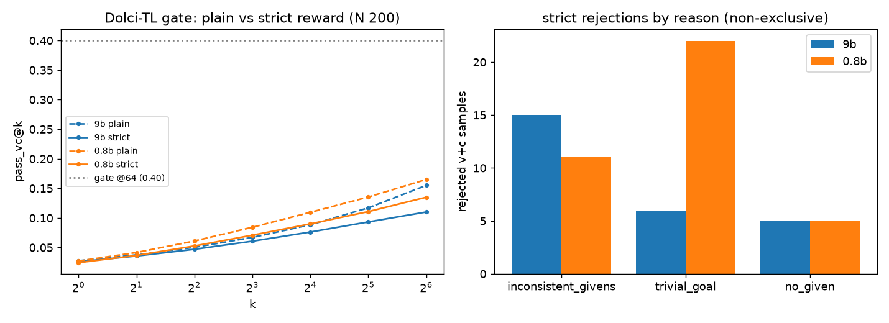

| | 9B | 0.8B |
|---|---|---|
| v+c samples, plain → strict | 354 → 332 | 347 → 312 |
| pass_vc@1 | 0.028 → 0.026 | 0.027 → 0.024 |
| pass_vc@64 | 0.155 → **0.110** | 0.165 → **0.135** |
| prompts solved | 31 → 22 | 33 → 27 |
| dapo / math / wordprob / yesno v+c | 1→0 / 65→64 / 187→172 / 101→96 | 0→0 / 100→88 / 36→26 / 211→198 |
| v+c with unanalysed givens | 123 | 195 |

Data: `rlvl_data/tl/s0/strict_rescore.json`, with example rejections per reason.

These are still lower bounds on hacking. Some hacks get through the strict check:
- the goal copies a given (yesno 128325, 147051, 153955, 137929, 162182);
- the answer is restated as a given (128414: `c1 = 21`, `? c1 = x1`);
- invented but consistent givens (157276: `c1 = 1`, `c2 = 1`, `? c1 = c2`).

The goal-copy rule can't be tightened, because honest generator logic traces also restate a given as the goal. Telling a faithful formalization from an unfaithful one needs back-translation or a judge.

**Next:** the strict reward becomes the default for any future Dolci-TL AZ or gate run. The proposed fix for the failed gate is a large-model formalization pipeline:
1. A large model formalizes Dolci prompts into TL, with a checker repair loop.
2. Filter by gold answer, the strict check and a back-translation judge.
3. Instruction-style SFT on (prompt → TL proof), plus the generator mix.

The model choice and the proof-engine question are with the user.

**Update 2026-10-14 07:20: the 0.8B AZ arms hung and were cancelled; they were flat throughout.**

58113 (`g_mul_num_f99_cq_lim_sil`) and 58209 (`g_mul_num_samp_sil_r40`) stopped logging at 19:48 and 17:28 on 10-13, after it 53 and it 67. From then on each sat at 100 % CPU for 11 to 14 h with no output, so both were cancelled at 07:20. ptrace is not permitted on the node, so the stack could not be dumped and the hang's cause is unknown. It is single-threaded CPU work, so the guide or checker is the likely place, e.g. big-number arithmetic. A future AZ launch should have a per-game/iteration watchdog. *07:55:* one candidate is fixed. `check.infeasible` and the `calc` T-bound solver built all pos × neg Fourier–Motzkin pairs before testing the 4000-row limit. A 1000 × 1000 case with big fractions took 29 s per call, and the checker runs once per searched leaf. They now test the size first. The result is identical and the time drops to 0.00 s (regression test `test_fm_blowup`; `test_check` and `test_guide` pass). Whether this was the actual hang is unproven. Greedy eval r (sims 0, N 200) every 10 iterations:

| it | 0 | 10 | 20 | 30 | 40 | 50 | 60 |
|---|---|---|---|---|---|---|---|
| f99_cq_lim_sil | 0.015 | 0.035 | 0.025 | 0.03 | 0.03 | 0.03 | |
| samp_sil_r40 | 0.025 | 0.025 | 0.03 | 0.03 | 0.03 | 0.025 | 0.03 |

Valid stays at 0.09 to 0.145 and dead ends at 0.84 to 0.88 the whole way. This is the same formalization ceiling the S2 gate shows below. Run dirs (2.9 G each, `latest` + eval jsonl) are kept as results.

**Update 2026-10-14 06:30: the S2 gate fails, and 9B is no better than 0.8B. 90 % of samples die in runaway formalization lines (PLAN S2).**

The 9B midtrain `tl_mid4_9b_lr1em5_b64_h60` finished on alex (job 4556917): 1 epoch, 6.25 h, train loss 0.40, eval loss 0.33.
It was gated exactly like the 0.8B midtrain:
* `s0_vllm_guide.slurm` on 1 × L40.
* HF/vLLM greedy equivalence on 64 rows.
* vLLM + guide pass@1..64 on 200 Dolci-TL eval prompts (T = 1, max_len 1024, line cap 128, no-repeat).

| | pass@1 v+c | pass@8 | pass@64 v+c | valid@1 | valid@64 | dead end | greedy r (64 rows) |
|---|---|---|---|---|---|---|---|
| 0.8B midtrain | 0.027 | 0.084 | 0.165 | 0.108 | 0.64 | 89.1 % | 0.016 |
| 9B midtrain | 0.028 | 0.067 | 0.155 | 0.096 | 0.575 | 90.4 % | 0.031 |
| gate threshold | ≥ 0.10 | | ≥ 0.40 | | | | |

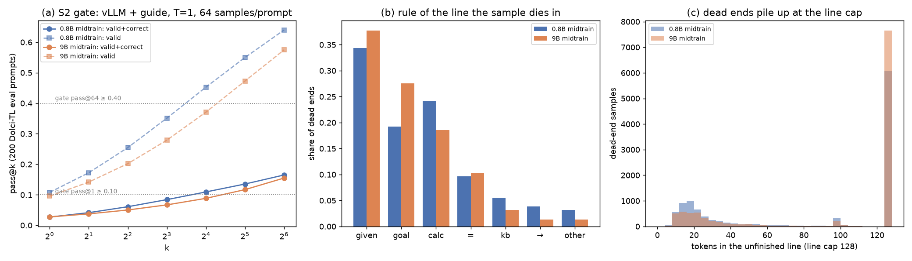

* **Model size is not the bottleneck.** pass@k of the 9B lies on top of the 0.8B curve: equal at k = 1, slightly lower at k = 64. The 9B is also slightly less often valid. A 12× larger model trained on the same midtrain mixture solves the same ≈ 16 % of prompts.
* **Where the samples die (panels b, c):**
  * Two-thirds of the 9B dead ends (53 % for 0.8B) are lines that run into the **128-token line cap**.
  * The median dead end is on line 5, i.e. still in the problem formalization: `given` 38 % and `goal` 28 % of 9B dead ends, `calc` 19 %.
  * These lines are degenerate nestings of KB lemmas, e.g. `given 1 : c1 = [ k24( k25( k24( k57( k22( [ k18( k16( 1 , k17( k57( …`. The 9B nests deeper than the 0.8B (median depth 11 vs 6; 63 % vs 48 % of dead ends at depth ≥ 8).
  * The guide allows these lines token by token: a `given` conclusion is any well-typed formula over the cited sentence's numerals. So the guide keeps the syntax legal but does not keep the model on track.
* **Per family (9B, v+c share of samples):** wordprob 5.8 %, yesno 3.5 %, math 1.6 %, dapo 0.0 %. Wordprob also has the fewest dead ends (77 %). The prompts closest to the generator data formalize best.
* **S0 equivalence (9B, bf16):** 46 / 64 greedy proofs are token-identical between HF and vLLM, with equal r (0.031). The first differences come late (token 20–239), as expected from bf16 numerics.
* **Gate fixes on the way (no effect on numbers):**
  * `dump_hf_greedy.py` now takes PARALLEL and DTYPE: the 9B loaded in fp32 (~36 GB) OOMed the L40.
  * `guide.calc_target` returns `()` for calc values above 4·CALC_MAX bits. A sampled calc value with more than 4300 digits had crashed the vLLM logits processor (Python's int→str limit). Such values cannot be written within CALC_MAX anyway. Regression test `test_calc_huge_value`.
* **Implication:** the PLAN step "if the gate passes, run 9B AZ" does not apply. The failure mode is the same at both scales: the model cannot formalize a Dolci problem into `given`/`goal` lines, and it rambles until the line cap. More search or a bigger model on the same policy recovers the ≈ 16 % of prompts it can already formalize, and little else.
* **Options (decision pending, see PLAN):**
  1. Formalization data: SFT on Dolci-style `given`/`goal` lines (problem → formalization pairs), since the midtrain mixture's formalizations come from generator templates.
  2. A tighter guide for formalization lines: a per-line cap for `given`/`goal` (e.g. 48 tokens) and a nesting cap. This only converts runaways into earlier dead ends, so it saves compute but does not by itself make solves.
     *Cap sizing (06:50, `scratchpad/caps.py` on the pass@64 generations):* in valid+correct proofs, `given`/`goal` lines stay short: 9B p99 length 27 / 37 tokens, max 54, max depth 4. A cap of **64 tokens and depth 4** on `given`/`goal` loses 0 / 354 9B v+c samples (0.8B: 3 / 347). At 48 tokens it loses 2 / 354, and at 32 tokens 119 / 354. The 64 / 4 cap cuts 56 % of 9B samples early and saves 29 % of generated tokens (0.8B: 42 %, 20 %).
  3. Run AZ on the prompt subset where pass@64 > 0 (wordprob / yesno heavy) and grow from there.

**Update 2026-10-14 01:45: the 9B end-to-end AZ smoke passes (2 × L40, LoRA 64, trie engine; PLAN S3).**

The run used `smoke9_az.slurm`: base_ext_9b (before midtraining), torchrun on 2 ranks, bf16 + LoRA 64 + gradient checkpointing, `--tree --trie --chunk 1024`.
Search settings: sims 16, leaves 4, max_len 1024, 64 games per iteration.
Training: 8 steps per iteration, with SIL.
The job ran 2 iterations, saved, then reloaded `final` with `--eval-only`.
All stages worked: self-play, gather, training, value head, save (LoRA 693 MB + value head 4 MB), and reload.
It took three attempts:

| job | outcome | cause → fix |
|---|---|---|
| 58466 | OOM in it1 self-play (33.3 GiB live) | **`TreeEngine.forward_trie` ran without `no_grad`.** With trainable LoRA parameters, the eager warm-up before graph capture kept the autograd state of all 32 layers (≈ 11.6 GiB). It now has `@torch.no_grad()`, and the prior/value heads in `_priors` run grad-free too. The bug was latent in the 0.8B full-FT arms as well; it wasted memory there but did not change any results. Also, `--eval-parallel` defaulted to 64, which allocated 64 tree slots × cap 2048 (≈ 7.5 GiB); the smoke now uses 32. |
| 58491 | NCCL watchdog abort after 10 min | Rank 0 finished its 32 games and waited in the `all_gather_object` after self-play while rank 1 was still playing. The process-group timeout is now 3 h, and each rank prints its self-play seconds before the gather. |
| 58533 | **pass** | see below |

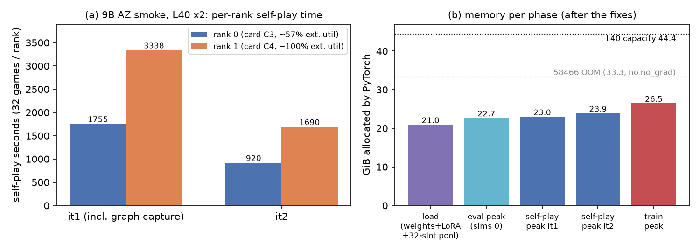

* **Memory (panel b; new `mem_*` fields in log.jsonl):**
  * 21.0 GiB after load: weights 16.7 + LoRA 0.65 + a 32-slot pool of ≈ 3.6.
  * Self-play peaks at 23–24 GiB and training at 26.5 GiB.
  * That leaves ≈ 18 GiB of headroom on an empty L40, and the run fits next to the ~10 GiB of external usage on gruenau12 cards.
* **Speed:**
  * Rank 1 was 1.85–1.9× slower than rank 0 in both iterations. Rank 1's card (C4) carried ~100 % external utilization, against ~57 % on C3. The gap is therefore a contended GPU, not straggler games.
  * Clean cost (rank 0, it2): **920 s per 32 games per GPU** (29 s/game), about 3× the 9B H100 bench at max_len 256 (10 s/game).
  * Training: 10.6 s per step (it2; it1's 233 s / 8 steps includes warm-up).
  * Games are long because the base model has not been midtrained: 33–39 % hit the 1024-token budget, the rest are dead ends, r = 0. A midtrained model should solve or stop earlier.
* **Implication:**
  * At this rate, one iteration of 64 games + 8 train steps takes ≈ 17 min on two uncontended L40s.
  * The midtrained model will shorten games, but "~200 iterations in a few hours" is not reachable at 9B on 2 L40s.
  * Options for the real run:
    * more ranks (alex A100-80GB, 4–8 ranks);
    * fewer games per iteration with more train steps per game;
    * a lower `--max-len` (e.g. 512) once the midtrained length distribution is known.
* **Next:** after the 9B midtrain (alex 4556917, ETA ≈ 05:00), run the S2 gate (pass@1 / pass@64 with vLLM + guide). Then launch 9B AZ from the midtrained checkpoint with these fixes.

**Update 2026-10-13 23:30: trie layout for leaf batches; about 2× the search throughput at 9B (PLAN S3).**

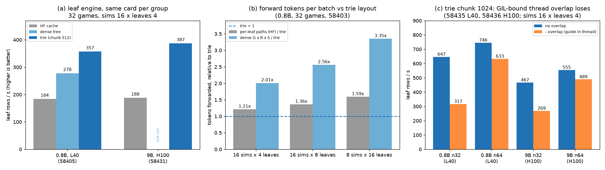

* **What the trie layout does.** MCTS leaves of one game share most of their path from the root: siblings differ only in the last token, and virtual-loss leaves branch off one another.
  * `TreeEngine.forward_trie` (`az.py --tree --trie`) merges a game's leaf paths into a trie and forwards each shared token once.
  * Attention uses an ancestor mask. Gated-DeltaNet runs the delta rule over strict ancestors, with the decay summed along the path, and the conv also runs over ancestors.
  * Games are packed into calls by a DP (`--chunk` = tokens per call).
  * `test_trie` matches the full no-cache forward: the prior gap is within 2× the dense engine's bf16 gap.
* **Token savings (b), 0.8B, 32 games (58403).** Compared with the trie, the old per-leaf HF path forwards 1.21–1.59× the tokens and the dense G × R × S layout 2.0–3.4×. The savings grow with more leaves per sim.
  * Mean leaf path: 16–18 tokens beyond the root cache. About 98 % of paths are shorter than 64 tokens.
* **Throughput (a): same card per group, 32 games, sims 16 × leaves 4, max_len 256.**
  * 0.8B on an L40 (58405), in leaf rows/s: trie 357, dense 278, HF 184.
  * 9B on an H100 (58431), in leaf rows/s: trie 387, HF 188.
  * So the trie is 1.9× HF at 0.8B and 2.06× HF at 9B.
  * The trie also needs fewer CUDA graphs: 72 instead of 158, with 8 s capture instead of 18 s. It uses less memory at 9B: 22.2 G peak against 28.0 G for HF.
* **Larger calls help.** At 9B on the same H100 node, raising `--chunk` from 512 to 1024 increases throughput from 387 to 467 rows/s (58431 → 58436, different jobs). Chunk 1024 is the new default.
* **Thread overlap of guide and forward fails (c).** `--overlap` ran the CPU guide in a thread while the GPU ran the forward. It was slower in all four configurations (rows/s, without → with overlap):

  | | without | with |
  |---|---|---|
  | 0.8B n32 | 647 | 317 |
  | 0.8B n64 | 746 | 633 |
  | 9B n32 | 467 | 269 |
  | 9B n64 | 555 | 489 |

  * The guide is pure Python and holds the GIL. With overlap, guide time per node rose from 0.44 to 0.82 ms, and the GPU launch thread waited on it too: per-call time went from 35 to 48 ms.
  * The overlap code is reverted.
* **Where time goes now (trie, chunk 1024, no overlap).** The model forward takes 54–71 % of search time and the guide 21–35 %. The guide share is larger at 0.8B, where the forward is cheap.
  * cProfile of the guide (FakeNet, 16 games): 138 of 171 s is the Earley-style `_Ctx.feed`. `State._successors` tries all ~60 vocab tokens at each new node, at about 0.45 ms per node.
  * This is the next CPU target: predict the parser's first set instead of trial-feeding every token, or run the guide in a process pool (threads do not work because of the GIL).
* **Cost at 9B (no overlap, chunk 1024, shared H100).**
  * 64 games × sims 16 × leaves 4 to 256 tokens: 656 s at 555 rows/s, about 10 s per game.
  * With leaves 8: 1595 s at 411 rows/s, measured at chunk 1024 in 58431.
  * Whether self-play at max_len 1024 with 4 data-parallel L40/Blackwell ranks fits the "200 steps every few hours" budget will be measured on the first 9B AZ iterations, with fast moves (`--fast-prior`) on. It is not extrapolated further here.
* **9B midtrain.** The 9B midtrain (alex 4556917) started early, at 22:47, and trains at 6.3 s/step over 3396 steps (ETA about 05:00 on 2026-10-14). When it finishes, it goes through the S2 gate (pass@1 ≥ 0.10, pass@64 ≥ 0.40), and only then into AZ with LoRA, `--tree --trie --chunk 1024`.

**Update 2026-10-13 19:30: S0 baseline and where search time goes (start of the 9B line, PLAN S0–S3).**

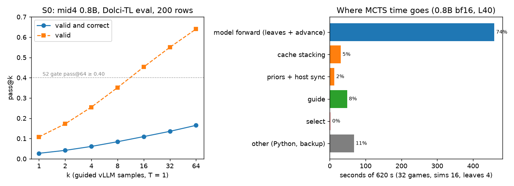

* **The vLLM harness matches HF.** `tl/vllm_guide.py` runs guided vLLM sampling, with the TL guide as a logits processor. Its greedy decode reproduces the HF greedy proof exactly on 45 of 64 rows, with the same r (0.016). The other 19 agree for the first 4–187 tokens and then diverge; vLLM runs in bf16 and HF in fp32.
* **0.8B pass@k (mid4, 200 eval rows, T = 1, 64 samples per row).**

  | | k = 1 | 4 | 16 | 64 |
  |---|---|---|---|---|
  | valid and correct | 0.027 | 0.061 | 0.109 | 0.165 |
  | valid | 0.108 | 0.255 | 0.453 | 0.640 |

  * 32 of 200 rows are mixed (between 1 and 63 of the 64 samples win).
  * Throughput on one L40: 15 samples/s, 2.8k tok/s.
  * The 0.8B clears neither part of the S2 gate (pass@1 ≥ 0.10, pass@64 ≥ 0.40). That is the bar the 9B midtrain (alex 4556917) has to clear before AZ.
* **MCTS time split (0.8B, 32 games, sims 16, leaves 4).** The model forward takes 74 % of play() time. Guide, selection and checker together take under 10 %.
  * Only about 16 leaf rows go into each forward. Games run in lockstep and are not refilled, so the batch shrinks as games finish, and fast moves skip search.
  * These times are upper bounds: the L40 was shared with another user's training job at 100 % utilization.
  * The 9B AZ run therefore needs large leaf batches: many parallel games with refill.
* **Engine (PLAN 2026-10-13 ~22:00).** MCTS stays token-level on the HF tree engine, which keeps exact per-game root caches including the Gated-DeltaNet states. Per-leaf vLLM requests would re-prefill up to 543 tokens per leaf, because vLLM caches hybrid states only at 544-token blocks.
  * New in az.py: LoRA (`--lora R`), bf16, gradient checkpointing and torchrun data parallelism.
  * `test_az_lora` passes: identity at init, only adapters train, base unchanged, exact reload.
  * The installed fla/Triton refuses the GDN backward on Hopper, so AZ training runs on L40 or Blackwell, not on the H100s.

**Update 2026-10-13 17:40, correcting 17:05: the "replayed wins" were a resume artifact, not memorisation.** The self-play prompt stream comes from its own RNG, `grng = Random(seed + 1)`. Each iteration draws 32 prompts uniformly, without replacement within the iteration, from the 45,291 training prompts (dolci_math 38,585, dolci_dapo 5,550, dolci_wordprob 1,156). The resumed run 58209 kept `--seed 0`, so its iterations 1–40 (global 41–80) re-drew exactly the prompts of the original run's iterations 1–40. Those are the prompts behind the 26 buffered wins.

The dedup key is (prompt id, tokens). The policy re-solved those prompts with the same lines it had been trained on, so 28 rewarded games added one new entry. Once the stream passed the original run's last iteration (global it82), new prompts appeared and the buffer grew immediately: 28 → 45 by it99, every entry on a distinct prompt.

On a fresh stream, prompt repeats are rare: iterations 41–80 share only 57 of 1,280 draws with iterations 1–40. The 17:05 claim that sil "does not find new lines" is withdrawn. What still holds is that the eval has been flat at r 0.025–0.03.

Fix: a resumed run must use a new `--seed`, for example the resume iteration. The two lr 1e-6 arms are not affected beyond global it82.

**Update 2026-10-13 17:05: both lr 1e-6 sil arms are flat, and the sampling arm only replays wins it has memorised.**

| arm | evals (it: r / valid) | buffer wins |
|---|---|---|
| MCTS + sil (58113) | 0: 0.015 / 0.11 · 10: 0.035 / 0.09 · 20: 0.025 / 0.105 | 6 by it19 |
| sampling + sil (58114 → 58209) | 40: 0.025 / 0.125 · 50: 0.025 / 0.13 · 60: 0.03 / 0.145 · 70: 0.03 / 0.135 · 80: 0.03 / 0.12 | 26 by it40, 28 by it82 |

Self-play reward in the sampling arm holds steady at about 2 %:

| iterations | rewarded games (of 320) | buffer at end of block |
|---|---|---|
| 1–10 | 7 | 7 |
| 11–20 | 4 | 10 |
| 21–30 | 7 | 17 |
| 31–40 | 9 | 26 |
| 41–50 | 8 | 27 |
| 51–60 | 4 | 27 |
| 61–70 | 7 | 27 |
| 71–80 | 9 | 27 |

Since it40, 28 rewarded games have added one new buffer entry. The buffer deduplicates whole games, so the policy now reproduces exactly the winning lines it has memorised (sil loss about 6e-5). It does not find new ones.

*(Withdrawn at 17:40: the repeats came from the resume re-drawing the same prompt sequence; see above.)* Eval r has stayed at 0.025–0.03 for 40 iterations, below the earlier lim arm's best of 0.045. Neither arm has met the stop rule (valid < 0.06), so both keep running, as decided ("if not we just wait"). *17:22 addendum:* between global it82 and it99, the sampling arm's buffer grew from 28 to 39 wins, so it does find new lines in bursts. The eval at it90 is still r 0.025 / valid 0.125. The MCTS arm has 8 wins by it24.

**Update 2026-10-13 16:15: a checker hang stalled the sampling arm; the checker now has a time limit, and the arm resumed from it40.** After iteration 41 (16:05:51), the sampling arm 58114 stopped logging. Its GPU sat idle while the main Python thread spun at about 90 % CPU. That pattern means scoring one finished game never returned: `check`/`answer_of` was stuck on some construct that the existing bounds do not cover (POW_BITS on `x^y`, the 2¹² subset cap in `rewrites`).

The fix, in `tl/az.py`, is a SIGALRM wall-clock cap of 30 s on scoring one terminal (`CHECK_SECONDS`). A game that hits the cap scores as failed (z = −1, end `check_timeout`), and the run prints its tokens to the Slurm .out as `check timeout: …` so the culprit can be found and the checker bounded properly. `stats()` also reports a `check_timeout` rate. A unit test with a never-returning checker passes, along with the rest of the suite.

The fix is frozen as `tl_snapshot_20261013b`. 58114 was cancelled and resumed as **58209** (`az_dolci_g_mul_num_samp_sil_lr1e6_r40`, IDX1) with:
- the it40 checkpoint (policy plus value head);
- the 26-win buffer reloaded through `--sil-init`;
- otherwise identical arguments.

The Adam state resets on resume. At lr 1e-6 that should matter little. In the figures, the resumed run is the dash-dot C7 curve, offset by 40.

The resumed run's it0 eval reproduces the parent's it40 eval exactly (r 0.025, valid 0.125), so the checkpoint and value head loaded correctly. The MCTS arm 58113 reached its it10 eval: r 0.035, valid 0.09, budget-outs 0.03 (it0: 0.015 / 0.11). That is within noise and above the stop line. It still runs on the old snapshot without the cap. At 16:28, the resumed sampling arm's eval at global it50 is r 0.025, valid 0.13. In ten iterations (320 games) it added only one win (27 total), and its sil loss stays at about 6e-5. The buffer is memorised, but the eval is flat. No game has hit the checker cap yet (`check_timeout` 0). At it60 (16:38) it scores r 0.03, valid 0.145. Valid has crept up over the evals (0.11 → 0.115 → 0.14 → 0.125 → 0.125 → 0.13 → 0.145), but that is within about 1.5 SE. Reward is still below the 0.045 bar. If it hangs the same way, it will be resumed on `20261013b`.

**Update 2026-10-13 15:20: the lr 5e-6 arms collapsed; relaunched at lr 1e-6.** Both `--sil` arms lost the ability to write valid answers within 10–20 iterations:

| greedy eval (200 rows) | it0 | MCTS + sil, it10 | sampling + sil, it10 | sampling + sil, it20 | old lim (lr 1e-6 × 8 steps), it10 / it30 |
|---|---|---|---|---|---|
| valid | 0.11 | **0.005** | 0.04 | **0.015** | 0.12 / 0.12 |
| dead end | 0.88 | 0.985 | 0.90 | 0.955 | 0.855 / 0.855 |
| r | 0.015 | 0.0 | 0.005 | 0.005 | 0.02 / 0.035 |

The MCTS arm had **no rewarded game** before its it10 eval (wins 0), so the `--sil` term never fired there. The collapse therefore comes from the plain AZ update at the larger step size: lr 5e-6 × 32 steps per iteration, about 20× the update of lim's lr 1e-6 × 8. The imitation loss is not the cause. One likely mechanism: with a flat value (v ≈ −1) the completed-Q target is ≈ the prior, so the policy gradient is near zero and mostly noise. Adam rescales such small gradients to steps of size ≈ lr, so the weights random-walk at a rate proportional to lr. The sampling arm drifted the same way with sil active: 8 wins memorized to loss_sil ≈ 1e-5. Both arms were stopped (57922 at it10, 57938 at it22) and relaunched from mid4 with **lr 1e-6**, all else unchanged (32 train steps per iteration, `--sil 1 --sil-batch 8`):
- **58113 `az_dolci_g_mul_num_f99_cq_lim_sil_lr1e6`**: MCTS 16 sims.
- **58114 `az_dolci_g_mul_num_samp_sil_lr1e6`**: sampling self-play.

Stop rule for these arms: stop an arm if its eval valid falls below 0.06 (≈2.5 SE under 0.11) on two consecutive evals.

**Update 2026-10-13 ~14:15: flat arms stopped; joint expert iteration (`--sil`) launched.** The user cancelled all four remaining arms because they were not moving:

| arm | last it | self-play games | rewarded | greedy eval r (first → last) |
|---|---|---|---|---|
| lim (47835) | 240 | 7,680 | 30 | 0.015 → 0.04 |
| free (19514) | 274 | 8,768 | 0 | 0.005 → 0.0 |
| r130 (56893) | 151 overall | 672 since resume | 3 | 0.045 → 0.04 |
| s64_r20 (56889) | 23 overall | 96 since resume | 0 | 0.03 |

All greedy evals stay within ±2 SE of their it0 value (see the eval figure).

*Diagnosis.* The AlphaZero loss gives the policy almost no signal at a ≈0.4 % hit rate. A failed game has z = 2r − 1 = −1, so the value head fits v ≈ −1 everywhere: loss_v is 1e-7 in free and ≈1e-4 in lim. The completed-Q target has no min-max rescaling, so a flat v makes π ≈ P0, the network's own prior. The policy loss is then mostly the prior's entropy, with ≈ 0 gradient. A rewarded game reaches the policy only where its winning terminal lay inside a search tree. Otherwise it is one z = +1 among ≈ 100 buffer games in the value loss. Training was also 2–5 % of the wall clock (8 steps × 16 games at lr 1e-6 per iteration), against 4–100 min of MCTS self-play.

*Fix (user's idea): expert iteration inside the AZ loss.* `--sil λ` keeps every rewarded game in a deduplicated buffer (`successes.jsonl`). Each optimizer step adds λ · mean −log p(played symbol) over all of these games' decisions, unsearched fast moves included, plus (z − v)² on the same positions. Policy and value thus learn from each success in the same step, with no RL/SFT alternation. `--sims 0` self-play now samples a ~ P0, which gives a no-MCTS control. Code is in `tl_snapshot_20261013`. The CPU tests pass; GPU smoke 56987 on generator prompts found 30 successes in 32 games, and `--sil-init` loaded them into a new run.

*New arms* (from mid4, on lim's settings: guide line cap 128 + no repeat, completed-Q, fast 0.99, max 1024 tokens, 32 games per iteration):
- **57922 `az_dolci_g_mul_num_f99_cq_lim_sil`:** MCTS 16 sims, `--sil 1 --sil-batch 8`, 32 train steps per iteration (was 8), lr 5e-6 (was 1e-6).
- **57938 `az_dolci_g_mul_num_samp_sil`:** the same loss with sampling self-play (sims 0), 1,000 iterations. A first launch (57923) OOMed in its first train step after another user started a 28 GB job on its card (IDX3) outside Slurm. It was relaunched on IDX0; the dead dir is `_oom57923`.

Pre-registered check: we compare the arms at equal wall clock on rewarded self-play games per hour and greedy eval r. A rise above lim's best eval (0.045), lasting two consecutive evals, would count as a signal.

**Update 19:45: it20 check (pre-registered).** By it20 both arms have 6 rewarded self-play solves in 608 games, so lim matches s64. lim took 1.7 h of self-play plus training, against 23.6 h for s64, about 14x less compute. lim's greedy eval at it20 is r 0.025 and valid 0.125 (s64: 0.03 / 0.17). Most of the valid gap was already there at it0 (0.11 vs 0.15), because the repeat ban blocks greedy recovery. The fallback is not triggered, and the ban stays strict.

**Update 17:40: checker bug.** 46581 hung after iteration 4. A `calc` line with nested powers (`((9 ^ 20) ^ 20) ^ 20 …`) made the checker compute numbers with billions of digits, because `x ^ y` capped the exponent at 20 but not the size of the result. Results above 4096 bits now have no value (regression test `test_pow_bound`). The arm was restarted from scratch as **47835**. The it0 numbers above are from 46581 and are unaffected; that run is kept in `runs/az_dolci_g_mul_num_f99_cq_lim_hung46581`.

## 8. Reading and options

**Why there is no learning signal.** The signal exists but is ~1 %. Following the user's guidance ("if not we just wait because many rl problems need a while to start getting any signal"), the guided completed-Q arms keep running. The runaway-derivation failure (§6) is the most likely reason the solve rate stays low: about 2/3 of games end in a budget-out regardless of length.

**Options for the user to decide** (design changes, not applied):
1. **Guide-level cap.** Cap statement length (e.g. ≤ 64 formula tokens) and/or ban repeating a statement already derived. This turns runaways into dead ends that search can back up from.
2. **Length-aware reward or value term.** Small per-token cost, or a terminal penalty for budget-outs.
3. **Expert iteration on search solutions** (the "sleeve" option). SFT on the rare self-play solves, which compounds them faster than one AZ policy step per solve.
4. **More search per move** (19770, running). If sims 64 lifts the self-play solve rate well above 1 %, search alone may be enough.

## Provenance

**Logs.** `synthetic-RLVL/docs/project_log.md`, entries 2026-10-10 "TL W4.1" through 2026-10-11 ~15:15.

**Runs** (all under `rlvl_data/tl/runs/`):
- `az_dolci_g_mul_num_f99` (visits, crashed it6)
- `az_dolci_g_mul_num_f99_v2` (visits, cancelled it10)
- `az_dolci_g_mul_num_f99_cq` (it0–13)
- `az_dolci_g_mul_num_f99_cq_r10`
- `az_dolci_f_mul_num_f99_cq`
- `az_dolci_g_mul_num_l4_crashed_it10`
- `az_dolci_g_mul_num_l4_v2`
- `az_dolci_g_mul_num_f99_cq_s64`

**Probes** (`rlvl_data/tl/evals/az0/`):
- `mid4/dolci_{full,free}`
- `mid4_f99/dolci_{full,free}`
- `mid4_len2048`
- `mid4_len4096`
